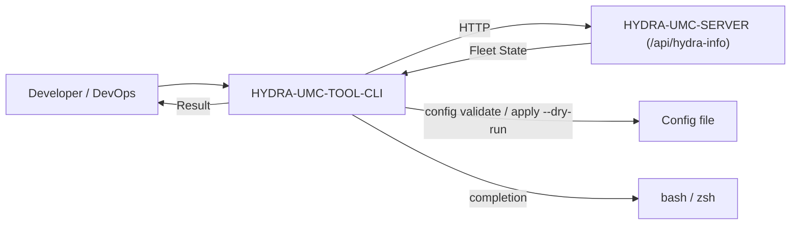

<!-- =============================================================================
HYDRA-UMC-TOOL-CLI - Command-line interface for fleet DevOps
Copyright (C) JuanenRac (Electro Hobby 3D) <electrohobby3d@gmail.com>
GPL-3.0-or-later - see LICENSE
============================================================================= -->

<p align="center">
  
</p>

# 🛠️ HYDRA-UMC-TOOL-CLI

<p align="center">🇺🇸 <b>English</b> | <a href="README_spa.md">🇪🇸 Español</a> | <a href="README_fra.md">🇫🇷 Français</a> | <a href="README_ita.md">🇮🇹 Italiano</a> | <a href="README_deu.md">🇩🇪 Deutsch</a> | <a href="README_zho.md">🇨🇳 简体中文</a> | <a href="README_jpn.md">🇯🇵 日本語</a> | <a href="README_por.md">🇵🇹 Português</a></p>

### 🛠️ Command-Line Interface for Fleet DevOps & Automation

<p align="center">
  
  
  
  
  
  
</p>

---

**Honesty check - what actually runs today:** `version`, `status`, `robots`, `claims`, `claim`, `release`, `limits`, `jog-arm`, `jog`, `table`, `robot`, `audit`, `doctor`, `connections`, `liveness`, `ecosystem-health`, `plan-simulate`, `config validate`, `config apply --dry-run`, and the interactive `shell` (`main.go`, `server.go`, `robots.go`, `control.go`, `doctor.go`, `observe.go`, `plansim.go`, `config.go`, `shell.go`, `exitcode.go`) are real, working Go code, exercised by 249 passing tests (`go test ./...`) - real `net/http`/`httptest` round-trips against a fake server plus real temp-file config fixtures, not stubs. Those tests simulate a HYDRA-UMC-SERVER instance; `status`, `robots` and `doctor` (login included) have also been run against a real HYDRA-UMC-SERVER process. `config apply` without `--dry-run` honestly returns the `ExitNotImplemented` exit code rather than faking success, because the fleet-write endpoint it would call doesn't exist on HYDRA-UMC-SERVER yet. `deploy`, `flash-all` and `audit` are pure aspiration - marked "planned" below and absent from `src/` entirely, not even a stub function. See `CHANGELOG.md` for exactly what has shipped so far.

---

> **Safety and security status:** this ecosystem is not a certified safety system. There is no hardware E-STOP path, no firmware-enforced limits or interlocks and no verified motion command yet; firmware images are checked with CRC-32 and an Ed25519 signature, and a release build refuses the published development keys (the tool heads and expansion boards behind the relay still run URTC bootloaders, which take a shared-key HMAC-SHA256 instead of a signature); TLS and mutual TLS are optional and off by default; no custom board has been populated or tested yet. Read the [security baseline](https://github.com/JuanenRac/HYDRA-UMC-DOCS/blob/main/docs/SECURITY_BASELINE.md) and the [threat model](https://github.com/JuanenRac/HYDRA-UMC-DOCS/blob/main/docs/THREAT_MODEL.md) before relying on any statement here for the safety of a person.

---

## 📋 At a glance

| | |
|---|---|
| Version | `0.1.9` |
| Maturity | Functional |
| Tests | 249 (`go test ./...`) |
| Stack | Go / standard-library flag handling |
| Target | The PC of the person using it |
| On real hardware | Simulated only: tested against emulators, fakes or simulators; no run on real hardware is recorded for this version |

**Jump to:** [Overview](#-overview) · [Architecture](#-architecture) · [Security & Safety](#-security--safety) · [Configuration](#-configuration) · [Quick start](#-quick-start) · [Testing](#-testing) · [Troubleshooting](#-troubleshooting) · [Repository Structure](#-repository-structure) · [Related Projects](#-related-projects)

## 🚦 Project status

Each line is one part of this repository and the light says how far it is today. It is written from what the repository can show (tests, builds, runs), not from what is planned.

🟢 Done and verified · 🟡 Works, with known limits · 🟠 Partly done or not verified yet · 🔴 Not done or not working

| Area | State | What it means here |
|---|---|---|
| Software | 🟡 | Works for its main purpose; the honesty check above lists what is still missing |
| Tests | 🟢 | 249 automated tests, run on every change |
| Real hardware | 🟠 | Simulated only: tested against emulators, fakes or simulators; no run on real hardware is recorded for this version |
| Documentation | 🟢 | README in eight languages, checked against the manifest on every change |

## 🎯 Overview

**HYDRA-UMC-TOOL-CLI** is the Swiss Army knife for developers and system administrators of the HYDRA-UMC ecosystem. It is a single static Go binary providing command-line tools to query, update, and audit HYDRA-UMC deployments.

The long-term goal is massive deployments of missions, parallel firmware updates (CAN-OTA), and deep system diagnostics directly from a terminal or CI/CD pipeline. Today it ships the real, working foundation that everything else builds on: version reporting and a live HTTP client against HYDRA-UMC-SERVER.

### Key Features:
* 🔏 **Signed release binaries (`hydra-sign`).** `go run ./src/cmd/hydra-sign sign --key PRIVATE.pem FILE...` writes `FILE.sha256` (the `sha256sum` format) and `FILE.sig` (Ed25519 over the contents of the file, base64); `verify --pub PUBLIC.pem FILE...` checks both and needs only the public key. The private key is only read from the file given, and is never printed or copied; `pubkey --key PRIVATE.pem` prints the public half. The tests use keys made for them. Which key signs a release is the release process's choice. The release process signs every published binary with the HYDRA release key and attaches the `.sha256` and `.sig` files; the build scripts set the version a binary reports from the project manifest.
* ✅ **`hydra-cli version`** — prints the CLI's own name and version. *(implemented)*
* ✅ **`hydra-cli status [--server URL] [--config PATH]`** — queries a live HYDRA-UMC-SERVER's `GET /api/hydra-info` and prints its reported identity. *(implemented)*
* ✅ **`hydra-cli robots [--server URL] [--config PATH] [--json]`** — queries a live HYDRA-UMC-SERVER's `GET /api/settings` and prints its real controller/robot roster (name, online status, model, role). *(implemented)*
* ✅ **`hydra-cli claims`, `claim <robot>`, `release <robot>`** — lists who reserves which robot (`GET /api/claims`) and reserves or releases one. The reservation belongs to your account and to this program's controller id (`--controller-id`, `HYDRA_CLI_CONTROLLER_ID`, default `hydra-cli-<host>`), sent with every request. Refusals (another account, another controller, controller id required, jog not armed) are told apart and exit with code `8`. *(implemented)*
* ✅ **`hydra-cli limits [--robot ID]`, `jog-arm <robot> <on|off>`, `jog <robot> <axis> <amount> [--absolute]`** — reads the safety limits the server holds, arms or disarms the jog (needed only when the server requires it) and moves one axis. A step above the limit of the robot's model is refused before it is sent, and nothing is sent when the limit cannot be read; the warnings of the server are printed. *(implemented)*
* ✅ **`hydra-cli robot <robot>`, `table <robot> <x> <y> [--rz N] [--relative]`, `audit [--limit N] [--type T] [--robot ID] [--verify] [--export FILE]`** — `robot` reads one robot with its revision; `table` moves the XY table in one atomic request (checked against the limits of the model before it is sent; the server applies all of it or none of it); `audit` (administrators only) reads the append-only audit record, checks the chain of SHA-256 hashes of the lines it was given (exit code 8 when it is broken) and, with `--verify`, has the server check the whole record; `--export FILE` saves the lines as stored. `claim`, `release`, `jog` and `table` also take `--if-match REVISION` (or `current`): the server then refuses the write with exit code 8 if the robot changed since that revision, and nothing is applied. The WebSocket push of reservations is not used by the CLI (it runs one command and exits).
* ✅ **`hydra-cli doctor [--server URL] [--config PATH] [--json]`** — read-only Server contract diagnosis: validates `/api/hydra-info` and `/api/settings`, then verifies published controller/robot totals against the settings roster. It never sends commands or probes hardware. `--json` prints a structured report with a `checkId`/`severity`/`status` per check instead of the plain-text line, for scripts (see [docs/DOCTOR.md](docs/DOCTOR.md)). *(implemented)*
* 🔐 **Sessions, safe credentials and fleet commands:** `login`/`logout` keep a session in a file only you can read (no login on every run); a password or token is refused over plain http to another machine unless `HYDRA_CLI_ALLOW_INSECURE=1`, and `HYDRA_CLI_CA_FILE` trusts a private CA; `scan`, `fleet doctor`, `stop`, `stop-all --yes`, `metrics` and `manifest validate` are new. See [`docs/CLI_REFERENCE.md`](docs/CLI_REFERENCE.md).
* 🧾 **`--json`, shell completion and read-only views:** every command that prints data also prints it as JSON with `--json` (one object with `schema_version`, `command`, `ok` and the fields of the command for the commands that act; the text output stays the default and does not change); `completion <bash|zsh|fish|powershell>` completes commands, subcommands, options and closed values, generated from the table of commands; `connections`, `liveness` and `ecosystem-health` read the clients and sign-in history, the signal of life of each robot and the health of the services from the server, and `plan-simulate` checks a plan with the dry run of the semantic planner (nothing is executed; exit code 8 when the plan is rejected). Each answer is checked against its contract before it is printed, and a malformed one is an error with no output. See [`docs/CLI_REFERENCE.md`](docs/CLI_REFERENCE.md).
* Every piece of text that came from a server and is printed (error messages, names, versions) now also passes through the shared secret redaction, so a token, a `password=` value or a bearer header in an answer is never echoed to the terminal (same vectors as the other projects).
* ✅ **`hydra-cli completion <bash|zsh>`** — prints a tab-completion script for the shell. *(implemented)*
* ✅ **A real, stable exit-code contract** — `0` ok, `1` general error, `2` usage error, `3` config error, `4` network error, `5` server error, `6` not implemented, `7` authentication required or refused. Every command classifies its own failures through this contract instead of a bare `exit 1`, so scripts wrapping this CLI can branch on *why* it failed. *(implemented)*
* ✅ **`hydra-cli config validate --config PATH`** — loads and schema-validates a local config file (server URL, request timeout). *(implemented)*
* ✅ **`hydra-cli config apply --config PATH [--dry-run]`** — `--dry-run` proves the real validation path end to end and prints exactly what it would send; without it, honestly returns "not implemented" since no live fleet-write endpoint exists yet. *(implemented, dry-run only)*
* ✅ **`--config PATH` on `status`/`robots`/`doctor`/`shell`** — the same validated file's `server`/`timeoutSec` really drives every live command's HTTP target and request timeout now, not just `config validate`/`apply`; `--server` still wins when both are given. *(implemented)*
* ✅ **`hydra-cli shell [--server URL] [--config PATH]`** — an interactive REPL: run any command above repeatedly against the same server without restarting the process. Dispatches through the exact same command table one-shot invocations use, so shell and one-shot behavior never drift apart. `exit`/`quit`/Ctrl-D to leave. *(implemented)*
* ✅ **`hydra-cli help` / `--help`** — full command usage. *(implemented)*
* 🚧 **`hydra-cli deploy`** — upload missions and configurations to a fleet of robots simultaneously. *(planned)*
* 🚧 **`hydra-cli flash-all`** — parallel firmware updates for controllers and URTC heads. *(planned)*
* 🚧 **`hydra-cli audit`** — automated diagnostic suite for CAN bus health and sensor validation. *(planned)*

## 🧩 Role in HYDRA-UMC

**HYDRA-UMC-TOOL-CLI** is `hydra-cli`, one Go binary with no shared-library dependencies that talks to `HYDRA-UMC-SERVER`: status, robots, limits, a doctor that checks a server, jog and software stops, a scan of private networks, fleet checks, validation of manifests and configuration files, and an interactive shell. It also holds `hydra-sign`, which signs and verifies release binaries.

## 🏛️ Architecture

<p align="center">
  
</p>

<details>
<summary>Text version of the diagram (Mermaid)</summary>



</details>

### ARCHITECTURE & DESIGN DECISIONS

* **Why `src/` holds a `cmd/hydra-cli/` subpath, not a flat layout.** Matches the standard Go CLI convention (a `cmd/<binary-name>/` entry point, with room for future `internal/`/`pkg/` packages as the CLI grows past a single command) - not this ecosystem's own invention, the wider Go community's own convention for multi-command CLIs.
* **Why a CLI, not just scripting HYDRA-UMC-SERVER's own REST API directly.** Fleet-scale operations (install/update across many CM5s, not just one) need real orchestration - retries, parallelism, a consistent UX - that a one-off curl script doesn't provide, the same reasoning HYDRA-UMC-UPDATER later applies at the ecosystem-checkout level.
* **Why `robots` reads `GET /api/settings`, not a new endpoint.** That endpoint already carries the full controller/robot roster and is already a real read that needs a logged-in account (see HYDRA-UMC-SERVER's own `src/server.ts`; the CLI logs in with `HYDRA_CLI_USER`/`HYDRA_CLI_PASSWORD`, or sends `HYDRA_CLI_TOKEN`) - `robots` is a real client of an already-shipping contract, not new server-side work. `doctor` uses that same read together with `/api/hydra-info` to catch incompatible public fleet totals without adding a new endpoint. The bigger, still-planned commands (`deploy`/`flash-all`/hardware-facing `audit`) genuinely do need new write endpoints that don't exist yet.
* **Why `doctor` is explicitly read-only.** An endpoint-contract check is useful before hardware exists and safe in CI. It reports only HTTP/JSON/count consistency; it neither commands equipment nor claims CAN, actuator, sensor, camera, Hailo, CM5, or safety health.
* **How this fits the rest of the ecosystem.** Does at fleet scale what URTC-FLASHER and URTC-TESTER each do for one board - manages HYDRA-UMC-SERVER instances across a fleet rather than a single board's own firmware.
* **Why `config apply` without `--dry-run` returns "not implemented" instead of silently doing nothing.** The live write endpoint on HYDRA-UMC-SERVER this would call genuinely does not exist yet (same gap `deploy`/`flash-all` are blocked on) - a distinct `ExitNotImplemented` exit code tells a caller "this is a real gap, not a bug" instead of a misleadingly successful no-op.
* **Why every command's errors now flow through one `CliError`/`ExitCode` type instead of ad-hoc `os.Exit` calls.** A stable, documented exit-code contract only stays stable if there is one place that assigns codes - `exitCodeFor()` (`exitcode.go`) is that place, and command functions keep returning idiomatic, wrappable `error` values rather than calling `os.Exit` themselves.

## 🔒 Security & Safety

| Threat | Defence | Where |
|---|---|---|
| A password or token left in a process list or shell history | The credential comes from the environment (`HYDRA_CLI_TOKEN`, or `HYDRA_CLI_USER` and `HYDRA_CLI_PASSWORD`) or from a saved session, never from a flag | `auth.go` |
| A saved session read by another user, or half written | The file is written to a temporary file with mode 0600 and renamed over the old one, in a folder made with mode 0700 | `session.go` |
| Credentials sent in the clear to another machine | They are refused over plain `http://` to any other machine unless `HYDRA_CLI_ALLOW_INSECURE=1`; `HYDRA_CLI_CA_FILE` trusts a private authority for `https://` | `transport.go` |
| A scan that wanders onto the internet, or a stop-all by accident | `scan` stays on private networks unless `--allow-public-range` is given and covers at most 1024 addresses by default; `stop-all` needs `--yes` | `fleet.go`, `emergency.go` |

**What it never does:** act as an emergency stop. `stop` and `stop-all` are software commands that need the server, the network and a login; the physical E-STOP of the cell is what stops a machine.

## ⚙️ Configuration

| Variable | Default | What it sets |
|---|---|---|
| `HYDRA_CLI_SERVER` / `--server` | `http://localhost:3000` | the server to talk to |
| `HYDRA_CLI_TIMEOUT_SEC` / `--timeout` | `5` | seconds allowed to each request (1 to 3600) |
| `HYDRA_CLI_TOKEN` | none | a bearer token that the server already issued |
| `HYDRA_CLI_USER`, `HYDRA_CLI_PASSWORD` | none | the CLI logs in for that run; the token wins when both are set |
| `HYDRA_CLI_ALLOW_INSECURE` | `0` | `1` allows credentials over plain http to another machine |
| `HYDRA_CLI_CA_FILE` | none | PEM file of a private authority to trust for https |
| `HYDRA_CLI_TOKEN_FILE` | the saved session | the file where `hydra-cli login` keeps the token and the refresh token, readable only by the user (also `tokenFile` of a config file; by default `hydra-cli/session.json` in the user configuration directory); `hydra-cli logout` revokes the refresh token and removes it |

## 🚀 Quick start

Requires Go 1.24 or newer.

```bash
./build.sh  # Linux, macOS (build.bat on Windows)
./run.sh status --server http://192.168.1.50:3000
./run.sh doctor
./run.sh config validate --config hydra-cli.json
./run.sh help
```

## 🧪 Testing

249 automated tests run with `cd src && go test ./...`. They need no hardware and nothing outside this machine.

The CI runs `HYDRA_UMC_CI=1 python tools/ci_validate.py`, which checks the manifest, the documents, the eight READMEs and the pictures.

## 🏗️ Build & Release

Requires Go >= 1.24.

```bash
# Linux/macOS
./build.sh
./run.sh version
./run.sh status --server http://localhost:3000
./run.sh robots --server http://localhost:3000
./run.sh doctor --server http://localhost:3000
./run.sh config validate --config ./hydra-cli.json
./run.sh config apply --config ./hydra-cli.json --dry-run
echo $?   # 0=ok 2=usage 3=config 4=network 5=server 6=not-implemented 7=auth

# Windows
build.bat
run.bat version
run.bat status --server http://localhost:3000
run.bat robots --server http://localhost:3000
run.bat doctor --server http://localhost:3000
run.bat config validate --config .\hydra-cli.json
run.bat config apply --config .\hydra-cli.json --dry-run
```

`robots` and `doctor` read `/api/settings`, which HYDRA-UMC-SERVER only gives to a logged-in account (an administrator sees the full settings, the other roles a redacted copy). Give the CLI a credential through the environment - never a flag, so it stays out of process listings and shell history: `HYDRA_CLI_TOKEN` (a bearer token the server already issued), or `HYDRA_CLI_USER` and `HYDRA_CLI_PASSWORD` (the CLI logs in with `POST /api/login` for that run; the token wins when both are set). Without one, the command exits with code `7` and says which variables to set. `status` and the first request of `doctor` use the public `/api/hydra-info` and never send the credential. A response is read up to 4 MiB.

`build` never changes the version (only `python tools/hydra_project_tool.py bump` raises it), runs the real test suite (`go vet` + `go test`), compiles the Go module in `src/` into `build/hydra-cli(.exe)`, and runs `version` once to verify - then cross-compiles a real release for `linux/amd64`, `linux/arm64` (the CM5's own architecture), `windows/amd64`, `darwin/amd64` and `darwin/arm64` into `build/release/<os>-<arch>/`, with a real `SHA256SUMS` checksum file alongside them. `run` executes the compiled binary again, forwarding all arguments — try `run doctor` against a running `HYDRA-UMC-SERVER` instance. Doctor is a safe read-only endpoint-contract check; see [docs/DOCTOR.md](docs/DOCTOR.md).

## 🩺 Troubleshooting

| You see | Because | Do |
|---|---|---|
| exit code 7 | The command needs a login and no credential was given, or the server refused it | Set `HYDRA_CLI_TOKEN`, or `HYDRA_CLI_USER` and `HYDRA_CLI_PASSWORD`, or run `login` |
| exit code 4 | The server could not be reached at all | Check the address (`--server`, config file, `HYDRA_CLI_SERVER`) and run `doctor` |
| exit code 2 | Unknown command, missing argument, or a flag without a value | Run `help`; nothing is silently ignored |

## 📂 Repository Structure

<p align="center">
  
</p>

<details>
<summary>Text version of the tree</summary>

```text
HYDRA-UMC-TOOL-CLI/
├── tools/                      source code
│   ├── build_test.py           Non-versioning build/compile check
│   ├── ci_validate.py          Manifest/CHANGELOG/docs validation used by CI
│   ├── _doc_policy.py          Documentation rules shared by the family (a copy of HYDRA-UMC-SDK's, kept in sync)
│   ├── _readme_parity.py       Check that the eight READMEs share one structure (a copy of HYDRA-UMC-SDK's, kept in sync)
│   └── hydra_project_tool.py   The same commands in every repository: validate, test, ci, version, status, bump
├── src/                        Go module
├── docs/                       Documentation: CLI_REFERENCE.md and DOCTOR.md
├── images/                     Media and diagrams
├── .github/                    CI workflow and issue templates
├── bump_version.py             explicit version bump
├── bump_manifest_version.py    Syncs hydra-umc.project.json's version to the native one (--sync)
├── build.sh / build.bat        Validate and build (building never changes the version)
├── run.sh / run.bat            Real run: executes the compiled binary
├── CHANGELOG.md                what changed in each version
├── build-test.sh               non-mutating build check
├── hydra-umc.project.json      manifest: version, maturity, family
└── test.sh                     runs the tests
```

</details>

## 🗺️ Roadmap & Known limits

`deploy`, `flash-all` and `audit` are not built yet: each needs a fleet write, over-the-air or audit endpoint on `HYDRA-UMC-SERVER` that does not exist. `config apply` without `--dry-run` is the honest placeholder for the same gap and answers exit code 6.

## 🌍 Languages

This README and the documents of the repository exist in eight languages: English, Spanish, German, French, Italian, Japanese, Chinese and Portuguese (Portugal). They are written together and checked in the CI so that the eight files have the same sections and the same links. This repository has no screen or message catalogue of its own, so there are no interface strings to translate.

## 🔗 Related Projects

This project is part of the HYDRA-UMC robotics ecosystem by the same author (JuanenRac / Electro Hobby 3D). Worth knowing about, since a request might actually be about one of these rather than this repository.

**Directly Related**
- **[HYDRA-UMC-SERVER](https://github.com/JuanenRac/HYDRA-UMC-SERVER)** — the real headless backend (REST/WebSocket) every control client actually talks to — the backend this CLI manages at fleet scale.
- **[URTC-FLASHER](https://github.com/JuanenRac/URTC-FLASHER)** — desktop GUI flashing tool for URTC boards, CAN-OTA plus full-chip SWD/JTAG — this tool's planned fleet-scale CAN-OTA deploy does for many boards what URTC-FLASHER does for one.
- **[URTC-TESTER](https://github.com/JuanenRac/URTC-TESTER)** — desktop live CAN-bus diagnostic tool for URTC boards, one panel per tool profile — this tool's planned fleet-scale diagnostics do for many boards what URTC-TESTER does for one.

**Also Part of the Ecosystem**

*Core Hardware & Platform*
- **[HYDRA-UMC](https://github.com/JuanenRac/HYDRA-UMC)** — the robot-arm motherboard design: CM5 host + dual-core STM32H745, meant to orchestrate up to 8 tool arms over CAN-OTA/SPI-OTA (firmware at an early stage; no populated board yet).
- **[HYDRA-UMC-OS](https://github.com/JuanenRac/HYDRA-UMC-OS)** — reproducible Raspberry Pi OS product layer for the CM5: read-only agent, validated config/profiles, WiFi first-contact provisioning.
- **[HYDRA-UMC-SDK](https://github.com/JuanenRac/HYDRA-UMC-SDK)** — the shared JSON-Schema contract and software job-gate boundary every bridge validates its commands against (not a certified safety function).
- **[HYDRA-UMC-CONNECTOR-HUB](https://github.com/JuanenRac/HYDRA-UMC-CONNECTOR-HUB)** — declarative adapter-manifest registry and validator for external-machine connectors; extends the SDK's own contract idea to external machines without replacing the industrial-gateway projects.

*Core Backend & Clients*
- **[HYDRA-UMC-STUDIO](https://github.com/JuanenRac/HYDRA-UMC-STUDIO)** — web control dashboard with real-time multi-robot 3D visualization.
- **[HYDRA-UMC-SUITE](https://github.com/JuanenRac/HYDRA-UMC-SUITE)** — desktop (PySide6) swarm command center for multiple servers at once, packaged as a standalone executable.
- **[HYDRA-UMC-ANDROID-CONTROL](https://github.com/JuanenRac/HYDRA-UMC-ANDROID-CONTROL)** — native Android control app with biometric login and a paired Wear OS companion.
- **[HYDRA-UMC-IOS-CONTROL](https://github.com/JuanenRac/HYDRA-UMC-IOS-CONTROL)** — iOS/iPadOS control app (Flutter) with real-time WebSocket sync.
- **[HYDRA-UMC-DSI](https://github.com/JuanenRac/HYDRA-UMC-DSI)** — native touch UI for the onboard 7" DSI touchscreen, embedded on the CM5 itself.
- **[HYDRA-UMC-EDITOR-URDF](https://github.com/JuanenRac/HYDRA-UMC-EDITOR-URDF)** — desktop graphical URDF creator/editor that pushes finished models into STUDIO's own catalog.
- **[HYDRA-UMC-EDITOR-STL](https://github.com/JuanenRac/HYDRA-UMC-EDITOR-STL)** — desktop STL model editor, transforming/replacing/removing/adding real parts in the same model catalog HYDRA-UMC-EDITOR-URDF also edits.
- **[HYDRA-UMC-BRIDGE-AMR](https://github.com/JuanenRac/HYDRA-UMC-BRIDGE-AMR)** — coordination boundary for AGV/AMR fleets via a VDA 5050 MQTT publisher (tested against an emulated fleet only).
- **[HYDRA-UMC-BRIDGE-CNC](https://github.com/JuanenRac/HYDRA-UMC-BRIDGE-CNC)** — high-level CNC-cell coordinator with GRBL status/control-byte access (tested against an emulator only).
- **[HYDRA-UMC-BRIDGE-DROIDS](https://github.com/JuanenRac/HYDRA-UMC-BRIDGE-DROIDS)** — coordination boundary for legged/humanoid droids, with a Boston Dynamics Spot command sender (tested against an emulator only).
- **[HYDRA-UMC-BRIDGE-LASER](https://github.com/JuanenRac/HYDRA-UMC-BRIDGE-LASER)** — laser-cell coordinator reading 3 key/enclosure/interlock GPIO signals (tested against a fake chip only; it cannot arm or fire a laser).
- **[HYDRA-UMC-BRIDGE-OPENPNP](https://github.com/JuanenRac/HYDRA-UMC-BRIDGE-OPENPNP)** — safe high-level board-flow coordinator for OpenPnP pick-and-place.
- **[HYDRA-UMC-BRIDGE-PRINTER3D](https://github.com/JuanenRac/HYDRA-UMC-BRIDGE-PRINTER3D)** — safe coordination boundary for Moonraker/Klipper 3D printers, with real gated job commands.
- **[HYDRA-UMC-BRIDGE-ROS2](https://github.com/JuanenRac/HYDRA-UMC-BRIDGE-ROS2)** — coordinator with a lazily imported rclpy ROS 2 transport (not yet run against a ROS 2 installation).
- **[HYDRA-UMC-BRIDGE-UAV](https://github.com/JuanenRac/HYDRA-UMC-BRIDGE-UAV)** — coordination boundary for camera-equipped UAVs, with a MAVLink command sender (tested against an emulator only).

*URTC Tool Platform*
- **[URTC](https://github.com/JuanenRac/URTC)** — firmware for the physical Universal Robot Tool Controller PCB, 25+ tool profiles over CAN bus.
- **[URTC-WEB-STUDIO](https://github.com/JuanenRac/URTC-WEB-STUDIO)** — browser-based alternative to URTC-TESTER via the Web Serial API, no local install needed.
- **[URTC-GATEWAY](https://github.com/JuanenRac/URTC-GATEWAY)** — gateway in front of the URTC CAN bus: an allowed list of identifiers, a rate limit and a session key; software tested on a computer, not yet on a real bus.

*Vision AI Node (Hailo-8)*
- **[HYDRA-UMC-VISION-NODE](https://github.com/JuanenRac/HYDRA-UMC-VISION-NODE)** — integration hub for the Hailo-8 vision pipeline, with a real per-stage hardware-readiness check.
- **[HYDRA-UMC-DETECTION-HEF](https://github.com/JuanenRac/HYDRA-UMC-DETECTION-HEF)** — real compiled-model registry with Hailo-architecture/checksum safe-load verification.
- **[HYDRA-UMC-VISION-STREAMER](https://github.com/JuanenRac/HYDRA-UMC-VISION-STREAMER)** — real GStreamer pipeline + MediaMTX config generator with a real HailoRT integration boundary.
- **[HYDRA-UMC-VISUAL-SERVOING-API](https://github.com/JuanenRac/HYDRA-UMC-VISUAL-SERVOING-API)** — Position-Based Visual Servoing correction law with authorisation gated on the zone state; no camera pose estimation yet.
- **[HYDRA-UMC-SAFETY-ZONES](https://github.com/JuanenRac/HYDRA-UMC-SAFETY-ZONES)** — v0 zone-breach, calibration-freshness and E-STOP-request logic that takes object positions from a file; no detector feeds it and no physical E-STOP is wired to it yet.

*Cognitive AI Node (Hailo-10)*
- **[HYDRA-UMC-COGNITIVE-NODE](https://github.com/JuanenRac/HYDRA-UMC-COGNITIVE-NODE)** — integration hub for the Hailo-10 cognitive pipeline (LLM/VLA/voice orchestration).
- **[HYDRA-UMC-VLA-ENGINE](https://github.com/JuanenRac/HYDRA-UMC-VLA-ENGINE)** — real action-token encoding/decoding and trajectory generation for a Vision-Language-Action model.
- **[HYDRA-UMC-VOICE-UI](https://github.com/JuanenRac/HYDRA-UMC-VOICE-UI)** — real voice front-end (VAD + intent parser) with a bounded, confirmation-gated Watch relay.
- **[HYDRA-UMC-SEMANTIC-PLANNER](https://github.com/JuanenRac/HYDRA-UMC-SEMANTIC-PLANNER)** — real rule-based task decomposition and semantic error recovery over MCU error codes.
- **[HYDRA-UMC-DOCS-QA](https://github.com/JuanenRac/HYDRA-UMC-DOCS-QA)** — real stdlib-only TF-IDF document search over this ecosystem's own Markdown docs.
- **[HYDRA-UMC-LOCAL-TECHNICIAN](https://github.com/JuanenRac/HYDRA-UMC-LOCAL-TECHNICIAN)** — local, policy-gated AI maintenance technician for the ecosystem itself - observes, diagnoses and proposes fixes; the two highest risk levels are deliberately not implemented yet.

*Orchestration & Swarm*
- **[HYDRA-UMC-ORCHESTRATOR](https://github.com/JuanenRac/HYDRA-UMC-ORCHESTRATOR)** — integration hub with a real gRPC/Protobuf health-report contract and mission state machine.
- **[HYDRA-UMC-JOB-DISPATCHER](https://github.com/JuanenRac/HYDRA-UMC-JOB-DISPATCHER)** — real priority-based job queue with deduplication, over a real HTTP API.
- **[HYDRA-UMC-NODE-HEALING](https://github.com/JuanenRac/HYDRA-UMC-NODE-HEALING)** — real gRPC-based fleet health watchdog with retry/backoff and identity-mismatch detection.
- **[HYDRA-UMC-PATH-PLANNER-3D](https://github.com/JuanenRac/HYDRA-UMC-PATH-PLANNER-3D)** — real RRT-based 3D path planner with real obstacle/workspace collision validation.
- **[HYDRA-UMC-SWARM-SYNC](https://github.com/JuanenRac/HYDRA-UMC-SWARM-SYNC)** — real CRDT LWW-Element-Map state sync, property-tested for multi-cell convergence.

*Digital Twin & Simulation*
- **[HYDRA-UMC-TWIN](https://github.com/JuanenRac/HYDRA-UMC-TWIN)** — integration hub for the digital-twin engine, with a real version-compatibility sync contract.
- **[HYDRA-UMC-HIL-BRIDGE](https://github.com/JuanenRac/HYDRA-UMC-HIL-BRIDGE)** — hardware-in-the-loop router with a software collision interlock between simulation and real hardware (tested without real hardware).
- **[HYDRA-UMC-PHYSICS-REPLICA](https://github.com/JuanenRac/HYDRA-UMC-PHYSICS-REPLICA)** — real forward kinematics and joint-limit validation over a real URDF subset.
- **[HYDRA-UMC-SYNTHETIC-DATA-GEN](https://github.com/JuanenRac/HYDRA-UMC-SYNTHETIC-DATA-GEN)** — real procedural 2D scene generator with YOLO/COCO annotation export.

*Data & Analytics*
- **[HYDRA-UMC-DATALAKE](https://github.com/JuanenRac/HYDRA-UMC-DATALAKE)** — real sqlite3-backed time-series store with a real ingest/query HTTP API.
- **[HYDRA-UMC-ANOMALY-DETECTOR](https://github.com/JuanenRac/HYDRA-UMC-ANOMALY-DETECTOR)** — real FFT + statistical baseline anomaly detector with drift monitoring.
- **[HYDRA-UMC-PRODUCTION-REPORTS](https://github.com/JuanenRac/HYDRA-UMC-PRODUCTION-REPORTS)** — real OEE/availability calculation over DATALAKE history, with reproducible CSV export.
- **[HYDRA-UMC-TELEMETRY-COLLECTOR](https://github.com/JuanenRac/HYDRA-UMC-TELEMETRY-COLLECTOR)** — real CAN/WebSocket ingestion pipeline into DATALAKE, with sequence deduplication.

*Industrial Gateway*
- **[HYDRA-UMC-GATEWAY-INDUSTRIAL](https://github.com/JuanenRac/HYDRA-UMC-GATEWAY-INDUSTRIAL)** — integration hub relaying to industrial protocols, with a real command allowlist/backpressure layer.
- **[HYDRA-UMC-OPCUA-SERVER](https://github.com/JuanenRac/HYDRA-UMC-OPCUA-SERVER)** — real OPC-UA address space, verified with a real binary-protocol client session.
- **[HYDRA-UMC-MQTT-BROKER](https://github.com/JuanenRac/HYDRA-UMC-MQTT-BROKER)** — real MQTT broker with optional per-client authentication and topic ACLs.
- **[HYDRA-UMC-MTCONNECT-ADAPTER](https://github.com/JuanenRac/HYDRA-UMC-MTCONNECT-ADAPTER)** — real MTConnect `/probe` and `/current` XML endpoints with degraded-mode output.

*Complementary Tools & Ecosystem Operations*
- **[HYDRA-UMC-DASHBOARD-AI](https://github.com/JuanenRac/HYDRA-UMC-DASHBOARD-AI)** — Smart Summaries and Anomaly Highlighting panels over DATALAKE/ANOMALY-DETECTOR, with an honest statistical fallback.
- **[HYDRA-UMC-WATCH](https://github.com/JuanenRac/HYDRA-UMC-WATCH)** — WearOS companion app with haptic alert patterns and a paired-phone voice relay (not yet run on a physical watch).
- **[URTC-SMART-RACK](https://github.com/JuanenRac/URTC-SMART-RACK)** — firmware for a board-mounting rack with real tool-ID decoding and Smart Idle pre-heating logic.
- **[URTC-VISION-TOOL](https://github.com/JuanenRac/URTC-VISION-TOOL)** — firmware plus a real Python vision companion for a thermal/RGB inspection tool head.
- **[HYDRA-UMC-UPDATER](https://github.com/JuanenRac/HYDRA-UMC-UPDATER)** — administrative desktop tool that discovers, clones and updates every repo in this ecosystem.
- **[HYDRA-UMC-OS-REBUILDER](https://github.com/JuanenRac/HYDRA-UMC-OS-REBUILDER)** — Windows/Linux desktop tool that builds a ready-to-flash CM5 image pre-loaded with the ecosystem's most current versions, with Raspberry-Pi-Imager-style first-boot Wi-Fi/user/SSH configuration.
- **[HYDRA-UMC-OPS-AGENT](https://github.com/JuanenRac/HYDRA-UMC-OPS-AGENT)** — maintenance-incident coordinator: a low-privilege edge role collects a sanitized inventory/health snapshot, a control-plane role renders it read-only and asks an AI provider to suggest a diagnosis - never applies a patch or deploys anything.
- **[HYDRA-UMC-DEV-SERVER](https://github.com/JuanenRac/HYDRA-UMC-DEV-SERVER)** — reproducible development host (Raspberry Pi 5 / CM5) that stores the ecosystem's source and runs bounded build/test tasks under a durable queue; a dedicated dev role, explicitly not an operational CM5.

## 📚 Documentation

Where to read more:

* [Security baseline of the ecosystem](https://github.com/JuanenRac/HYDRA-UMC-DOCS/blob/main/docs/SECURITY_BASELINE.md)
* [Threat model of the ecosystem](https://github.com/JuanenRac/HYDRA-UMC-DOCS/blob/main/docs/THREAT_MODEL.md)
* [Changelog of this repository](CHANGELOG.md)
* [License of this repository](LICENSE.md)

## 🤝 Contributing & Community

* Before a pull request run `HYDRA_UMC_CI=1 py -3 tools/ci_validate.py` (or `HYDRA_UMC_CI=1 python3 tools/ci_validate.py`): it must print `CI_VALIDATION=PASS`. Do not run `build.sh` or `build.bat` for this check; building is not a check.
* The eight READMEs are written from one source in HYDRA-UMC-DOCS; do not edit them by hand. Change the source and write them again with `tools/make_readmes.py`.
* Do not state in a README what has not run: say "simulated" or "not tried on hardware" where that is the truth.
* See [CONTRIBUTING.md](CONTRIBUTING.md), the [code of conduct](CODE_OF_CONDUCT.md), [SECURITY.md](SECURITY.md) and [SUPPORT.md](SUPPORT.md).

## 👤 AUTHOR

**JuanenRac (Electro Hobby 3D)** · electrohobby3d@gmail.com

## 📜 LICENSE

GPL-3.0-or-later - [LICENSE](LICENSE).
