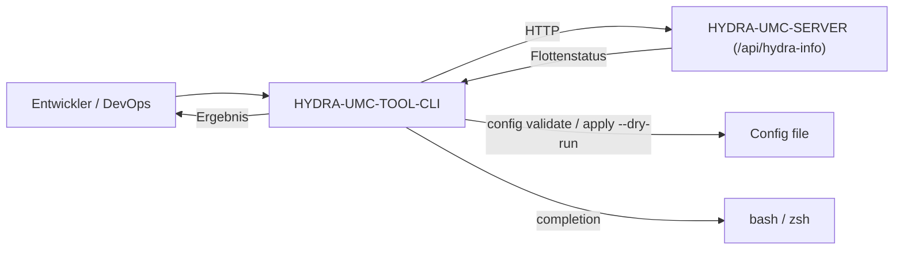

<!-- =============================================================================
HYDRA-UMC-TOOL-CLI - Command-line interface for fleet DevOps
Copyright (C) JuanenRac (Electro Hobby 3D) <electrohobby3d@gmail.com>
GPL-3.0-or-later - see LICENSE
============================================================================= -->

<p align="center">
  
</p>

# 🛠️ HYDRA-UMC-TOOL-CLI

<p align="center"><a href="README.md">🇺🇸 English</a> | <a href="README_spa.md">🇪🇸 Español</a> | <a href="README_fra.md">🇫🇷 Français</a> | <a href="README_ita.md">🇮🇹 Italiano</a> | 🇩🇪 <b>Deutsch</b> | <a href="README_zho.md">🇨🇳 简体中文</a> | <a href="README_jpn.md">🇯🇵 日本語</a> | <a href="README_por.md">🇵🇹 Português</a></p>

### 🛠️ Kommandozeilen-Schnittstelle für Flotten-DevOps & Automatisierung

<p align="center">
  
  
  
  
  
  
</p>

---

**Ehrlichkeitscheck - was heute wirklich funktioniert:** `version`, `status`, `robots`, `claims`, `claim`, `release`, `limits`, `jog-arm`, `jog`, `table`, `robot`, `audit`, `doctor`, `config validate`, `config apply --dry-run` und die interaktive `shell` (`main.go`, `server.go`, `robots.go`, `control.go`, `doctor.go`, `config.go`, `shell.go`, `exitcode.go`) sind echter, funktionierender Go-Code, geprüft durch 219 bestandene Tests (`go test ./...`) - echte `net/http`/`httptest`-Round-Trips gegen einen simulierten Server plus echte Temp-Datei-Konfigurationsfixtures, keine Stubs. Diese Tests simulieren eine HYDRA-UMC-SERVER-Instanz; `status`, `robots` und `doctor` (einschließlich der Anmeldung) wurden zusätzlich gegen einen echten HYDRA-UMC-SERVER-Prozess ausgeführt. `config apply` gibt ohne `--dry-run` ehrlich den Exit-Code `ExitNotImplemented` zurück, statt einen Erfolg vorzutäuschen, weil der Fleet-Write-Endpunkt, den es aufrufen würde, auf HYDRA-UMC-SERVER noch nicht existiert. `deploy`, `flash-all` und `audit` sind reine Zukunftsmusik - unten als "planned" markiert und in `src/` vollständig abwesend, nicht einmal als Stub-Funktion. Siehe `CHANGELOG.md` für das, was bisher genau ausgeliefert wurde.

---

> **Stand von Sicherheit (Safety) und Security:** Dieses Ökosystem ist kein zertifiziertes Sicherheitssystem. Es gibt noch keinen Hardware-E-STOP-Pfad, keine von der Firmware durchgesetzten Grenzen oder Verriegelungen und keinen verifizierten Bewegungsbefehl; Firmware-Images werden mit CRC32 und einem HMAC-SHA256 mit gemeinsamem Schlüssel geprüft, nicht mit einer asymmetrischen Signatur; TLS und gegenseitiges TLS sind optional und standardmäßig aus; noch keine eigene Platine wurde bestückt oder getestet. Lesen Sie die [Sicherheitsbasis](https://github.com/JuanenRac/HYDRA-UMC-DOCS/blob/main/docs/SECURITY_BASELINE.md) und das [Bedrohungsmodell](https://github.com/JuanenRac/HYDRA-UMC-DOCS/blob/main/docs/THREAT_MODEL.md), bevor Sie sich für die Sicherheit einer Person auf eine Aussage hier verlassen.

---

## 📋 Auf einen Blick

| | |
|---|---|
| Version | `0.1.8` |
| Reifegrad | Funktionsfähig |
| Tests | 219 (`go test ./...`) |
| Technik | Go / standard-library flag handling |
| Ziel | Der PC der Person, die es benutzt |
| Auf echter Hardware | Nur simuliert: gegen Emulatoren, Attrappen oder Simulatoren getestet; für diese Version ist kein Lauf auf echter Hardware vermerkt |

**Springe zu:** [Überblick](#-überblick) · [Architektur](#-architektur) · [Sicherheit und Schutz](#-sicherheit-und-schutz) · [Konfiguration](#-konfiguration) · [Schnellstart](#-schnellstart) · [Tests](#-tests) · [Fehlerbehebung](#-fehlerbehebung) · [Struktur des Repositorys](#-struktur-des-repositorys) · [Verwandte Projekte](#-verwandte-projekte)

## 🚦 Projektstatus

Jede Zeile ist ein Teil dieses Repositorys, und die Ampel sagt, wie weit er heute ist. Sie beruht auf dem, was das Repository zeigen kann (Tests, Builds, Läufe), nicht auf dem, was geplant ist.

🟢 Fertig und überprüft · 🟡 Funktioniert, mit bekannten Grenzen · 🟠 Teilweise fertig oder noch nicht überprüft · 🔴 Nicht gemacht oder funktioniert nicht

| Bereich | Stand | Was das hier bedeutet |
|---|---|---|
| Software | 🟡 | Funktioniert für seinen Hauptzweck; die Ehrlichkeitsprüfung oben nennt, was noch fehlt |
| Tests | 🟢 | 219 automatische Tests, bei jeder Änderung ausgeführt |
| Echte Hardware | 🟠 | Nur simuliert: gegen Emulatoren, Attrappen oder Simulatoren getestet; für diese Version ist kein Lauf auf echter Hardware vermerkt |
| Dokumentation | 🟢 | README in acht Sprachen, bei jeder Änderung gegen das Manifest geprüft |

## 🎯 Überblick

**HYDRA-UMC-TOOL-CLI** ist das Schweizer Taschenmesser für Entwickler und Systemadministratoren des HYDRA-UMC-Ökosystems. Es ist eine einzelne statische Go-Binärdatei, die Kommandozeilenwerkzeuge zum Abfragen, Aktualisieren und Prüfen von HYDRA-UMC-Deployments bereitstellt.

Das langfristige Ziel sind massive Missionsausrollungen, parallele Firmware-Updates (CAN-OTA) und tiefgehende Systemdiagnosen direkt aus einem Terminal oder einer CI/CD-Pipeline. Heute enthält es das reale, funktionierende Fundament, auf dem alles Weitere aufbaut: Versionsauskunft und einen echten HTTP-Client gegen HYDRA-UMC-SERVER.

### Hauptmerkmale:
* 🔏 **Signierte Release-Binärdateien (`hydra-sign`).** `go run ./src/cmd/hydra-sign sign --key PRIVAT.pem DATEI...` schreibt `DATEI.sha256` (Format von `sha256sum`) und `DATEI.sig` (Ed25519 über den Dateiinhalt, Base64); `verify --pub OEFFENTLICH.pem DATEI...` prüft beides und braucht nur den öffentlichen Schlüssel. Der private Schlüssel wird nur aus der angegebenen Datei gelesen und nie ausgegeben oder kopiert; `pubkey --key PRIVAT.pem` gibt die öffentliche Hälfte aus. Die Tests verwenden eigens erzeugte Schlüssel. Welcher Schlüssel ein Release signiert, bestimmt der Release-Prozess. Der Release-Prozess signiert jede veröffentlichte Binärdatei mit dem HYDRA-Release-Schlüssel und hängt die Dateien `.sha256` und `.sig` an; die Build-Skripte setzen die vom Binär gemeldete Version aus dem Projektmanifest.
* ✅ **`hydra-cli version`** — gibt Name und Version des CLI selbst aus. *(implementiert)*
* ✅ **`hydra-cli status [--server URL] [--config PATH]`** — fragt `GET /api/hydra-info` einer laufenden HYDRA-UMC-SERVER-Instanz ab und gibt deren gemeldete Identität aus. *(implementiert)*
* ✅ **`hydra-cli robots [--server URL] [--config PATH] [--json]`** — fragt `GET /api/settings` einer laufenden HYDRA-UMC-SERVER-Instanz ab und gibt deren echte Controller-/Roboterliste aus (Name, Online-Status, Modell, Rolle). *(implementiert)*
* ✅ **`hydra-cli claims`, `claim <robot>`, `release <robot>`** — listet auf, wer welchen Roboter reserviert (`GET /api/claims`), und reserviert oder gibt einen frei. Die Reservierung gehört zu deinem Konto und zur Controller-ID dieses Programms (`--controller-id`, `HYDRA_CLI_CONTROLLER_ID`, Standard `hydra-cli-<host>`), die bei jeder Anfrage mitgesendet wird. Ablehnungen (anderes Konto, anderer Controller, Controller-ID erforderlich, Jog nicht scharfgeschaltet) werden unterschieden und enden mit Code `8`. *(implementiert)*
* ✅ **`hydra-cli limits [--robot ID]`, `jog-arm <robot> <on|off>`, `jog <robot> <Achse> <Betrag> [--absolute]`** — liest die Sicherheitsgrenzen des Servers, schaltet den Jog scharf oder aus (nur nötig, wenn der Server es verlangt) und bewegt eine Achse. Ein Schritt über der Grenze des Robotermodells wird abgelehnt, bevor er gesendet wird, und es wird nichts gesendet, wenn die Grenze nicht gelesen werden kann; die Warnungen des Servers werden ausgegeben. *(implementiert)*
* ✅ **`hydra-cli robot <Roboter>`, `table <Roboter> <x> <y> [--rz N] [--relative]`, `audit [--limit N] [--type T] [--robot ID] [--verify] [--export DATEI]`** — `robot` liest einen Roboter mit seiner Revision; `table` bewegt den XY-Tisch in einer atomaren Anfrage (vor dem Senden gegen die Grenzen des Modells geprüft; der Server wendet alles oder nichts an); `audit` (nur Administratoren) liest das nur anfügbare Audit-Protokoll, prüft die Kette der SHA-256-Hashes der erhaltenen Zeilen (Exit-Code 8, wenn sie unterbrochen ist) und lässt mit `--verify` den Server das ganze Protokoll prüfen; `--export DATEI` speichert die Zeilen so, wie sie abgelegt sind. `claim`, `release`, `jog` und `table` nehmen auch `--if-match REVISION` (oder `current`): der Server lehnt den Schreibzugriff dann mit Exit-Code 8 ab, wenn sich der Roboter seit dieser Revision geändert hat, und nichts wird angewendet. Den WebSocket-Push der Reservierungen nutzt die CLI nicht (sie führt einen Befehl aus und endet).
* ✅ **`hydra-cli doctor [--server URL] [--config PATH] [--json]`** — schreibgeschützte Server-Vertragsdiagnose: prüft `/api/hydra-info` und `/api/settings` und vergleicht veröffentlichte Controller-/Roboterzahlen mit der Liste. Sendet keine Befehle und prüft keine Hardware. `--json` gibt statt der Textzeile einen strukturierten Bericht mit `checkId`/`severity`/`status` pro Prüfung aus, für Skripte (siehe [docs/DOCTOR.md](docs/DOCTOR.md)). *(implementiert)*
* 🔐 **Sitzungen, sichere Zugangsdaten und Flottenbefehle:** `login`/`logout` speichern eine Sitzung in einer Datei, die nur du lesen kannst (kein Login bei jedem Lauf); ein Passwort oder Token wird über einfaches http zu einem anderen Rechner abgelehnt, außer mit `HYDRA_CLI_ALLOW_INSECURE=1`, und `HYDRA_CLI_CA_FILE` vertraut einer privaten CA; neu sind `scan`, `fleet doctor`, `stop`, `stop-all --yes`, `metrics` und `manifest validate`. Siehe [`docs/CLI_REFERENCE.md`](docs/CLI_REFERENCE.md).
* Jeder Text, der von einem Server kommt und ausgegeben wird (Fehlermeldungen, Namen, Versionen), läuft jetzt auch durch die gemeinsame Geheimnis-Schwärzung; ein Token, ein `password=`-Wert oder ein Bearer-Header in einer Antwort erscheint so nie im Terminal (dieselben Vektoren wie in den anderen Projekten).
* ✅ **`hydra-cli completion <bash|zsh>`** — gibt ein Tab-Vervollständigungsskript für die Shell aus. *(implementiert)*
* ✅ **Ein echter, stabiler Exit-Code-Vertrag** — `0` ok, `1` allgemeiner Fehler, `2` Nutzungsfehler, `3` Konfigurationsfehler, `4` Netzwerkfehler, `5` Serverfehler, `6` nicht implementiert, `7` Authentifizierung erforderlich oder abgelehnt. Jeder Befehl klassifiziert seine eigenen Fehlschläge über diesen Vertrag statt über ein bloßes `exit 1`, sodass Skripte, die dieses CLI umschließen, anhand des *Warum* eines Fehlschlags verzweigen können. *(implementiert)*
* ✅ **`hydra-cli config validate --config PATH`** — lädt und validiert eine lokale Konfigurationsdatei anhand eines Schemas (Server-URL, Anfrage-Timeout). *(implementiert)*
* ✅ **`hydra-cli config apply --config PATH [--dry-run]`** — `--dry-run` beweist den echten Validierungspfad end-to-end und gibt genau aus, was gesendet würde; ohne diese Option liefert der Befehl ehrlich "nicht implementiert" zurück, da es noch keinen Live-Schreib-Endpunkt für die Flotte gibt. *(implementiert, nur dry-run)*
* ✅ **`--config PATH` bei `status`/`robots`/`doctor`/`shell`** — dieselbe validierte Datei mit ihrem `server`/`timeoutSec` steuert jetzt wirklich das HTTP-Ziel und das Anfrage-Timeout jedes Live-Befehls, nicht nur `config validate`/`apply`; `--server` gewinnt weiterhin, wenn beides angegeben ist. *(implementiert)*
* ✅ **`hydra-cli shell [--server URL] [--config PATH]`** — eine interaktive REPL: führt jeden der obigen Befehle wiederholt gegen denselben Server aus, ohne den Prozess neu zu starten. Leitet über dieselbe Befehlstabelle weiter, die auch Einzelaufrufe nutzen, sodass Shell- und Einzelaufruf-Verhalten niemals auseinanderdriften können. `exit`/`quit`/Strg+D zum Verlassen. *(implementiert)*
* ✅ **`hydra-cli help` / `--help`** — vollständige Befehlsübersicht. *(implementiert)*
* 🚧 **`hydra-cli deploy`** — lädt Missionen und Konfigurationen gleichzeitig auf eine Roboterflotte hoch. *(geplant)*
* 🚧 **`hydra-cli flash-all`** — parallele Firmware-Updates für Controller und URTC-Köpfe. *(geplant)*
* 🚧 **`hydra-cli audit`** — automatisierte Diagnosesuite für CAN-Bus-Gesundheit und Sensorvalidierung. *(geplant)*

## 🧩 Rolle in HYDRA-UMC

**HYDRA-UMC-TOOL-CLI** ist `hydra-cli`, eine einzige Go-Binärdatei ohne Abhängigkeit von gemeinsamen Bibliotheken, die mit `HYDRA-UMC-SERVER` spricht: Status, Roboter, Grenzwerte, ein Doctor, der einen Server prüft, Jog und Software-Stopps, ein Scan privater Netze, Flottenprüfungen, Validierung von Manifesten und Konfigurationsdateien und eine interaktive Shell. Dazu gehört `hydra-sign`, das Release-Binärdateien signiert und prüft.

## 🏛️ Architektur

<p align="center">
  
</p>

<details>
<summary>Textversion des Diagramms (Mermaid)</summary>



</details>

### ARCHITEKTUR & DESIGNENTSCHEIDUNGEN

* **Warum `src/` einen Unterpfad `cmd/hydra-cli/` enthält, kein flaches Layout.** Folgt der Standard-Go-Konvention für CLIs (ein Einstiegspunkt `cmd/<Binärname>/`, mit Platz für künftige `internal/`/`pkg/`-Pakete, sobald die CLI über einen einzelnen Befehl hinauswächst) - keine Erfindung dieses Ökosystems, sondern die eigene Konvention der breiteren Go-Community für Multi-Befehl-CLIs.
* **Warum eine CLI und nicht einfach direktes Scripting gegen die eigene REST-API von HYDRA-UMC-SERVER.** Operationen im Flottenmaßstab (Installieren/Aktualisieren über viele CM5, nicht nur eines) brauchen echte Orchestrierung - Wiederholungen, Parallelität, eine konsistente UX -, die ein einmaliges curl-Skript nicht bietet, derselbe Grund, den HYDRA-UMC-UPDATER später auf Ebene des gesamten Ökosystem-Checkouts anwendet.
* **Wie sich das ins restliche Ökosystem einfügt.** Macht im Flottenmaßstab, was URTC-FLASHER und URTC-TESTER jeweils für eine einzelne Platine machen - verwaltet HYDRA-UMC-SERVER-Instanzen über eine Flotte hinweg statt der eigenen Firmware einer einzelnen Platine.
* **Warum `robots` `GET /api/settings` liest statt eines neuen Endpunkts.** Dieser Endpunkt liefert bereits die vollständige Controller-/Roboterliste und ist bereits eine echte Lese-Operation, die ein angemeldetes Konto verlangt (siehe das eigene `src/server.ts` von HYDRA-UMC-SERVER; das CLI meldet sich mit `HYDRA_CLI_USER`/`HYDRA_CLI_PASSWORD` an oder sendet `HYDRA_CLI_TOKEN`) - `robots` ist ein echter Client eines bereits ausgelieferten Vertrags, keine neue serverseitige Arbeit. `doctor` nutzt dieselbe Lese-Operation zusammen mit `/api/hydra-info`, um inkompatible öffentliche Flottenzahlen ohne neuen Endpunkt zu erkennen. Die größeren, noch geplanten Befehle (`deploy`/`flash-all`/hardwarebezogenes `audit`) benötigen wirklich neue Schreib-Endpunkte, die noch nicht existieren.
* **Warum `doctor` ausdrücklich schreibgeschützt ist.** Eine Vertragsprüfung ist vor vorhandener Hardware nützlich und in CI sicher. Sie meldet nur HTTP-/JSON-/Zählerkonsistenz; sie steuert keine Geräte und behauptet keine CAN-, Aktor-, Sensor-, Kamera-, Hailo-, CM5- oder Sicherheitsgesundheit.
* **Warum `config apply` ohne `--dry-run` "nicht implementiert" zurückgibt, statt still nichts zu tun.** Der Live-Schreib-Endpunkt auf HYDRA-UMC-SERVER, den dies aufrufen würde, existiert tatsächlich noch nicht (dieselbe Lücke, an der auch `deploy`/`flash-all` hängen) - ein eigener `ExitNotImplemented`-Exit-Code sagt dem Aufrufer "das ist eine echte Lücke, kein Bug", statt eines irreführend erfolgreichen No-ops.
* **Warum die Fehler jedes Befehls jetzt über einen einzigen `CliError`/`ExitCode`-Typ laufen statt über Ad-hoc-Aufrufe von `os.Exit`.** Ein stabiler, dokumentierter Exit-Code-Vertrag bleibt nur stabil, wenn es eine einzige Stelle gibt, die Codes vergibt - `exitCodeFor()` (`exitcode.go`) ist diese Stelle, und die Befehlsfunktionen geben weiterhin idiomatische, verkettbare `error`-Werte zurück, statt selbst `os.Exit` aufzurufen.

## 🔒 Sicherheit und Schutz

| Bedrohung | Abwehr | Wo |
|---|---|---|
| Ein Passwort oder Token in der Prozessliste oder im Shell-Verlauf | Die Zugangsdaten kommen aus der Umgebung (`HYDRA_CLI_TOKEN` oder `HYDRA_CLI_USER` und `HYDRA_CLI_PASSWORD`) oder aus einer gespeicherten Sitzung, nie aus einer Option | `auth.go` |
| Eine gespeicherte Sitzung, die ein anderer Benutzer liest oder die halb geschrieben ist | Die Datei wird in eine temporäre Datei mit Modus 0600 geschrieben und über die alte umbenannt, in einem Ordner mit Modus 0700 | `session.go` |
| Zugangsdaten im Klartext an einen anderen Rechner | Sie werden über reines `http://` zu jedem anderen Rechner abgelehnt, außer `HYDRA_CLI_ALLOW_INSECURE=1`; `HYDRA_CLI_CA_FILE` vertraut für `https://` einer privaten Stelle | `transport.go` |
| Ein Scan, der ins Internet wandert, oder ein versehentliches stop-all | `scan` bleibt in privaten Netzen, außer `--allow-public-range` ist gesetzt, und umfasst standardmäßig höchstens 1024 Adressen; `stop-all` verlangt `--yes` | `fleet.go`, `emergency.go` |

**Was es nie tut:** als Not-Halt dienen. `stop` und `stop-all` sind Softwarebefehle, die Server, Netz und Anmeldung brauchen; der physische Not-Halt der Zelle hält eine Maschine an.

## ⚙️ Konfiguration

| Variable | Standard | Was sie festlegt |
|---|---|---|
| `HYDRA_CLI_SERVER` / `--server` | `http://localhost:3000` | der Server, mit dem gesprochen wird |
| `HYDRA_CLI_TIMEOUT_SEC` / `--timeout` | `5` | Sekunden je Anfrage (1 bis 3600) |
| `HYDRA_CLI_TOKEN` | keiner | ein Bearer-Token, das der Server schon ausgestellt hat |
| `HYDRA_CLI_USER`, `HYDRA_CLI_PASSWORD` | keiner | die CLI meldet sich für diesen Lauf an; das Token gewinnt, wenn beide gesetzt sind |
| `HYDRA_CLI_ALLOW_INSECURE` | `0` | `1` erlaubt Zugangsdaten über reines http zu einem anderen Rechner |
| `HYDRA_CLI_CA_FILE` | keiner | PEM-Datei einer privaten Stelle, der für https vertraut wird |

## 🚀 Schnellstart

Benötigt Go 1.24 oder neuer.

```bash
./build.sh  # Linux, macOS (build.bat on Windows)
./run.sh status --server http://192.168.1.50:3000
./run.sh doctor
./run.sh config validate --config hydra-cli.json
./run.sh help
```

## 🧪 Tests

219 automatische Tests laufen mit `cd src && go test ./...`. Sie brauchen weder Hardware noch etwas außerhalb dieses Rechners.

Die CI führt `HYDRA_UMC_CI=1 python tools/ci_validate.py` aus; das prüft das Manifest, die Dokumente, die acht READMEs und die Bilder.

## 🏗️ Build und Veröffentlichung

Erfordert Go >= 1.24.

```bash
# Linux/macOS
./build.sh
./run.sh version
./run.sh status --server http://localhost:3000
./run.sh robots --server http://localhost:3000
./run.sh doctor --server http://localhost:3000
./run.sh config validate --config ./hydra-cli.json
./run.sh config apply --config ./hydra-cli.json --dry-run
echo $?   # 0=ok 2=Nutzung 3=Konfiguration 4=Netzwerk 5=Server 6=nicht-implementiert 7=Authentifizierung

# Windows
build.bat
run.bat version
run.bat status --server http://localhost:3000
run.bat robots --server http://localhost:3000
run.bat doctor --server http://localhost:3000
run.bat config validate --config .\hydra-cli.json
run.bat config apply --config .\hydra-cli.json --dry-run
```

`robots` und `doctor` lesen `/api/settings`, das HYDRA-UMC-SERVER nur einem angemeldeten Konto gibt (ein Administrator sieht die vollständigen Einstellungen, die anderen Rollen eine Kopie mit geschwärzten Geheimnissen). Geben Sie dem CLI Zugangsdaten über die Umgebung - nie über eine Option, damit sie nicht in der Prozessliste und im Shell-Verlauf landen: `HYDRA_CLI_TOKEN` (ein vom Server bereits ausgestelltes Bearer-Token) oder `HYDRA_CLI_USER` und `HYDRA_CLI_PASSWORD` (das CLI meldet sich für diesen Lauf mit `POST /api/login` an; sind beide gesetzt, gewinnt das Token). Ohne eines von beiden endet der Befehl mit Code `7` und nennt die zu setzenden Variablen. `status` und die erste Anfrage von `doctor` nutzen das öffentliche `/api/hydra-info` und senden die Zugangsdaten nie. Eine Antwort wird bis zu 4 MiB gelesen.

`build` ändert die Version nie (nur `python tools/hydra_project_tool.py bump` erhöht sie), führt die echte Testsuite aus (`go vet` + `go test`), kompiliert das Go-Modul in `src/` nach `build/hydra-cli(.exe)` und führt einmalig `version` zur Verifikation aus - kompiliert dann plattformübergreifend ein echtes Release für linux/amd64, linux/arm64 (die eigene Architektur der CM5), windows/amd64, darwin/amd64 und darwin/arm64 nach build/release/, mit einer echten SHA256SUMS-Prüfsummendatei. `run` führt die kompilierte Binärdatei erneut aus und leitet alle Argumente weiter — probiere `run doctor` gegen eine laufende `HYDRA-UMC-SERVER`-Instanz. Doctor ist eine sichere, schreibgeschützte Endpunkt-Vertragsprüfung; siehe [docs/DOCTOR.md](docs/DOCTOR.md).

## 🩺 Fehlerbehebung

| Du siehst | Weil | Tu |
|---|---|---|
| exit code 7 | Der Befehl braucht eine Anmeldung und es wurde keine Zugangsdaten angegeben, oder der Server hat sie abgelehnt | `HYDRA_CLI_TOKEN` oder `HYDRA_CLI_USER` und `HYDRA_CLI_PASSWORD` setzen oder `login` ausführen |
| exit code 4 | Der Server war überhaupt nicht erreichbar | Adresse prüfen (`--server`, Konfigurationsdatei, `HYDRA_CLI_SERVER`) und `doctor` ausführen |
| exit code 2 | Unbekannter Befehl, fehlendes Argument oder Option ohne Wert | `help` ausführen; nichts wird stillschweigend ignoriert |

## 📂 Struktur des Repositorys

<p align="center">
  
</p>

<details>
<summary>Textversion des Baums</summary>

```text
HYDRA-UMC-TOOL-CLI/
├── tools/                      Quellcode
│   ├── build_test.py           Nicht-versionierender Build-Check
│   ├── ci_validate.py          Manifest/CHANGELOG/Docs-Validierung, von CI genutzt
│   ├── _doc_policy.py          Von der Familie geteilte Dokumentationsregeln (Kopie der von HYDRA-UMC-SDK, synchron gehalten)
│   ├── _readme_parity.py       Prüfung, dass die acht READMEs dieselbe Struktur haben (Kopie der von HYDRA-UMC-SDK, synchron gehalten)
│   └── hydra_project_tool.py   Dieselben Befehle in jedem Repository: validate, test, ci, version, status, bump
├── src/                        Go-Modul
├── docs/                       Dokumentation: CLI_REFERENCE.md und DOCTOR.md
├── images/                     Medien und Diagramme
├── .github/                    CI-Workflow und Issue-Vorlagen
├── bump_version.py             ausdrückliche Versionserhöhung
├── bump_manifest_version.py    Synchronisiert die Version von hydra-umc.project.json mit der nativen (--sync)
├── build.sh / build.bat        Echter Build: Erhöhung + echte Testsuite + go build + Rauchtest + plattformübergreifende Paketierung
├── run.sh / run.bat            Echte Ausführung: startet die kompilierte Binärdatei
├── CHANGELOG.md                was sich in jeder Version geändert hat
├── build-test.sh               Build-Prüfung ohne Änderungen
├── hydra-umc.project.json      Manifest: Version, Reifegrad, Familie
└── test.sh                     führt die Tests aus
```

</details>

## 🗺️ Roadmap und bekannte Grenzen

`deploy`, `flash-all` und `audit` sind noch nicht gebaut: Jedes braucht auf `HYDRA-UMC-SERVER` einen Flottenschreib-, Over-the-Air- oder Audit-Endpunkt, den es nicht gibt. `config apply` ohne `--dry-run` ist der ehrliche Platzhalter für dieselbe Lücke und antwortet mit Exit-Code 6.

## 🌍 Sprachen

Diese README und die Dokumente des Repositorys gibt es in acht Sprachen: Englisch, Spanisch, Deutsch, Französisch, Italienisch, Japanisch, Chinesisch und Portugiesisch (Portugal). Sie entstehen gemeinsam, und die CI prüft, dass die acht Dateien dieselben Abschnitte und dieselben Links haben. Dieses Repository hat weder eine eigene Oberfläche noch einen eigenen Meldungskatalog, es gibt also keine Oberflächentexte zu übersetzen.

## 🔗 Verwandte Projekte

Dieses Projekt ist Teil des HYDRA-UMC-Robotik-Ökosystems desselben Autors (JuanenRac / Electro Hobby 3D). Gut zu wissen, da eine Anfrage eigentlich eines dieser Projekte betreffen könnte statt dieses Repositorys.

**Direkt verwandt**
- **[HYDRA-UMC-SERVER](https://github.com/JuanenRac/HYDRA-UMC-SERVER)** — das reale Headless-Backend (REST/WebSocket), mit dem jeder Steuerungsclient tatsächlich spricht — das Backend, das diese CLI im Flottenmaßstab verwaltet.
- **[URTC-FLASHER](https://github.com/JuanenRac/URTC-FLASHER)** — Desktop-GUI-Flash-Tool für URTC-Platinen, CAN-OTA plus Full-Chip-SWD/JTAG — der geplante flottenweite CAN-OTA-Deploy dieses Tools tut für viele Platinen, was URTC-FLASHER für eine tut.
- **[URTC-TESTER](https://github.com/JuanenRac/URTC-TESTER)** — Desktop-Live-CAN-Bus-Diagnosetool für URTC-Platinen, ein Panel pro Werkzeugprofil — die geplante flottenweite Diagnose dieses Tools tut für viele Platinen, was URTC-TESTER für eine tut.

**Ebenfalls Teil des Ökosystems**

*Kern-Hardware & Plattform*
- **[HYDRA-UMC](https://github.com/JuanenRac/HYDRA-UMC)** — der Entwurf des Motherboards des Roboterarms: CM5-Host + Dual-Core-STM32H745, gedacht zur Koordination von bis zu 8 Werkzeugarmen über CAN-OTA/SPI-OTA (Firmware in einer frühen Phase; noch keine bestückte Platine).
- **[HYDRA-UMC-OS](https://github.com/JuanenRac/HYDRA-UMC-OS)** — reproduzierbare Raspberry-Pi-OS-Produktschicht für den CM5: schreibgeschützter Agent, validierte Konfiguration/Profile, WiFi-Ersteinrichtung.
- **[HYDRA-UMC-SDK](https://github.com/JuanenRac/HYDRA-UMC-SDK)** — der gemeinsame JSON-Schema-Vertrag und die Software-Auftragsschranke, gegen die jede Bridge ihre Befehle validiert (keine zertifizierte Sicherheitsfunktion).
- **[HYDRA-UMC-CONNECTOR-HUB](https://github.com/JuanenRac/HYDRA-UMC-CONNECTOR-HUB)** — deklaratives Adapter-Manifest-Register und Validator für Konnektoren externer Maschinen; erweitert die eigene Vertragsidee des SDK auf externe Maschinen, ohne die Industrie-Gateway-Projekte zu ersetzen.

*Kern-Backend & Clients*
- **[HYDRA-UMC-STUDIO](https://github.com/JuanenRac/HYDRA-UMC-STUDIO)** — Web-Steuerungs-Dashboard mit Echtzeit-3D-Visualisierung mehrerer Roboter.
- **[HYDRA-UMC-SUITE](https://github.com/JuanenRac/HYDRA-UMC-SUITE)** — Desktop-Schwarmleitstand (PySide6) für mehrere Server gleichzeitig, verpackt als eigenständige ausführbare Datei.
- **[HYDRA-UMC-ANDROID-CONTROL](https://github.com/JuanenRac/HYDRA-UMC-ANDROID-CONTROL)** — native Android-Steuerungs-App mit biometrischem Login und einer gekoppelten Wear-OS-Begleit-App.
- **[HYDRA-UMC-IOS-CONTROL](https://github.com/JuanenRac/HYDRA-UMC-IOS-CONTROL)** — iOS/iPadOS-Steuerungs-App (Flutter) mit Echtzeit-WebSocket-Synchronisierung.
- **[HYDRA-UMC-DSI](https://github.com/JuanenRac/HYDRA-UMC-DSI)** — native Touch-UI für das eingebaute 7"-DSI-Touchscreen, direkt auf dem CM5 eingebettet.
- **[HYDRA-UMC-EDITOR-URDF](https://github.com/JuanenRac/HYDRA-UMC-EDITOR-URDF)** — grafischer Desktop-URDF-Ersteller/-Editor, der fertige Modelle in STUDIOs eigenen Katalog überträgt.
- **[HYDRA-UMC-EDITOR-STL](https://github.com/JuanenRac/HYDRA-UMC-EDITOR-STL)** — Desktop-STL-Modelleditor, der echte Teile im selben Modellkatalog transformiert/ersetzt/entfernt/hinzufügt, den auch HYDRA-UMC-EDITOR-URDF bearbeitet.
- **[HYDRA-UMC-BRIDGE-AMR](https://github.com/JuanenRac/HYDRA-UMC-BRIDGE-AMR)** — Koordinationsschranke für AGV-/AMR-Flotten über einen VDA-5050-MQTT-Publisher (nur gegen eine emulierte Flotte getestet).
- **[HYDRA-UMC-BRIDGE-CNC](https://github.com/JuanenRac/HYDRA-UMC-BRIDGE-CNC)** — High-Level-Koordinator für CNC-Zellen mit GRBL-Status-/Steuerbyte-Zugriff (nur gegen einen Emulator getestet).
- **[HYDRA-UMC-BRIDGE-DROIDS](https://github.com/JuanenRac/HYDRA-UMC-BRIDGE-DROIDS)** — Koordinationsschranke für laufende/humanoide Droiden, mit einem Boston-Dynamics-Spot-Befehlssender (nur gegen einen Emulator getestet).
- **[HYDRA-UMC-BRIDGE-LASER](https://github.com/JuanenRac/HYDRA-UMC-BRIDGE-LASER)** — Koordinator für Laserzellen, liest 3 Schlüssel-/Gehäuse-/Verriegelungs-GPIO-Signale (nur gegen einen simulierten Chip getestet; kann keinen Laser scharfschalten oder auslösen).
- **[HYDRA-UMC-BRIDGE-OPENPNP](https://github.com/JuanenRac/HYDRA-UMC-BRIDGE-OPENPNP)** — sicherer High-Level-Koordinator für den Leiterplattenfluss von OpenPnP Pick-and-Place.
- **[HYDRA-UMC-BRIDGE-PRINTER3D](https://github.com/JuanenRac/HYDRA-UMC-BRIDGE-PRINTER3D)** — sichere Koordinationsschranke für Moonraker/Klipper-3D-Drucker, mit echten gesicherten Job-Befehlen.
- **[HYDRA-UMC-BRIDGE-ROS2](https://github.com/JuanenRac/HYDRA-UMC-BRIDGE-ROS2)** — Koordinator mit einem träge importierten rclpy-ROS-2-Transport (noch nicht gegen eine ROS-2-Installation ausgeführt).
- **[HYDRA-UMC-BRIDGE-UAV](https://github.com/JuanenRac/HYDRA-UMC-BRIDGE-UAV)** — Koordinationsschranke für kameraausgestattete UAVs, mit einem MAVLink-Befehlssender (nur gegen einen Emulator getestet).

*URTC-Werkzeugplattform*
- **[URTC](https://github.com/JuanenRac/URTC)** — Firmware für die physische Universal-Robot-Tool-Controller-Platine, 25+ Werkzeugprofile über CAN-Bus.
- **[URTC-WEB-STUDIO](https://github.com/JuanenRac/URTC-WEB-STUDIO)** — browserbasierte Alternative zu URTC-TESTER über die Web-Serial-API, ohne lokale Installation.
- **[URTC-GATEWAY](https://github.com/JuanenRac/URTC-GATEWAY)** — Gateway vor dem CAN-Bus von URTC: Liste erlaubter Kennungen, Ratenbegrenzung und Sitzungsschlüssel; Software auf dem Computer getestet, noch nicht an einem echten Bus.

*Vision-KI-Knoten (Hailo-8)*
- **[HYDRA-UMC-VISION-NODE](https://github.com/JuanenRac/HYDRA-UMC-VISION-NODE)** — Integrationsknoten für die Hailo-8-Vision-Pipeline, mit einer echten stufenweisen Hardware-Bereitschaftsprüfung.
- **[HYDRA-UMC-DETECTION-HEF](https://github.com/JuanenRac/HYDRA-UMC-DETECTION-HEF)** — echte Registry für kompilierte Modelle mit Hailo-Architektur-/Prüfsummen-Safe-Load-Verifizierung.
- **[HYDRA-UMC-VISION-STREAMER](https://github.com/JuanenRac/HYDRA-UMC-VISION-STREAMER)** — echter GStreamer-Pipeline- + MediaMTX-Konfigurationsgenerator mit einer echten HailoRT-Integrationsschranke.
- **[HYDRA-UMC-VISUAL-SERVOING-API](https://github.com/JuanenRac/HYDRA-UMC-VISUAL-SERVOING-API)** — Position-Based-Visual-Servoing-Korrekturgesetz mit Freigabe abhängig vom Zonenstatus; noch keine Posenschätzung per Kamera.
- **[HYDRA-UMC-SAFETY-ZONES](https://github.com/JuanenRac/HYDRA-UMC-SAFETY-ZONES)** — v0-Logik für Zonenverletzung, Kalibrierungsaktualität und E-STOP-Anforderung, die Objektpositionen aus einer Datei nimmt; kein Detektor speist sie, und noch kein physischer E-STOP ist angeschlossen.

*Kognitiver KI-Knoten (Hailo-10)*
- **[HYDRA-UMC-COGNITIVE-NODE](https://github.com/JuanenRac/HYDRA-UMC-COGNITIVE-NODE)** — Integrationsknoten für die Hailo-10-Cognitive-Pipeline (LLM-/VLA-/Sprach-Orchestrierung).
- **[HYDRA-UMC-VLA-ENGINE](https://github.com/JuanenRac/HYDRA-UMC-VLA-ENGINE)** — echte Aktions-Token-Kodierung/-Dekodierung und Trajektoriengenerierung für ein Vision-Language-Action-Modell.
- **[HYDRA-UMC-VOICE-UI](https://github.com/JuanenRac/HYDRA-UMC-VOICE-UI)** — echtes Sprach-Frontend (VAD + Intent-Parser) mit einem begrenzten, bestätigungsgesicherten Watch-Relay.
- **[HYDRA-UMC-SEMANTIC-PLANNER](https://github.com/JuanenRac/HYDRA-UMC-SEMANTIC-PLANNER)** — echte regelbasierte Aufgabenzerlegung und semantische Fehlerbehebung über MCU-Fehlercodes.
- **[HYDRA-UMC-DOCS-QA](https://github.com/JuanenRac/HYDRA-UMC-DOCS-QA)** — echte, nur auf der Standardbibliothek basierende TF-IDF-Dokumentensuche über die eigenen Markdown-Dokumente dieses Ökosystems.
- **[HYDRA-UMC-LOCAL-TECHNICIAN](https://github.com/JuanenRac/HYDRA-UMC-LOCAL-TECHNICIAN)** — lokaler, richtlinien-gesteuerter KI-Wartungstechniker für das Ökosystem selbst - beobachtet, diagnostiziert und schlägt Korrekturen vor; die zwei höchsten Risikostufen sind absichtlich noch nicht implementiert.

*Orchestrierung & Schwarm*
- **[HYDRA-UMC-ORCHESTRATOR](https://github.com/JuanenRac/HYDRA-UMC-ORCHESTRATOR)** — Integrationsknoten mit einem echten gRPC/Protobuf-Health-Report-Vertrag und einer Missions-Zustandsmaschine.
- **[HYDRA-UMC-JOB-DISPATCHER](https://github.com/JuanenRac/HYDRA-UMC-JOB-DISPATCHER)** — echte prioritätsbasierte Job-Queue mit Deduplizierung, über eine echte HTTP-API.
- **[HYDRA-UMC-NODE-HEALING](https://github.com/JuanenRac/HYDRA-UMC-NODE-HEALING)** — echter gRPC-basierter Flotten-Health-Watchdog mit Retry/Backoff und Identitäts-Mismatch-Erkennung.
- **[HYDRA-UMC-PATH-PLANNER-3D](https://github.com/JuanenRac/HYDRA-UMC-PATH-PLANNER-3D)** — echter RRT-basierter 3D-Pfadplaner mit echter Hindernis-/Arbeitsraum-Kollisionsvalidierung.
- **[HYDRA-UMC-SWARM-SYNC](https://github.com/JuanenRac/HYDRA-UMC-SWARM-SYNC)** — echte CRDT-LWW-Element-Map-Zustandssynchronisation, eigenschaftsgetestet auf Multi-Zellen-Konvergenz.

*Digitaler Zwilling & Simulation*
- **[HYDRA-UMC-TWIN](https://github.com/JuanenRac/HYDRA-UMC-TWIN)** — Integrationsknoten für die Digital-Twin-Engine, mit einem echten Versionskompatibilitäts-Sync-Vertrag.
- **[HYDRA-UMC-HIL-BRIDGE](https://github.com/JuanenRac/HYDRA-UMC-HIL-BRIDGE)** — Hardware-in-the-Loop-Router mit einer Software-Kollisionsverriegelung zwischen Simulation und echter Hardware (ohne echte Hardware getestet).
- **[HYDRA-UMC-PHYSICS-REPLICA](https://github.com/JuanenRac/HYDRA-UMC-PHYSICS-REPLICA)** — echte Vorwärtskinematik und Gelenkgrenzenvalidierung über eine echte URDF-Teilmenge.
- **[HYDRA-UMC-SYNTHETIC-DATA-GEN](https://github.com/JuanenRac/HYDRA-UMC-SYNTHETIC-DATA-GEN)** — echter prozeduraler 2D-Szenengenerator mit YOLO/COCO-Annotationsexport.

*Daten & Analytik*
- **[HYDRA-UMC-DATALAKE](https://github.com/JuanenRac/HYDRA-UMC-DATALAKE)** — echter sqlite3-gestützter Zeitreihenspeicher mit einer echten Ingest-/Abfrage-HTTP-API.
- **[HYDRA-UMC-ANOMALY-DETECTOR](https://github.com/JuanenRac/HYDRA-UMC-ANOMALY-DETECTOR)** — echter FFT- + statistischer Basislinien-Anomaliedetektor mit Drift-Überwachung.
- **[HYDRA-UMC-PRODUCTION-REPORTS](https://github.com/JuanenRac/HYDRA-UMC-PRODUCTION-REPORTS)** — echte OEE-/Verfügbarkeitsberechnung über den DATALAKE-Verlauf, mit reproduzierbarem CSV-Export.
- **[HYDRA-UMC-TELEMETRY-COLLECTOR](https://github.com/JuanenRac/HYDRA-UMC-TELEMETRY-COLLECTOR)** — echte CAN/WebSocket-Ingestion-Pipeline in DATALAKE, mit Sequenz-Deduplizierung.

*Industrie-Gateway*
- **[HYDRA-UMC-GATEWAY-INDUSTRIAL](https://github.com/JuanenRac/HYDRA-UMC-GATEWAY-INDUSTRIAL)** — Integrationsknoten, der zu Industrieprotokollen weiterleitet, mit einer echten Befehls-Allowlist-/Backpressure-Schicht.
- **[HYDRA-UMC-OPCUA-SERVER](https://github.com/JuanenRac/HYDRA-UMC-OPCUA-SERVER)** — echter OPC-UA-Adressraum, verifiziert mit einer echten Binärprotokoll-Client-Session.
- **[HYDRA-UMC-MQTT-BROKER](https://github.com/JuanenRac/HYDRA-UMC-MQTT-BROKER)** — echter MQTT-Broker mit optionaler Pro-Client-Authentifizierung und Topic-ACLs.
- **[HYDRA-UMC-MTCONNECT-ADAPTER](https://github.com/JuanenRac/HYDRA-UMC-MTCONNECT-ADAPTER)** — echte MTConnect-`/probe`- und `/current`-XML-Endpunkte mit Degraded-Mode-Ausgabe.

*Ergänzende Tools & Ökosystembetrieb*
- **[HYDRA-UMC-DASHBOARD-AI](https://github.com/JuanenRac/HYDRA-UMC-DASHBOARD-AI)** — Smart-Summaries- und Anomaly-Highlighting-Panels über DATALAKE/ANOMALY-DETECTOR, mit einem ehrlichen statistischen Fallback.
- **[HYDRA-UMC-WATCH](https://github.com/JuanenRac/HYDRA-UMC-WATCH)** — WearOS-Begleit-App mit haptischen Alarmmustern und einem Sprach-Relay zum gekoppelten Telefon (noch nicht auf einer physischen Uhr ausgeführt).
- **[URTC-SMART-RACK](https://github.com/JuanenRac/URTC-SMART-RACK)** — Firmware für ein Platinenmontagegestell mit echter Werkzeug-ID-Dekodierung und Smart-Idle-Vorheizlogik.
- **[URTC-VISION-TOOL](https://github.com/JuanenRac/URTC-VISION-TOOL)** — Firmware plus ein echter Python-Vision-Begleiter für einen Thermal-/RGB-Inspektionswerkzeugkopf.
- **[HYDRA-UMC-UPDATER](https://github.com/JuanenRac/HYDRA-UMC-UPDATER)** — administratives Desktop-Tool, das jedes Repository in diesem Ökosystem entdeckt, klont und aktualisiert.
- **[HYDRA-UMC-OS-REBUILDER](https://github.com/JuanenRac/HYDRA-UMC-OS-REBUILDER)** — Windows/Linux-Desktop-Tool, das ein flashbereites CM5-Image baut, vorgeladen mit den aktuellsten Versionen des Ökosystems, mit Ersteinrichtungs-Konfiguration für WLAN/Benutzer/SSH im Stil von Raspberry Pi Imager.
- **[HYDRA-UMC-OPS-AGENT](https://github.com/JuanenRac/HYDRA-UMC-OPS-AGENT)** — Wartungsvorfall-Koordinator: eine Edge-Rolle mit niedrigem Privileg sammelt einen bereinigten Inventar-/Gesundheits-Snapshot, eine Control-Plane-Rolle rendert ihn schreibgeschützt und bittet einen KI-Anbieter um einen Diagnosevorschlag - wendet nie einen Patch an und stellt nie etwas bereit.
- **[HYDRA-UMC-DEV-SERVER](https://github.com/JuanenRac/HYDRA-UMC-DEV-SERVER)** — reproduzierbarer Entwicklungshost (Raspberry Pi 5 / CM5), der den Quellcode des Ökosystems vorhält und begrenzte Build-/Test-Aufgaben über eine dauerhafte Warteschlange ausführt; eine dedizierte Entwicklerrolle, ausdrücklich kein operativer CM5.

## 📚 Dokumentation

Hier steht mehr:

* [Sicherheitsgrundlage des Ökosystems](https://github.com/JuanenRac/HYDRA-UMC-DOCS/blob/main/docs/SECURITY_BASELINE.md)
* [Bedrohungsmodell des Ökosystems](https://github.com/JuanenRac/HYDRA-UMC-DOCS/blob/main/docs/THREAT_MODEL.md)
* [Änderungsprotokoll dieses Repositorys](CHANGELOG.md)
* [Lizenz dieses Repositorys](LICENSE.md)

## 🤝 Mitwirken und Community

* Führe vor einem Pull Request `HYDRA_UMC_CI=1 py -3 tools/ci_validate.py` (oder `HYDRA_UMC_CI=1 python3 tools/ci_validate.py`) aus: Es muss `CI_VALIDATION=PASS` ausgeben. Führe dafür nicht `build.sh` oder `build.bat` aus; Bauen ist keine Prüfung.
* Die acht READMEs entstehen aus einer einzigen Quelle in HYDRA-UMC-DOCS; bearbeite sie nicht von Hand. Ändere die Quelle und schreibe sie mit `tools/make_readmes.py` neu.
* Behaupte in einer README nichts, was nicht gelaufen ist: Schreibe „simuliert“ oder „nicht auf Hardware erprobt“, wo das stimmt.
* Siehe [CONTRIBUTING.md](CONTRIBUTING.md), den [Verhaltenskodex](CODE_OF_CONDUCT.md), [SECURITY.md](SECURITY.md) und [SUPPORT.md](SUPPORT.md).

## 👤 AUTOR

**JuanenRac (Electro Hobby 3D)** · electrohobby3d@gmail.com

## 📜 LIZENZ

GPL-3.0-or-later - [LICENSE](LICENSE).
