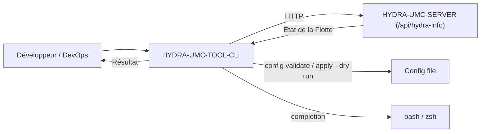

<p align="center">
  
</p>

# 💻 HYDRA-UMC-TOOL-CLI

<p align="center"><a href="README.md">🇺🇸 English</a> | <a href="README_spa.md">🇪🇸 Español</a> | 🇫🇷 <b>Français</b> | <a href="README_ita.md">🇮🇹 Italiano</a> | <a href="README_deu.md">🇩🇪 Deutsch</a> | <a href="README_zho.md">🇨🇳 简体中文</a> | <a href="README_jpn.md">🇯🇵 日本語</a> | <a href="README_por.md">🇵🇹 Português</a></p>

### 🛠️ Interface en Ligne de Commande pour le DevOps et l'Automatisation de Flottes

<p align="center">
  
  
  
</p>

---

**Vérification d'honnêteté - ce qui fonctionne réellement aujourd'hui :** `version`, `status`, `robots`, `doctor`, `config validate`, `config apply --dry-run`, et le `shell` interactif (`main.go`, `server.go`, `robots.go`, `doctor.go`, `config.go`, `shell.go`, `exitcode.go`) sont du code Go réel et fonctionnel, vérifié par 105 tests qui passent (`go test ./...`) - de vrais échanges `net/http`/`httptest` contre un faux serveur, plus de vraies fixtures de fichiers de configuration temporaires, pas des stubs. Ces tests simulent une instance de HYDRA-UMC-SERVER ; `status`, `robots` et `doctor` (connexion comprise) ont aussi été exécutés contre un vrai processus HYDRA-UMC-SERVER. `config apply` sans `--dry-run` renvoie honnêtement le code de sortie `ExitNotImplemented` plutôt que de simuler un succès, car le endpoint d'écriture de flotte qu'il appellerait n'existe pas encore sur HYDRA-UMC-SERVER. `deploy`, `flash-all` et `audit` relèvent de la pure aspiration - marqués "planned" ci-dessous et totalement absents de `src/`, pas même une fonction stub. Voir `CHANGELOG.md` pour savoir exactement ce qui a été livré jusqu'à présent.

---

> **État de la sûreté et de la cybersécurité :** cet écosystème n'est pas un système de sécurité certifié. Il n'existe pas encore de chaîne d'E-STOP matérielle, ni de limites ou de verrouillages imposés par le firmware, ni de commande de mouvement vérifiée ; les images de firmware sont contrôlées par CRC32 et un HMAC-SHA256 à clé partagée, pas par une signature asymétrique ; TLS et TLS mutuel sont optionnels et désactivés par défaut ; aucune carte propre n'a encore été assemblée ni testée. Lisez la [base de sécurité](https://github.com/JuanenRac/HYDRA-UMC-DOCS/blob/main/docs/SECURITY_BASELINE.md) et le [modèle de menaces](https://github.com/JuanenRac/HYDRA-UMC-DOCS/blob/main/docs/THREAT_MODEL.md) avant de vous fier à une affirmation d'ici pour la sécurité d'une personne.

## 📋 En un coup d'œil

| | |
|---|---|
| Version | `0.1.7` |
| Maturité | Fonctionnel |
| Tests | 83 (`go test ./...`) |
| Technologie | Go / standard-library flag handling |
| Cible | Le PC de la personne qui l'utilise |
| Sur matériel réel | Simulé seulement : testé avec des émulateurs, des doubles de test ou des simulateurs ; aucune exécution sur du matériel réel n'est consignée pour cette version |

## 1. 🛠️ APERÇU TECHNIQUE

**HYDRA-UMC-TOOL-CLI** est le couteau suisse des développeurs et administrateurs système de l'écosystème HYDRA-UMC. Il s'agit d'un binaire Go statique unique fournissant des outils en ligne de commande pour interroger, mettre à jour et auditer les déploiements HYDRA-UMC.

L'objectif à long terme est de permettre des déploiements massifs de missions, des mises à jour de firmware en parallèle (CAN-OTA) et des diagnostics système approfondis directement depuis un terminal ou un pipeline CI/CD. Aujourd'hui, il fournit la base réelle et fonctionnelle sur laquelle tout le reste s'appuiera : le rapport de version et un client HTTP réel vers HYDRA-UMC-SERVER.

### Fonctionnalités Clés :
* ✅ **`hydra-cli version`** — affiche le nom et la version du CLI. *(implémenté)*
* ✅ **`hydra-cli status [--server URL] [--config PATH]`** — interroge le `GET /api/hydra-info` d'une instance HYDRA-UMC-SERVER active et affiche son identité déclarée. *(implémenté)*
* ✅ **`hydra-cli robots [--server URL] [--config PATH] [--json]`** — interroge le `GET /api/settings` d'une instance HYDRA-UMC-SERVER active et affiche sa liste réelle de contrôleurs/robots (nom, statut en ligne, modèle, rôle). *(implémenté)*
* ✅ **`hydra-cli doctor [--server URL] [--config PATH] [--json]`** — diagnostic de contrat du serveur en lecture seule : valide `/api/hydra-info` et `/api/settings`, puis compare les totaux publiés de contrôleurs/robots avec la liste. N'envoie aucune commande et ne sonde aucun matériel. `--json` affiche un rapport structuré avec un `checkId`/`severity`/`status` par vérification au lieu de la ligne texte, pour les scripts (voir [docs/DOCTOR.md](docs/DOCTOR.md)). *(implémenté)*
* ✅ **`hydra-cli completion <bash|zsh>`** — affiche un script de complétion pour le shell. *(implémenté)*
* ✅ **Un contrat de codes de sortie réel et stable** — `0` ok, `1` erreur générale, `2` erreur d'usage, `3` erreur de configuration, `4` erreur réseau, `5` erreur serveur, `6` non implémenté, `7` authentification requise ou refusée. Chaque commande classe ses propres échecs à travers ce contrat plutôt qu'un simple `exit 1`, afin que les scripts encapsulant cette CLI puissent se brancher selon *pourquoi* elle a échoué. *(implémenté)*
* ✅ **`hydra-cli config validate --config PATH`** — charge et valide par schéma un fichier de configuration local (URL du serveur, délai des requêtes). *(implémenté)*
* ✅ **`hydra-cli config apply --config PATH [--dry-run]`** — `--dry-run` prouve le vrai chemin de validation de bout en bout et affiche exactement ce qu'elle enverrait ; sans lui, elle retourne honnêtement "non implémenté" car aucun endpoint d'écriture de flotte en direct n'existe encore. *(implémenté, dry-run uniquement)*
* ✅ **`--config PATH` sur `status`/`robots`/`doctor`/`shell`** — le même fichier validé, avec son `server`/`timeoutSec`, pilote désormais réellement la cible HTTP et le délai d'expiration de chaque commande en direct, pas seulement `config validate`/`apply` ; `--server` l'emporte toujours si les deux sont fournis. *(implémenté)*
* ✅ **`hydra-cli shell [--server URL] [--config PATH]`** — un REPL interactif : exécute n'importe laquelle des commandes ci-dessus de façon répétée contre le même serveur sans redémarrer le processus. Passe par exactement la même table de commandes que les invocations ponctuelles, si bien que le comportement du shell et celui en une seule fois ne peuvent jamais diverger. `exit`/`quit`/Ctrl-D pour quitter. *(implémenté)*
* ✅ **`hydra-cli help` / `--help`** — usage complet des commandes. *(implémenté)*
* 🚧 **`hydra-cli deploy`** — envoie missions et configurations vers une flotte de robots simultanément. *(prévu)*
* 🚧 **`hydra-cli flash-all`** — mises à jour de firmware en parallèle pour contrôleurs et têtes URTC. *(prévu)*
* 🚧 **`hydra-cli audit`** — suite de diagnostic automatisée pour la santé du bus CAN et la validation des capteurs. *(prévu)*

---

## 2. 🔄 FLUX DU CLI



---

## 3. 🧱 ARCHITECTURE & DÉCISIONS DE CONCEPTION

* **Pourquoi `src/` contient un sous-chemin `cmd/hydra-cli/`, pas une disposition plate.** Suit la convention Go standard pour les CLI (un point d'entrée `cmd/<nom-binaire>/`, avec de la place pour de futurs paquets `internal/`/`pkg/` à mesure que la CLI dépasse une seule commande) - pas une invention de cet écosystème, la propre convention de la communauté Go au sens large pour les CLI multi-commandes.
* **Pourquoi une CLI, plutôt que simplement scripter directement la propre API REST de HYDRA-UMC-SERVER.** Les opérations à l'échelle de la flotte (installer/mettre à jour sur de nombreux CM5, pas un seul) nécessitent une vraie orchestration - retries, parallélisme, une UX cohérente - qu'un script curl ponctuel n'offre pas, la même raison que HYDRA-UMC-UPDATER applique plus tard au niveau de tout le checkout de l'écosystème.
* **Comment cela s'intègre dans le reste de l'écosystème.** Fait à l'échelle de la flotte ce qu'URTC-FLASHER et URTC-TESTER font chacun pour une seule carte - gère des instances de HYDRA-UMC-SERVER à travers une flotte plutôt que le propre firmware d'une seule carte.
* **Pourquoi `robots` lit `GET /api/settings` plutôt qu'un nouvel endpoint.** Cet endpoint porte déjà la liste complète des contrôleurs/robots et est déjà une vraie lecture qui exige un compte connecté (voir le propre `src/server.ts` de HYDRA-UMC-SERVER ; la CLI se connecte avec `HYDRA_CLI_USER`/`HYDRA_CLI_PASSWORD` ou envoie `HYDRA_CLI_TOKEN`) - `robots` est un vrai client d'un contrat déjà livré, pas un nouveau travail côté serveur. `doctor` utilise cette même lecture avec `/api/hydra-info` pour détecter des totaux publics incompatibles sans ajouter d'endpoint. Les commandes plus importantes, encore prévues (`deploy`/`flash-all`/`audit` orienté matériel), ont réellement besoin de nouveaux endpoints d'écriture qui n'existent pas encore.
* **Pourquoi `doctor` est explicitement en lecture seule.** Un contrôle de contrat est utile avant de disposer du matériel et sûr en CI. Il ne rapporte que la cohérence HTTP/JSON/compteurs ; il ne commande aucun équipement et ne prétend pas vérifier la santé CAN, actionneurs, capteurs, caméras, Hailo, CM5 ou sécurité.
* **Pourquoi `config apply` sans `--dry-run` retourne "non implémenté" plutôt que de ne rien faire silencieusement.** L'endpoint d'écriture en direct de HYDRA-UMC-SERVER que cela appellerait n'existe vraiment pas encore (le même manque qui bloque `deploy`/`flash-all`) - un code de sortie distinct, `ExitNotImplemented`, indique à l'appelant "c'est un vrai manque, pas un bug", plutôt qu'un no-op faussement réussi.
* **Pourquoi les erreurs de chaque commande passent désormais par un seul type `CliError`/`ExitCode` plutôt que par des appels ad hoc à `os.Exit`.** Un contrat de codes de sortie stable et documenté ne le reste que s'il existe un seul endroit qui attribue les codes - `exitCodeFor()` (`exitcode.go`) est cet endroit, et les fonctions de commande continuent de retourner des valeurs `error` idiomatiques et enchaînables plutôt que d'appeler elles-mêmes `os.Exit`.

---

## 📂 STRUCTURE DES DOSSIERS

Service purement logiciel (CLI) — sans matériel, micrologiciel ou système d'exploitation propres ; ces dossiers sont omis conformément à la politique de structure du dépôt.

```text
HYDRA-UMC-TOOL-CLI/
├── src/                       # Module Go
│   ├── go.mod                 # Définition du module (github.com/JuanenRac/HYDRA-UMC-TOOL-CLI)
│   └── cmd/hydra-cli/         # Point d'entrée du binaire
│       ├── main.go            # Répartition des commandes (version/help/status/robots/doctor/config/shell)
│       ├── server.go          # Résolution partagée de --server/--config/HYDRA_CLI_SERVER
│       ├── auth.go            # Identifiants issus de l'environnement (jeton ou connexion) pour les lectures authentifiées
│       ├── robots.go          # Vrai client GET /api/settings + affichage de la liste
│       ├── doctor.go          # Diagnostic de contrat à deux endpoints, en lecture seule
│       ├── config.go          # Chargement réel du fichier de configuration, validation, apply --dry-run
│       ├── shell.go           # REPL interactif sur la même table de commandes
│       ├── exitcode.go        # Contrat réel et stable ExitCode/CliError
│       ├── *_test.go          # Vrais tests (allers-retours net/http/httptest, fixtures de fichiers temporaires)
│       └── version.go         # const Version - incrément type compteur kilométrique, synchronisé avec le manifeste
├── docs/                      # Documentation : CLI_REFERENCE.md et DOCTOR.md
├── build/                     # Binaires compilés (ignoré par git)
├── images/                    # Médias et diagrammes
├── bump_version.py            # Incrémentation de version native façon compteur kilométrique (exécuté par build)
├── bump_manifest_version.py   # Synchronise la version de hydra-umc.project.json avec la version native (--sync)
├── build.sh / build.bat       # Build réel : incrémentation + vraie suite de tests + go build + test de fumée + empaquetage multiplateforme
├── run.sh / run.bat           # Exécution réelle : lance le binaire compilé
└── README.md
```

---

## 4. ⚙️ COMPILATION ET EXÉCUTION

Nécessite Go >= 1.24.

```bash
# Linux/macOS
./build.sh
./run.sh version
./run.sh status --server http://localhost:3000
./run.sh robots --server http://localhost:3000
./run.sh doctor --server http://localhost:3000
./run.sh config validate --config ./hydra-cli.json
./run.sh config apply --config ./hydra-cli.json --dry-run
echo $?   # 0=ok 2=usage 3=config 4=réseau 5=serveur 6=non-implémenté 7=authentification

# Windows
build.bat
run.bat version
run.bat status --server http://localhost:3000
run.bat robots --server http://localhost:3000
run.bat doctor --server http://localhost:3000
run.bat config validate --config .\hydra-cli.json
run.bat config apply --config .\hydra-cli.json --dry-run
```

`robots` et `doctor` lisent `/api/settings`, que HYDRA-UMC-SERVER ne donne qu'à un compte connecté (un administrateur voit les réglages complets, les autres rôles une copie dont les secrets sont masqués). Donnez un identifiant à la CLI par l'environnement - jamais par une option, pour qu'il reste hors de la liste des processus et de l'historique du shell : `HYDRA_CLI_TOKEN` (un jeton Bearer que le serveur a déjà émis), ou `HYDRA_CLI_USER` et `HYDRA_CLI_PASSWORD` (la CLI se connecte avec `POST /api/login` pour cette exécution ; le jeton l'emporte si les deux sont définis). Sans aucun des deux, la commande se termine avec le code `7` et indique quelles variables définir. `status` et la première requête de `doctor` utilisent le `/api/hydra-info` public et n'envoient jamais l'identifiant. Une réponse est lue jusqu'à 4 Mio.

`build` incrémente la version (`src/cmd/hydra-cli/version.go`), exécute la vraie suite de tests (`go vet` + `go test`), compile le module Go dans `src/` vers `build/hydra-cli(.exe)`, puis exécute `version` une fois pour vérifier - avant de compiler de façon croisée une version réelle pour `linux/amd64`, `linux/arm64` (l'architecture propre de la CM5), `windows/amd64`, `darwin/amd64` et `darwin/arm64` dans `build/release/`, avec un vrai fichier de somme de contrôle `SHA256SUMS`. `run` relance le binaire compilé en transmettant tous les arguments — essayez `run doctor` face à une instance `HYDRA-UMC-SERVER` en cours d'exécution. Doctor est une vérification sûre et en lecture seule des contrats d'endpoints ; voir [docs/DOCTOR.md](docs/DOCTOR.md).

---

## 🔗 Projets Liés

Ce projet fait partie de l'écosystème robotique HYDRA-UMC du même auteur (JuanenRac / Electro Hobby 3D). Bon à savoir, car une demande pourrait en réalité concerner l'un de ceux-ci plutôt que ce dépôt.

**Directement Liés**
- **[HYDRA-UMC-SERVER](https://github.com/JuanenRac/HYDRA-UMC-SERVER)** — le vrai backend headless (REST/WebSocket) auquel parle réellement chaque client de contrôle — le backend que cette CLI gère à l'échelle de la flotte.
- **[URTC-FLASHER](https://github.com/JuanenRac/URTC-FLASHER)** — outil de bureau à interface graphique pour flasher les cartes URTC, CAN-OTA plus SWD/JTAG puce complète — le déploiement CAN-OTA à l'échelle de la flotte prévu par cet outil fait pour de nombreuses cartes ce qu'URTC-FLASHER fait pour une seule.
- **[URTC-TESTER](https://github.com/JuanenRac/URTC-TESTER)** — outil de bureau de diagnostic CAN-bus en direct pour cartes URTC, un panneau par profil d'outil — le diagnostic à l'échelle de la flotte prévu par cet outil fait pour de nombreuses cartes ce qu'URTC-TESTER fait pour une seule.

**Fait Également Partie de l'Écosystème**

*Matériel & Plateforme de Base*
- **[HYDRA-UMC](https://github.com/JuanenRac/HYDRA-UMC)** — la conception de la carte mère du bras robotique : hôte CM5 + coprocesseur STM32H745 double cœur, destinée à coordonner jusqu'à 8 bras-outils via CAN-OTA/SPI-OTA (firmware à un stade précoce ; aucune carte assemblée pour l'instant).
- **[HYDRA-UMC-OS](https://github.com/JuanenRac/HYDRA-UMC-OS)** — couche produit reproductible sur Raspberry Pi OS pour le CM5 : agent en lecture seule, config/profils validés, provisionnement WiFi de premier contact.
- **[HYDRA-UMC-SDK](https://github.com/JuanenRac/HYDRA-UMC-SDK)** — le contrat JSON-Schema partagé et la barrière logicielle de contrôle des jobs contre laquelle chaque bridge valide ses commandes (pas une fonction de sécurité certifiée).
- **[HYDRA-UMC-CONNECTOR-HUB](https://github.com/JuanenRac/HYDRA-UMC-CONNECTOR-HUB)** — registre déclaratif et validateur de manifestes d'adaptateur pour les connecteurs de machines externes ; étend la propre idée de contrat du SDK aux machines externes sans remplacer les projets de passerelle industrielle.

*Backend Central & Clients*
- **[HYDRA-UMC-STUDIO](https://github.com/JuanenRac/HYDRA-UMC-STUDIO)** — tableau de bord de contrôle web avec visualisation 3D multi-robot en temps réel.
- **[HYDRA-UMC-SUITE](https://github.com/JuanenRac/HYDRA-UMC-SUITE)** — centre de commande d'essaim de bureau (PySide6) pour plusieurs serveurs à la fois, empaqueté en exécutable autonome.
- **[HYDRA-UMC-ANDROID-CONTROL](https://github.com/JuanenRac/HYDRA-UMC-ANDROID-CONTROL)** — application de contrôle Android native avec connexion biométrique et un compagnon Wear OS jumelé.
- **[HYDRA-UMC-IOS-CONTROL](https://github.com/JuanenRac/HYDRA-UMC-IOS-CONTROL)** — application de contrôle iOS/iPadOS (Flutter) avec synchronisation WebSocket en temps réel.
- **[HYDRA-UMC-DSI](https://github.com/JuanenRac/HYDRA-UMC-DSI)** — interface tactile native pour l'écran tactile DSI 7" embarqué, intégrée directement sur le CM5.
- **[HYDRA-UMC-EDITOR-URDF](https://github.com/JuanenRac/HYDRA-UMC-EDITOR-URDF)** — créateur/éditeur graphique de bureau pour URDF qui envoie les modèles terminés vers le propre catalogue de STUDIO.
- **[HYDRA-UMC-EDITOR-STL](https://github.com/JuanenRac/HYDRA-UMC-EDITOR-STL)** — éditeur de bureau de modèles STL, transformant/remplaçant/retirant/ajoutant de vraies pièces dans le même catalogue de modèles qu'édite aussi HYDRA-UMC-EDITOR-URDF.
- **[HYDRA-UMC-BRIDGE-AMR](https://github.com/JuanenRac/HYDRA-UMC-BRIDGE-AMR)** — frontière de coordination pour les flottes AGV/AMR via un éditeur MQTT VDA 5050 (testé uniquement contre une flotte émulée).
- **[HYDRA-UMC-BRIDGE-CNC](https://github.com/JuanenRac/HYDRA-UMC-BRIDGE-CNC)** — coordinateur haut niveau pour cellules CNC avec accès au statut/octets de contrôle GRBL (testé uniquement contre un émulateur).
- **[HYDRA-UMC-BRIDGE-DROIDS](https://github.com/JuanenRac/HYDRA-UMC-BRIDGE-DROIDS)** — frontière de coordination pour droïdes à pattes/humanoïdes, avec un émetteur de commandes Boston Dynamics Spot (testé uniquement contre un émulateur).
- **[HYDRA-UMC-BRIDGE-LASER](https://github.com/JuanenRac/HYDRA-UMC-BRIDGE-LASER)** — coordinateur de cellules laser lisant 3 signaux GPIO de clé/enceinte/verrouillage (testé uniquement contre une puce simulée ; il ne peut ni armer ni tirer un laser).
- **[HYDRA-UMC-BRIDGE-OPENPNP](https://github.com/JuanenRac/HYDRA-UMC-BRIDGE-OPENPNP)** — coordinateur haut niveau sûr pour le flux de cartes du pick-and-place OpenPnP.
- **[HYDRA-UMC-BRIDGE-PRINTER3D](https://github.com/JuanenRac/HYDRA-UMC-BRIDGE-PRINTER3D)** — frontière de coordination sûre pour imprimantes 3D Moonraker/Klipper, avec de vraies commandes de tâche contrôlées.
- **[HYDRA-UMC-BRIDGE-ROS2](https://github.com/JuanenRac/HYDRA-UMC-BRIDGE-ROS2)** — coordinateur avec un transport ROS 2 rclpy à importation paresseuse (pas encore exécuté contre une installation ROS 2).
- **[HYDRA-UMC-BRIDGE-UAV](https://github.com/JuanenRac/HYDRA-UMC-BRIDGE-UAV)** — frontière de coordination pour UAV équipés de caméra, avec un émetteur de commandes MAVLink (testé uniquement contre un émulateur).

*Plateforme d'Outils URTC*
- **[URTC](https://github.com/JuanenRac/URTC)** — firmware pour la carte physique Universal Robot Tool Controller, plus de 25 profils d'outil sur bus CAN.
- **[URTC-WEB-STUDIO](https://github.com/JuanenRac/URTC-WEB-STUDIO)** — alternative basée navigateur à URTC-TESTER via la Web Serial API, sans installation locale.

*Nœud IA de Vision (Hailo-8)*
- **[HYDRA-UMC-VISION-NODE](https://github.com/JuanenRac/HYDRA-UMC-VISION-NODE)** — hub d'intégration pour le pipeline de vision Hailo-8, avec une vraie vérification de disponibilité matérielle par étape.
- **[HYDRA-UMC-DETECTION-HEF](https://github.com/JuanenRac/HYDRA-UMC-DETECTION-HEF)** — registre réel de modèles compilés avec vérification de chargement sécurisé par architecture Hailo/checksum.
- **[HYDRA-UMC-VISION-STREAMER](https://github.com/JuanenRac/HYDRA-UMC-VISION-STREAMER)** — générateur réel de pipeline GStreamer + config MediaMTX, avec une vraie frontière d'intégration HailoRT.
- **[HYDRA-UMC-VISUAL-SERVOING-API](https://github.com/JuanenRac/HYDRA-UMC-VISUAL-SERVOING-API)** — loi de correction Position-Based Visual Servoing avec autorisation conditionnée à l'état de zone ; pas encore d'estimation de pose par caméra.
- **[HYDRA-UMC-SAFETY-ZONES](https://github.com/JuanenRac/HYDRA-UMC-SAFETY-ZONES)** — logique v0 de violation de zone, de fraîcheur de calibration et de demande d'E-STOP qui lit les positions d'objets dans un fichier ; aucun détecteur ne l'alimente et aucun E-STOP physique n'y est encore relié.

*Nœud IA Cognitif (Hailo-10)*
- **[HYDRA-UMC-COGNITIVE-NODE](https://github.com/JuanenRac/HYDRA-UMC-COGNITIVE-NODE)** — hub d'intégration pour le pipeline cognitif Hailo-10 (orchestration LLM/VLA/voix).
- **[HYDRA-UMC-VLA-ENGINE](https://github.com/JuanenRac/HYDRA-UMC-VLA-ENGINE)** — vrai encodage/décodage de jetons d'action et génération de trajectoire pour un modèle Vision-Language-Action.
- **[HYDRA-UMC-VOICE-UI](https://github.com/JuanenRac/HYDRA-UMC-VOICE-UI)** — vrai front-end vocal (VAD + analyseur d'intention) avec un relais Watch borné et soumis à confirmation.
- **[HYDRA-UMC-SEMANTIC-PLANNER](https://github.com/JuanenRac/HYDRA-UMC-SEMANTIC-PLANNER)** — vraie décomposition de tâches basée sur des règles et récupération sémantique d'erreurs sur les codes d'erreur MCU.
- **[HYDRA-UMC-DOCS-QA](https://github.com/JuanenRac/HYDRA-UMC-DOCS-QA)** — vraie recherche documentaire TF-IDF (bibliothèque standard uniquement) sur les propres documents Markdown de cet écosystème.
- **[HYDRA-UMC-LOCAL-TECHNICIAN](https://github.com/JuanenRac/HYDRA-UMC-LOCAL-TECHNICIAN)** — technicien de maintenance IA local et à portes de politique pour l'écosystème lui-même - observe, diagnostique et propose des corrections ; les deux niveaux de risque les plus élevés ne sont délibérément pas encore implémentés.

*Orchestration & Essaim*
- **[HYDRA-UMC-ORCHESTRATOR](https://github.com/JuanenRac/HYDRA-UMC-ORCHESTRATOR)** — hub d'intégration avec un vrai contrat de rapport de santé gRPC/Protobuf et une machine à états de mission.
- **[HYDRA-UMC-JOB-DISPATCHER](https://github.com/JuanenRac/HYDRA-UMC-JOB-DISPATCHER)** — vraie file de tâches basée sur la priorité avec déduplication, via une vraie API HTTP.
- **[HYDRA-UMC-NODE-HEALING](https://github.com/JuanenRac/HYDRA-UMC-NODE-HEALING)** — vrai chien de garde de santé de flotte basé sur gRPC, avec retry/backoff et détection d'incohérence d'identité.
- **[HYDRA-UMC-PATH-PLANNER-3D](https://github.com/JuanenRac/HYDRA-UMC-PATH-PLANNER-3D)** — vrai planificateur de trajectoire 3D basé sur RRT, avec vraie validation des collisions obstacle/espace de travail.
- **[HYDRA-UMC-SWARM-SYNC](https://github.com/JuanenRac/HYDRA-UMC-SWARM-SYNC)** — vraie synchronisation d'état CRDT LWW-Element-Map, testée par propriétés pour la convergence multi-cellule.

*Jumeau Numérique & Simulation*
- **[HYDRA-UMC-TWIN](https://github.com/JuanenRac/HYDRA-UMC-TWIN)** — hub d'intégration pour le moteur de jumeau numérique, avec un vrai contrat de synchronisation par compatibilité de version.
- **[HYDRA-UMC-HIL-BRIDGE](https://github.com/JuanenRac/HYDRA-UMC-HIL-BRIDGE)** — routeur hardware-in-the-loop avec un verrouillage logiciel de collision entre simulation et matériel réel (testé sans matériel réel).
- **[HYDRA-UMC-PHYSICS-REPLICA](https://github.com/JuanenRac/HYDRA-UMC-PHYSICS-REPLICA)** — vraie cinématique directe et validation des limites articulaires sur un vrai sous-ensemble URDF.
- **[HYDRA-UMC-SYNTHETIC-DATA-GEN](https://github.com/JuanenRac/HYDRA-UMC-SYNTHETIC-DATA-GEN)** — vrai générateur procédural de scènes 2D avec export d'annotations YOLO/COCO.

*Données & Analytique*
- **[HYDRA-UMC-DATALAKE](https://github.com/JuanenRac/HYDRA-UMC-DATALAKE)** — vrai magasin de séries temporelles basé sur sqlite3, avec une vraie API HTTP d'ingestion/requête.
- **[HYDRA-UMC-ANOMALY-DETECTOR](https://github.com/JuanenRac/HYDRA-UMC-ANOMALY-DETECTOR)** — vrai détecteur d'anomalies FFT + ligne de base statistique, avec surveillance de dérive.
- **[HYDRA-UMC-PRODUCTION-REPORTS](https://github.com/JuanenRac/HYDRA-UMC-PRODUCTION-REPORTS)** — vrai calcul OEE/disponibilité sur l'historique de DATALAKE, avec export CSV reproductible.
- **[HYDRA-UMC-TELEMETRY-COLLECTOR](https://github.com/JuanenRac/HYDRA-UMC-TELEMETRY-COLLECTOR)** — vrai pipeline d'ingestion CAN/WebSocket vers DATALAKE, avec déduplication par séquence.

*Passerelle Industrielle*
- **[HYDRA-UMC-GATEWAY-INDUSTRIAL](https://github.com/JuanenRac/HYDRA-UMC-GATEWAY-INDUSTRIAL)** — hub d'intégration relayant vers les protocoles industriels, avec une vraie couche de liste blanche de commandes/contre-pression.
- **[HYDRA-UMC-OPCUA-SERVER](https://github.com/JuanenRac/HYDRA-UMC-OPCUA-SERVER)** — vrai espace d'adressage OPC-UA, vérifié avec une vraie session client du protocole binaire.
- **[HYDRA-UMC-MQTT-BROKER](https://github.com/JuanenRac/HYDRA-UMC-MQTT-BROKER)** — vrai broker MQTT avec authentification par client optionnelle et ACL de sujets.
- **[HYDRA-UMC-MTCONNECT-ADAPTER](https://github.com/JuanenRac/HYDRA-UMC-MTCONNECT-ADAPTER)** — vrais points de terminaison XML MTConnect `/probe` et `/current`, avec sortie en mode dégradé.

*Outils Complémentaires & Opérations de l'Écosystème*
- **[HYDRA-UMC-DASHBOARD-AI](https://github.com/JuanenRac/HYDRA-UMC-DASHBOARD-AI)** — panneaux Smart Summaries et Anomaly Highlighting sur DATALAKE/ANOMALY-DETECTOR, avec un repli statistique honnête.
- **[HYDRA-UMC-WATCH](https://github.com/JuanenRac/HYDRA-UMC-WATCH)** — application compagnon WearOS avec des motifs d'alerte haptique et un relais vocal vers le téléphone jumelé (pas encore exécutée sur une montre physique).
- **[URTC-SMART-RACK](https://github.com/JuanenRac/URTC-SMART-RACK)** — firmware pour un rack de montage de cartes avec décodage réel d'ID d'outil et logique de préchauffage Smart Idle.
- **[URTC-VISION-TOOL](https://github.com/JuanenRac/URTC-VISION-TOOL)** — firmware plus un vrai compagnon de vision Python pour une tête d'outil d'inspection thermique/RGB.
- **[HYDRA-UMC-UPDATER](https://github.com/JuanenRac/HYDRA-UMC-UPDATER)** — outil administratif de bureau qui découvre, clone et met à jour chaque dépôt de cet écosystème.
- **[HYDRA-UMC-OS-REBUILDER](https://github.com/JuanenRac/HYDRA-UMC-OS-REBUILDER)** — outil de bureau Windows/Linux qui construit une image de la CM5 prête à graver, préchargée avec les versions les plus actuelles de l'écosystème, avec une configuration de premier démarrage Wi-Fi/utilisateur/SSH façon Raspberry Pi Imager.
- **[HYDRA-UMC-OPS-AGENT](https://github.com/JuanenRac/HYDRA-UMC-OPS-AGENT)** — coordinateur d'incidents de maintenance : un rôle edge à faible privilège collecte un instantané d'inventaire/santé assaini, un rôle control-plane le rend en lecture seule et demande à un fournisseur d'IA de suggérer un diagnostic - n'applique jamais de correctif ni ne déploie rien.
- **[HYDRA-UMC-DEV-SERVER](https://github.com/JuanenRac/HYDRA-UMC-DEV-SERVER)** — hôte de développement reproductible (Raspberry Pi 5 / CM5) qui héberge le code source de l'écosystème et exécute des tâches de compilation/test délimitées via une file d'attente durable ; un rôle de développement dédié, explicitement distinct d'un CM5 opérationnel.


---

## 📚 Documentation & Communauté

- **[CONTRIBUTING.md](CONTRIBUTING.md)** — pile technologique et lignes directrices de codage pour une pull request.
- **[CODE_OF_CONDUCT.md](CODE_OF_CONDUCT.md)** — les normes de comportement attendues dans cette communauté.
- **[SECURITY.md](SECURITY.md)** — comment signaler une vulnérabilité, et les véritables axes de sécurité de ce projet.
- **[SUPPORT.md](SUPPORT.md)** — où poser des questions et signaler des bugs.
- **[LICENSE.md](LICENSE.md)** — la licence propre de ce projet.

## 👤 AUTEUR
**JuanenRac** (Electro Hobby 3D)
📧 electrohobby3d@gmail.com
📺 [youtube.com/@electrohobby3d](https://youtube.com/@electrohobby3d)

## 📜 LICENCE
GPL-3.0 - Voir LICENSE pour plus de détails.
