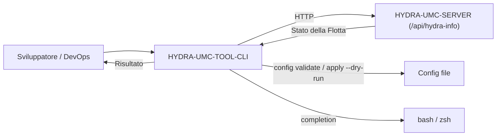

<!-- =============================================================================
HYDRA-UMC-TOOL-CLI - Command-line interface for fleet DevOps
Copyright (C) JuanenRac (Electro Hobby 3D) <electrohobby3d@gmail.com>
GPL-3.0-or-later - see LICENSE
============================================================================= -->

<p align="center">
  
</p>

# 🛠️ HYDRA-UMC-TOOL-CLI

<p align="center"><a href="README.md">🇺🇸 English</a> | <a href="README_spa.md">🇪🇸 Español</a> | <a href="README_fra.md">🇫🇷 Français</a> | 🇮🇹 <b>Italiano</b> | <a href="README_deu.md">🇩🇪 Deutsch</a> | <a href="README_zho.md">🇨🇳 简体中文</a> | <a href="README_jpn.md">🇯🇵 日本語</a> | <a href="README_por.md">🇵🇹 Português</a></p>

### 🛠️ Interfaccia a Riga di Comando per DevOps e Automazione della Flotta

<p align="center">
  
  
  
  
  
  
</p>

---

**Verifica di onestà - cosa funziona davvero oggi:** `version`, `status`, `robots`, `claims`, `claim`, `release`, `limits`, `jog-arm`, `jog`, `table`, `robot`, `audit`, `doctor`, `config validate`, `config apply --dry-run` e la `shell` interattiva (`main.go`, `server.go`, `robots.go`, `control.go`, `doctor.go`, `config.go`, `shell.go`, `exitcode.go`) sono codice Go reale e funzionante, verificato da 219 test superati (`go test ./...`) - veri round-trip `net/http`/`httptest` contro un server fittizio più vere fixture di file di configurazione temporanei, non stub. Questi test simulano un'istanza di HYDRA-UMC-SERVER; `status`, `robots` e `doctor` (login incluso) sono stati eseguiti anche contro un vero processo HYDRA-UMC-SERVER. `config apply` senza `--dry-run` restituisce onestamente il codice di uscita `ExitNotImplemented` invece di simulare un successo, perché l'endpoint di scrittura per la flotta che chiamerebbe non esiste ancora su HYDRA-UMC-SERVER. `deploy`, `flash-all` e `audit` sono pura aspirazione - segnati come "planned" più sotto e completamente assenti da `src/`, nemmeno come funzione stub. Vedi `CHANGELOG.md` per sapere esattamente cosa è stato consegnato finora.

---

> **Stato di sicurezza (safety e security):** questo ecosistema non è un sistema di sicurezza certificato. Non esiste ancora un percorso E-STOP hardware, né limiti o interblocchi imposti dal firmware, né un comando di movimento verificato; le immagini firmware sono controllate con CRC32 e un HMAC-SHA256 a chiave condivisa, non con una firma asimmetrica; TLS e TLS reciproco sono opzionali e disattivati per impostazione predefinita; nessuna scheda propria è stata ancora assemblata o provata. Leggi la [base di sicurezza](https://github.com/JuanenRac/HYDRA-UMC-DOCS/blob/main/docs/SECURITY_BASELINE.md) e il [modello delle minacce](https://github.com/JuanenRac/HYDRA-UMC-DOCS/blob/main/docs/THREAT_MODEL.md) prima di fidarti di qualsiasi affermazione qui per la sicurezza di una persona.

---

## 📋 In breve

| | |
|---|---|
| Versione | `0.1.8` |
| Maturità | Funzionale |
| Test | 219 (`go test ./...`) |
| Tecnologia | Go / standard-library flag handling |
| Destinazione | Il PC di chi lo usa |
| Su hardware reale | Solo simulato: provato con emulatori, test double o simulatori; per questa versione non risulta alcuna esecuzione su hardware reale |

**Vai a:** [Panoramica](#-panoramica) · [Architettura](#-architettura) · [Sicurezza e protezione](#-sicurezza-e-protezione) · [Configurazione](#-configurazione) · [Avvio rapido](#-avvio-rapido) · [Test](#-test) · [Risoluzione dei problemi](#-risoluzione-dei-problemi) · [Struttura del repository](#-struttura-del-repository) · [Progetti correlati](#-progetti-correlati)

## 🚦 Stato del progetto

Ogni riga è una parte di questo repository e il semaforo dice a che punto è oggi. È scritta in base a ciò che il repository può mostrare (test, compilazioni, esecuzioni), non a ciò che è previsto.

🟢 Fatto e verificato · 🟡 Funziona, con limiti noti · 🟠 Fatto a metà o non ancora verificato · 🔴 Non fatto o non funzionante

| Area | Stato | Cosa significa qui |
|---|---|---|
| Software | 🟡 | Funziona per il suo scopo principale; la verifica di onestà qui sopra elenca ciò che manca ancora |
| Test | 🟢 | 219 test automatici, eseguiti a ogni modifica |
| Hardware reale | 🟠 | Solo simulato: provato con emulatori, test double o simulatori; per questa versione non risulta alcuna esecuzione su hardware reale |
| Documentazione | 🟢 | README in otto lingue, verificato rispetto al manifesto a ogni modifica |

## 🎯 Panoramica

**HYDRA-UMC-TOOL-CLI** è il coltellino svizzero per sviluppatori e amministratori di sistema dell'ecosistema HYDRA-UMC. È un singolo binario statico Go che fornisce strumenti a riga di comando per interrogare, aggiornare e verificare i deployment di HYDRA-UMC.

L'obiettivo a lungo termine sono deployment massivi di missioni, aggiornamenti firmware in parallelo (CAN-OTA) e diagnostiche di sistema approfondite direttamente da un terminale o da una pipeline CI/CD. Oggi offre la base reale e funzionante su cui si costruirà tutto il resto: la segnalazione della versione e un client HTTP reale verso HYDRA-UMC-SERVER.

### Caratteristiche Principali:
* 🔏 **Binari di release firmati (`hydra-sign`).** `go run ./src/cmd/hydra-sign sign --key PRIVATA.pem FILE...` scrive `FILE.sha256` (formato `sha256sum`) e `FILE.sig` (Ed25519 sul contenuto del file, in base64); `verify --pub PUBBLICA.pem FILE...` verifica entrambi e richiede solo la chiave pubblica. La chiave privata viene letta solo dal file indicato e non viene mai stampata né copiata; `pubkey --key PRIVATA.pem` stampa la metà pubblica. I test usano chiavi create per loro. Quale chiave firma una release lo decide il processo di pubblicazione. Il processo di pubblicazione firma ogni binario pubblicato con la chiave di release di HYDRA e allega i file `.sha256` e `.sig`; gli script di build impostano la versione dichiarata dal binario a partire dal manifesto del progetto.
* ✅ **`hydra-cli version`** — stampa nome e versione del CLI stesso. *(implementato)*
* ✅ **`hydra-cli status [--server URL] [--config PATH]`** — interroga il `GET /api/hydra-info` di un'istanza attiva di HYDRA-UMC-SERVER e ne stampa l'identità dichiarata. *(implementato)*
* ✅ **`hydra-cli robots [--server URL] [--config PATH] [--json]`** — interroga il `GET /api/settings` di un'istanza attiva di HYDRA-UMC-SERVER e ne stampa l'elenco reale di controller/robot (nome, stato online, modello, ruolo). *(implementato)*
* ✅ **`hydra-cli claims`, `claim <robot>`, `release <robot>`** — elenca chi riserva quale robot (`GET /api/claims`) e riserva o rilascia un robot. La riserva appartiene al tuo account e all'identificativo di controller di questo programma (`--controller-id`, `HYDRA_CLI_CONTROLLER_ID`, predefinito `hydra-cli-<host>`), inviato con ogni richiesta. I rifiuti (altro account, altro controller, identificativo richiesto, jog non armato) sono distinti ed escono con il codice `8`. *(implementato)*
* ✅ **`hydra-cli limits [--robot ID]`, `jog-arm <robot> <on|off>`, `jog <robot> <asse> <valore> [--absolute]`** — legge i limiti di sicurezza tenuti dal server, arma o disarma il jog (serve solo quando il server lo richiede) e muove un asse. Un passo oltre il limite del modello del robot viene rifiutato prima dell'invio, e non si invia nulla se il limite non è leggibile; gli avvisi del server vengono stampati. *(implementato)*
* ✅ **`hydra-cli robot <robot>`, `table <robot> <x> <y> [--rz N] [--relative]`, `audit [--limit N] [--type T] [--robot ID] [--verify] [--export FILE]`** — `robot` legge un robot con la sua revisione; `table` sposta la tavola XY in una sola richiesta atomica (controllata contro i limiti del modello prima dell'invio; il server applica tutto o niente); `audit` (solo amministratori) legge il registro di audit in sola aggiunta, controlla la catena di hash SHA-256 delle righe ricevute (codice di uscita 8 se è interrotta) e, con `--verify`, fa controllare al server l'intero registro; `--export FILE` salva le righe così come sono memorizzate. `claim`, `release`, `jog` e `table` accettano anche `--if-match REVISIONE` (o `current`): il server rifiuta allora la scrittura con codice di uscita 8 se il robot è cambiato da quella revisione, e non viene applicato nulla. Il push WebSocket delle prenotazioni non è usato dalla CLI (esegue un comando ed esce).
* ✅ **`hydra-cli doctor [--server URL] [--config PATH] [--json]`** — diagnostica del contratto del server in sola lettura: convalida `/api/hydra-info` e `/api/settings` e confronta i totali pubblicati di controller/robot con l'elenco. Non invia comandi né sonda hardware. `--json` stampa un report strutturato con un `checkId`/`severity`/`status` per ogni verifica al posto della riga di testo, per gli script (vedi [docs/DOCTOR.md](docs/DOCTOR.md)). *(implementato)*
* 🔐 **Sessioni, credenziali sicure e comandi di flotta:** `login`/`logout` conservano una sessione in un file che solo tu puoi leggere (nessun login a ogni esecuzione); una password o un token vengono rifiutati su http semplice verso un'altra macchina salvo `HYDRA_CLI_ALLOW_INSECURE=1`, e `HYDRA_CLI_CA_FILE` si fida di una CA privata; sono nuovi `scan`, `fleet doctor`, `stop`, `stop-all --yes`, `metrics` e `manifest validate`. Vedi [`docs/CLI_REFERENCE.md`](docs/CLI_REFERENCE.md).
* Ogni testo che arriva da un server e viene stampato (messaggi di errore, nomi, versioni) passa ora anche dalla redazione dei segreti condivisa: un token, un valore `password=` o un'intestazione bearer in una risposta non viene mai ripetuto nel terminale (stessi vettori degli altri progetti).
* ✅ **`hydra-cli completion <bash|zsh>`** — stampa uno script di completamento per la shell. *(implementato)*
* ✅ **Un contratto di exit code reale e stabile** — `0` ok, `1` errore generale, `2` errore d'uso, `3` errore di configurazione, `4` errore di rete, `5` errore del server, `6` non implementato, `7` autenticazione richiesta o rifiutata. Ogni comando classifica i propri fallimenti tramite questo contratto invece di un semplice `exit 1`, così gli script che avvolgono questa CLI possono ramificarsi in base al *perché* è fallito. *(implementato)*
* ✅ **`hydra-cli config validate --config PATH`** — carica e valida secondo schema un file di configurazione locale (URL del server, timeout delle richieste). *(implementato)*
* ✅ **`hydra-cli config apply --config PATH [--dry-run]`** — `--dry-run` dimostra il vero percorso di validazione end-to-end e stampa esattamente cosa invierebbe; senza di esso, restituisce onestamente "non implementato" poiché non esiste ancora un endpoint di scrittura della flotta live. *(implementato, solo dry-run)*
* ✅ **`--config PATH` su `status`/`robots`/`doctor`/`shell`** — lo stesso file validato, con il suo `server`/`timeoutSec`, ora determina realmente l'endpoint HTTP e il timeout di richiesta di ogni comando live, non solo `config validate`/`apply`; `--server` prevale comunque se entrambi sono forniti. *(implementato)*
* ✅ **`hydra-cli shell [--server URL] [--config PATH]`** — una REPL interattiva: esegue ripetutamente uno qualsiasi dei comandi sopra contro lo stesso server senza riavviare il processo. Instrada attraverso la stessa tabella dei comandi usata dalle invocazioni singole, quindi il comportamento della shell e quello singolo non possono mai divergere. `exit`/`quit`/Ctrl-D per uscire. *(implementato)*
* ✅ **`hydra-cli help` / `--help`** — utilizzo completo dei comandi. *(implementato)*
* 🚧 **`hydra-cli deploy`** — carica missioni e configurazioni su una flotta di robot simultaneamente. *(pianificato)*
* 🚧 **`hydra-cli flash-all`** — aggiornamenti firmware in parallelo per controller e teste URTC. *(pianificato)*
* 🚧 **`hydra-cli audit`** — suite diagnostica automatizzata per la salute del bus CAN e la validazione dei sensori. *(pianificato)*

## 🧩 Ruolo in HYDRA-UMC

**HYDRA-UMC-TOOL-CLI** è `hydra-cli`, un unico binario Go senza dipendenze da librerie condivise che parla con `HYDRA-UMC-SERVER`: stato, robot, limiti, un doctor che controlla un server, jog e arresti software, una scansione delle reti private, controlli di flotta, validazione di manifesti e file di configurazione, e una shell interattiva. Contiene anche `hydra-sign`, che firma e verifica i binari di rilascio.

## 🏛️ Architettura

<p align="center">
  
</p>

<details>
<summary>Versione testuale del diagramma (Mermaid)</summary>



</details>

### ARCHITETTURA E DECISIONI DI PROGETTAZIONE

* **Perché `src/` contiene un sotto-percorso `cmd/hydra-cli/`, non un layout piatto.** Segue la convenzione standard Go per le CLI (un entry point `cmd/<nome-binario>/`, con spazio per futuri pacchetti `internal/`/`pkg/` man mano che la CLI cresce oltre un singolo comando) - non un'invenzione di questo ecosistema, la convenzione propria della più ampia comunità Go per le CLI multi-comando.
* **Perché una CLI, e non semplicemente scriptare direttamente l'API REST propria di HYDRA-UMC-SERVER.** Le operazioni su scala flotta (installare/aggiornare su molti CM5, non solo uno) richiedono una vera orchestrazione - retry, parallelismo, una UX coerente - che uno script curl estemporaneo non offre, lo stesso motivo che HYDRA-UMC-UPDATER applica più avanti a livello dell'intero checkout dell'ecosistema.
* **Come si inserisce nel resto dell'ecosistema.** Fa su scala flotta ciò che URTC-FLASHER e URTC-TESTER fanno ciascuno per una singola scheda - gestisce istanze di HYDRA-UMC-SERVER attraverso una flotta invece del firmware proprio di una singola scheda.
* **Perché `robots` legge `GET /api/settings` invece di un nuovo endpoint.** Quell'endpoint porta già l'elenco completo di controller/robot ed è già una lettura reale che richiede un account con accesso effettuato (vedi il proprio `src/server.ts` di HYDRA-UMC-SERVER; la CLI esegue il login con `HYDRA_CLI_USER`/`HYDRA_CLI_PASSWORD` oppure invia `HYDRA_CLI_TOKEN`) - `robots` è un vero client di un contratto già pubblicato, non nuovo lavoro lato server. `doctor` usa questa stessa lettura con `/api/hydra-info` per rilevare totali pubblici incompatibili senza aggiungere un endpoint. I comandi più grandi, ancora pianificati (`deploy`/`flash-all`/`audit` orientato all'hardware), necessitano davvero di nuovi endpoint di scrittura che non esistono ancora.
* **Perché `doctor` è esplicitamente in sola lettura.** Un controllo del contratto è utile prima di disporre dell'hardware e sicuro in CI. Riporta solo coerenza HTTP/JSON/contatori; non comanda apparecchiature né dichiara salute di CAN, attuatori, sensori, camere, Hailo, CM5 o sicurezza.
* **Perché `config apply` senza `--dry-run` restituisce "non implementato" invece di non fare nulla silenziosamente.** L'endpoint di scrittura live su HYDRA-UMC-SERVER che verrebbe chiamato in questo caso davvero non esiste ancora (lo stesso gap su cui sono bloccati `deploy`/`flash-all`) - un exit code distinto, `ExitNotImplemented`, dice a chi chiama "questo è un gap reale, non un bug", invece di un no-op ingannevolmente riuscito.
* **Perché gli errori di ogni comando ora passano attraverso un unico tipo `CliError`/`ExitCode` invece di chiamate ad-hoc a `os.Exit`.** Un contratto di exit code stabile e documentato resta tale solo se esiste un unico punto che assegna i codici - `exitCodeFor()` (`exitcode.go`) è quel punto, e le funzioni dei comandi continuano a restituire valori `error` idiomatici e concatenabili invece di chiamare `os.Exit` da sole.

## 🔒 Sicurezza e protezione

| Minaccia | Difesa | Dove |
|---|---|---|
| Una password o un token lasciati nell'elenco dei processi o nella cronologia della shell | La credenziale viene dall'ambiente (`HYDRA_CLI_TOKEN`, oppure `HYDRA_CLI_USER` e `HYDRA_CLI_PASSWORD`) o da una sessione salvata, mai da un'opzione | `auth.go` |
| Una sessione salvata letta da un altro utente, o scritta a metà | Il file è scritto in uno temporaneo con modo 0600 e rinominato sopra il vecchio, in una cartella creata con modo 0700 | `session.go` |
| Credenziali inviate in chiaro a un'altra macchina | Sono rifiutate su `http://` semplice verso qualsiasi altra macchina salvo `HYDRA_CLI_ALLOW_INSECURE=1`; `HYDRA_CLI_CA_FILE` si fida di un'autorità privata per `https://` | `transport.go` |
| Una scansione che finisce su internet, o uno stop-all per sbaglio | `scan` resta sulle reti private salvo `--allow-public-range` e copre al massimo 1024 indirizzi per impostazione predefinita; `stop-all` richiede `--yes` | `fleet.go`, `emergency.go` |

**Cosa non fa mai:** fare da arresto di emergenza. `stop` e `stop-all` sono comandi software che richiedono server, rete e login; è l'arresto di emergenza fisico della cella a fermare una macchina.

## ⚙️ Configurazione

| Variabile | Predefinito | Cosa imposta |
|---|---|---|
| `HYDRA_CLI_SERVER` / `--server` | `http://localhost:3000` | il server con cui parlare |
| `HYDRA_CLI_TIMEOUT_SEC` / `--timeout` | `5` | secondi concessi a ogni richiesta (da 1 a 3600) |
| `HYDRA_CLI_TOKEN` | nessuno | un token Bearer già emesso dal server |
| `HYDRA_CLI_USER`, `HYDRA_CLI_PASSWORD` | nessuno | la CLI effettua il login per quell'esecuzione; il token vince se sono impostati entrambi |
| `HYDRA_CLI_ALLOW_INSECURE` | `0` | `1` consente le credenziali su http semplice verso un'altra macchina |
| `HYDRA_CLI_CA_FILE` | nessuno | file PEM di un'autorità privata di cui fidarsi per https |

## 🚀 Avvio rapido

Richiede Go 1.24 o successivo.

```bash
./build.sh  # Linux, macOS (build.bat on Windows)
./run.sh status --server http://192.168.1.50:3000
./run.sh doctor
./run.sh config validate --config hydra-cli.json
./run.sh help
```

## 🧪 Test

219 test automatici si eseguono con `cd src && go test ./...`. Non richiedono hardware né nulla al di fuori di questa macchina.

La CI esegue `HYDRA_UMC_CI=1 python tools/ci_validate.py`, che controlla il manifesto, i documenti, gli otto README e le immagini.

## 🏗️ Compilazione e rilascio

Richiede Go >= 1.24.

```bash
# Linux/macOS
./build.sh
./run.sh version
./run.sh status --server http://localhost:3000
./run.sh robots --server http://localhost:3000
./run.sh doctor --server http://localhost:3000
./run.sh config validate --config ./hydra-cli.json
./run.sh config apply --config ./hydra-cli.json --dry-run
echo $?   # 0=ok 2=uso 3=config 4=rete 5=server 6=non-implementato 7=autenticazione

# Windows
build.bat
run.bat version
run.bat status --server http://localhost:3000
run.bat robots --server http://localhost:3000
run.bat doctor --server http://localhost:3000
run.bat config validate --config .\hydra-cli.json
run.bat config apply --config .\hydra-cli.json --dry-run
```

`robots` e `doctor` leggono `/api/settings`, che HYDRA-UMC-SERVER dà solo a un account con accesso effettuato (un amministratore vede le impostazioni complete, gli altri ruoli una copia con i segreti oscurati). Dia alla CLI una credenziale tramite l'ambiente - mai con un'opzione, così resta fuori dall'elenco dei processi e dalla cronologia della shell: `HYDRA_CLI_TOKEN` (un token Bearer già emesso dal server), oppure `HYDRA_CLI_USER` e `HYDRA_CLI_PASSWORD` (la CLI esegue il login con `POST /api/login` per quell'esecuzione; se ci sono entrambi, vince il token). Senza nessuna, il comando termina con il codice `7` e indica quali variabili impostare. `status` e la prima richiesta di `doctor` usano il pubblico `/api/hydra-info` e non inviano mai la credenziale. Una risposta viene letta fino a 4 MiB.

`build` non cambia mai la versione (solo `python tools/hydra_project_tool.py bump` la alza), esegue la vera suite di test (`go vet` + `go test`), compila il modulo Go in `src/` in `build/hydra-cli(.exe)` ed esegue `version` una volta per verificare - poi compila in modo incrociato una release reale per linux/amd64, linux/arm64 (l'architettura propria della CM5), windows/amd64, darwin/amd64 e darwin/arm64 in build/release/, con un vero file di checksum SHA256SUMS. `run` riesegue il binario compilato, inoltrando tutti gli argomenti — prova `run doctor` contro un'istanza `HYDRA-UMC-SERVER` in esecuzione. Doctor è un controllo sicuro e in sola lettura dei contratti endpoint; vedi [docs/DOCTOR.md](docs/DOCTOR.md).

## 🩺 Risoluzione dei problemi

| Vedi | Perché | Fai |
|---|---|---|
| exit code 7 | Il comando richiede un login e non è stata data alcuna credenziale, oppure il server l'ha rifiutata | Imposta `HYDRA_CLI_TOKEN`, oppure `HYDRA_CLI_USER` e `HYDRA_CLI_PASSWORD`, oppure esegui `login` |
| exit code 4 | Non è stato possibile raggiungere il server | Controlla l'indirizzo (`--server`, file di configurazione, `HYDRA_CLI_SERVER`) ed esegui `doctor` |
| exit code 2 | Comando sconosciuto, argomento mancante od opzione senza valore | Esegui `help`; nulla viene ignorato in silenzio |

## 📂 Struttura del repository

<p align="center">
  
</p>

<details>
<summary>Versione testuale dell'albero</summary>

```text
HYDRA-UMC-TOOL-CLI/
├── tools/                      codice sorgente
│   ├── build_test.py           Controllo build senza versionamento
│   ├── ci_validate.py          Validazione manifest/CHANGELOG/docs usata dalla CI
│   ├── _doc_policy.py          Regole di documentazione condivise dalla famiglia (copia di quella di HYDRA-UMC-SDK, mantenuta sincronizzata)
│   ├── _readme_parity.py       Verifica che gli otto README abbiano la stessa struttura (copia di quella di HYDRA-UMC-SDK, mantenuta sincronizzata)
│   └── hydra_project_tool.py   Gli stessi comandi in ogni repository: validate, test, ci, version, status, bump
├── src/                        Modulo Go
├── docs/                       Documentazione: CLI_REFERENCE.md e DOCTOR.md
├── images/                     Media e diagrammi
├── .github/                    workflow di CI e modelli di segnalazione
├── bump_version.py             Incremento di versione stile contachilometri (eseguito solo dal comando `bump` esplicito)
├── bump_manifest_version.py    Sincronizza la versione di hydra-umc.project.json con quella nativa (--sync)
├── build.sh / build.bat        Valida e compila (compilare non cambia mai la versione)
├── run.sh / run.bat            Esecuzione reale: avvia il binario compilato
├── CHANGELOG.md                cosa è cambiato in ogni versione
├── build-test.sh               controllo di build senza modifiche
├── hydra-umc.project.json      manifesto: versione, maturità, famiglia
└── test.sh                     esegue i test
```

</details>

## 🗺️ Roadmap e limiti noti

`deploy`, `flash-all` e `audit` non sono ancora realizzati: ciascuno richiede su `HYDRA-UMC-SERVER` un endpoint di scrittura di flotta, over-the-air o audit che non esiste. `config apply` senza `--dry-run` è il segnaposto onesto della stessa lacuna e risponde con il codice di uscita 6.

## 🌍 Lingue

Questo README e i documenti del repository esistono in otto lingue: inglese, spagnolo, tedesco, francese, italiano, giapponese, cinese e portoghese (Portogallo). Sono scritti insieme e la CI verifica che gli otto file abbiano le stesse sezioni e gli stessi link. Questo repository non ha uno schermo né un catalogo di messaggi propri, quindi non ci sono stringhe di interfaccia da tradurre.

## 🔗 Progetti correlati

Questo progetto fa parte dell'ecosistema robotico HYDRA-UMC dello stesso autore (JuanenRac / Electro Hobby 3D). Vale la pena conoscerlo, poiché una richiesta potrebbe in realtà riguardare uno di questi invece di questo repository.

**Direttamente Correlati**
- **[HYDRA-UMC-SERVER](https://github.com/JuanenRac/HYDRA-UMC-SERVER)** — il vero backend headless (REST/WebSocket) con cui parla davvero ogni client di controllo — il backend che questa CLI gestisce su scala di flotta.
- **[URTC-FLASHER](https://github.com/JuanenRac/URTC-FLASHER)** — strumento desktop con GUI per il flashing delle schede URTC, CAN-OTA più SWD/JTAG a chip intero — il deploy CAN-OTA a scala di flotta pianificato di questo strumento fa per molte schede ciò che URTC-FLASHER fa per una sola.
- **[URTC-TESTER](https://github.com/JuanenRac/URTC-TESTER)** — strumento desktop di diagnostica CAN-bus dal vivo per schede URTC, un pannello per profilo utensile — la diagnostica a scala di flotta pianificata di questo strumento fa per molte schede ciò che URTC-TESTER fa per una sola.

**Fa Anche Parte dell'Ecosistema**

*Hardware e Piattaforma di Base*
- **[HYDRA-UMC](https://github.com/JuanenRac/HYDRA-UMC)** — il progetto della scheda madre del braccio robotico: host CM5 + coprocessore STM32H745 dual-core, pensato per coordinare fino a 8 bracci utensile via CAN-OTA/SPI-OTA (firmware in fase iniziale; nessuna scheda assemblata per ora).
- **[HYDRA-UMC-OS](https://github.com/JuanenRac/HYDRA-UMC-OS)** — livello prodotto riproducibile su Raspberry Pi OS per il CM5: agente in sola lettura, config/profili validati, provisioning WiFi al primo contatto.
- **[HYDRA-UMC-SDK](https://github.com/JuanenRac/HYDRA-UMC-SDK)** — il contratto JSON-Schema condiviso e la barriera software di controllo dei job contro cui ogni bridge valida i propri comandi (non è una funzione di sicurezza certificata).
- **[HYDRA-UMC-CONNECTOR-HUB](https://github.com/JuanenRac/HYDRA-UMC-CONNECTOR-HUB)** — registro dichiarativo e validatore di manifesti adattatore per connettori di macchine esterne; estende la propria idea di contratto dell'SDK alle macchine esterne senza sostituire i progetti di gateway industriale.

*Backend Centrale e Client*
- **[HYDRA-UMC-STUDIO](https://github.com/JuanenRac/HYDRA-UMC-STUDIO)** — dashboard di controllo web con visualizzazione 3D multi-robot in tempo reale.
- **[HYDRA-UMC-SUITE](https://github.com/JuanenRac/HYDRA-UMC-SUITE)** — centro di comando sciame desktop (PySide6) per più server contemporaneamente, pacchettizzato come eseguibile standalone.
- **[HYDRA-UMC-ANDROID-CONTROL](https://github.com/JuanenRac/HYDRA-UMC-ANDROID-CONTROL)** — app di controllo nativa per Android con login biometrico e un companion Wear OS abbinato.
- **[HYDRA-UMC-IOS-CONTROL](https://github.com/JuanenRac/HYDRA-UMC-IOS-CONTROL)** — app di controllo per iOS/iPadOS (Flutter) con sincronizzazione WebSocket in tempo reale.
- **[HYDRA-UMC-DSI](https://github.com/JuanenRac/HYDRA-UMC-DSI)** — interfaccia touch nativa per il touchscreen DSI da 7" a bordo, incorporata direttamente nel CM5.
- **[HYDRA-UMC-EDITOR-URDF](https://github.com/JuanenRac/HYDRA-UMC-EDITOR-URDF)** — creatore/editor grafico desktop di URDF che invia i modelli finiti al catalogo di STUDIO.
- **[HYDRA-UMC-EDITOR-STL](https://github.com/JuanenRac/HYDRA-UMC-EDITOR-STL)** — editor desktop di modelli STL, che trasforma/sostituisce/rimuove/aggiunge veri pezzi nello stesso catalogo di modelli modificato anche da HYDRA-UMC-EDITOR-URDF.
- **[HYDRA-UMC-BRIDGE-AMR](https://github.com/JuanenRac/HYDRA-UMC-BRIDGE-AMR)** — barriera di coordinamento per flotte AGV/AMR tramite un publisher MQTT VDA 5050 (testato solo contro una flotta emulata).
- **[HYDRA-UMC-BRIDGE-CNC](https://github.com/JuanenRac/HYDRA-UMC-BRIDGE-CNC)** — coordinatore ad alto livello per celle CNC con accesso a stato/byte di controllo GRBL (testato solo contro un emulatore).
- **[HYDRA-UMC-BRIDGE-DROIDS](https://github.com/JuanenRac/HYDRA-UMC-BRIDGE-DROIDS)** — barriera di coordinamento per droidi con zampe/umanoidi, con un mittente di comandi per Boston Dynamics Spot (testato solo contro un emulatore).
- **[HYDRA-UMC-BRIDGE-LASER](https://github.com/JuanenRac/HYDRA-UMC-BRIDGE-LASER)** — coordinatore per celle laser che legge 3 segnali GPIO di chiave/involucro/interblocco (testato solo contro un chip simulato; non può armare né far partire un laser).
- **[HYDRA-UMC-BRIDGE-OPENPNP](https://github.com/JuanenRac/HYDRA-UMC-BRIDGE-OPENPNP)** — coordinatore ad alto livello sicuro per il flusso schede del pick-and-place OpenPnP.
- **[HYDRA-UMC-BRIDGE-PRINTER3D](https://github.com/JuanenRac/HYDRA-UMC-BRIDGE-PRINTER3D)** — barriera di coordinamento sicura per stampanti 3D Moonraker/Klipper, con comandi di lavoro reali e controllati.
- **[HYDRA-UMC-BRIDGE-ROS2](https://github.com/JuanenRac/HYDRA-UMC-BRIDGE-ROS2)** — coordinatore con un trasporto ROS 2 rclpy importato in modo lazy (non ancora eseguito contro un'installazione ROS 2).
- **[HYDRA-UMC-BRIDGE-UAV](https://github.com/JuanenRac/HYDRA-UMC-BRIDGE-UAV)** — barriera di coordinamento per UAV dotati di fotocamera, con un mittente di comandi MAVLink (testato solo contro un emulatore).

*Piattaforma Strumenti URTC*
- **[URTC](https://github.com/JuanenRac/URTC)** — firmware per la scheda fisica dell'Universal Robot Tool Controller, oltre 25 profili utensile su bus CAN.
- **[URTC-WEB-STUDIO](https://github.com/JuanenRac/URTC-WEB-STUDIO)** — alternativa basata su browser a URTC-TESTER tramite la Web Serial API, senza installazione locale.
- **[URTC-GATEWAY](https://github.com/JuanenRac/URTC-GATEWAY)** — gateway davanti al bus CAN di URTC: elenco di identificatori consentiti, limite di frequenza e chiave di sessione; software provato su computer, non ancora su un bus reale.

*Nodo IA Visione (Hailo-8)*
- **[HYDRA-UMC-VISION-NODE](https://github.com/JuanenRac/HYDRA-UMC-VISION-NODE)** — hub di integrazione per la pipeline di visione Hailo-8, con un vero controllo di prontezza hardware per fase.
- **[HYDRA-UMC-DETECTION-HEF](https://github.com/JuanenRac/HYDRA-UMC-DETECTION-HEF)** — registro reale di modelli compilati con verifica di caricamento sicuro per architettura Hailo/checksum.
- **[HYDRA-UMC-VISION-STREAMER](https://github.com/JuanenRac/HYDRA-UMC-VISION-STREAMER)** — generatore reale di pipeline GStreamer + config MediaMTX, con una vera barriera di integrazione HailoRT.
- **[HYDRA-UMC-VISUAL-SERVOING-API](https://github.com/JuanenRac/HYDRA-UMC-VISUAL-SERVOING-API)** — legge di correzione Position-Based Visual Servoing con autorizzazione condizionata allo stato di zona; ancora nessuna stima di posa da telecamera.
- **[HYDRA-UMC-SAFETY-ZONES](https://github.com/JuanenRac/HYDRA-UMC-SAFETY-ZONES)** — logica v0 di violazione zona, freschezza di calibrazione e richiesta E-STOP che legge le posizioni degli oggetti da un file; nessun rilevatore la alimenta e nessun E-STOP fisico è ancora collegato.

*Nodo IA Cognitivo (Hailo-10)*
- **[HYDRA-UMC-COGNITIVE-NODE](https://github.com/JuanenRac/HYDRA-UMC-COGNITIVE-NODE)** — hub di integrazione per la pipeline cognitiva Hailo-10 (orchestrazione LLM/VLA/voce).
- **[HYDRA-UMC-VLA-ENGINE](https://github.com/JuanenRac/HYDRA-UMC-VLA-ENGINE)** — vera codifica/decodifica di token d'azione e generazione di traiettoria per un modello Vision-Language-Action.
- **[HYDRA-UMC-VOICE-UI](https://github.com/JuanenRac/HYDRA-UMC-VOICE-UI)** — vero front-end vocale (VAD + parser di intenti) con un relay verso Watch limitato e soggetto a conferma.
- **[HYDRA-UMC-SEMANTIC-PLANNER](https://github.com/JuanenRac/HYDRA-UMC-SEMANTIC-PLANNER)** — vera scomposizione dei task basata su regole e recupero semantico degli errori sui codici errore MCU.
- **[HYDRA-UMC-DOCS-QA](https://github.com/JuanenRac/HYDRA-UMC-DOCS-QA)** — vera ricerca documentale TF-IDF (solo libreria standard) sui documenti Markdown di questo ecosistema.
- **[HYDRA-UMC-LOCAL-TECHNICIAN](https://github.com/JuanenRac/HYDRA-UMC-LOCAL-TECHNICIAN)** — tecnico di manutenzione IA locale e con cancelli di policy per l'ecosistema stesso - osserva, diagnostica e propone correzioni; i due livelli di rischio più alti non sono deliberatamente ancora implementati.

*Orchestrazione e Sciame*
- **[HYDRA-UMC-ORCHESTRATOR](https://github.com/JuanenRac/HYDRA-UMC-ORCHESTRATOR)** — hub di integrazione con un vero contratto di health-report gRPC/Protobuf e una macchina a stati di missione.
- **[HYDRA-UMC-JOB-DISPATCHER](https://github.com/JuanenRac/HYDRA-UMC-JOB-DISPATCHER)** — vera coda di lavori basata su priorità con deduplicazione, su una vera API HTTP.
- **[HYDRA-UMC-NODE-HEALING](https://github.com/JuanenRac/HYDRA-UMC-NODE-HEALING)** — vero watchdog di salute della flotta basato su gRPC, con retry/backoff e rilevamento di discrepanza d'identità.
- **[HYDRA-UMC-PATH-PLANNER-3D](https://github.com/JuanenRac/HYDRA-UMC-PATH-PLANNER-3D)** — vero pianificatore di percorsi 3D basato su RRT, con vera validazione delle collisioni ostacolo/spazio di lavoro.
- **[HYDRA-UMC-SWARM-SYNC](https://github.com/JuanenRac/HYDRA-UMC-SWARM-SYNC)** — vera sincronizzazione di stato CRDT LWW-Element-Map, con property test per la convergenza multi-cella.

*Gemello Digitale e Simulazione*
- **[HYDRA-UMC-TWIN](https://github.com/JuanenRac/HYDRA-UMC-TWIN)** — hub di integrazione per il motore di gemello digitale, con un vero contratto di sincronizzazione per compatibilità di versione.
- **[HYDRA-UMC-HIL-BRIDGE](https://github.com/JuanenRac/HYDRA-UMC-HIL-BRIDGE)** — router hardware-in-the-loop con un interblocco software di collisione tra simulazione e hardware reale (testato senza hardware reale).
- **[HYDRA-UMC-PHYSICS-REPLICA](https://github.com/JuanenRac/HYDRA-UMC-PHYSICS-REPLICA)** — vera cinematica diretta e validazione dei limiti articolari su un vero sottoinsieme URDF.
- **[HYDRA-UMC-SYNTHETIC-DATA-GEN](https://github.com/JuanenRac/HYDRA-UMC-SYNTHETIC-DATA-GEN)** — vero generatore procedurale di scene 2D con esportazione di annotazioni YOLO/COCO.

*Dati e Analisi*
- **[HYDRA-UMC-DATALAKE](https://github.com/JuanenRac/HYDRA-UMC-DATALAKE)** — vero archivio di serie temporali basato su sqlite3, con una vera API HTTP di ingestione/query.
- **[HYDRA-UMC-ANOMALY-DETECTOR](https://github.com/JuanenRac/HYDRA-UMC-ANOMALY-DETECTOR)** — vero rilevatore di anomalie FFT + baseline statistica, con monitoraggio della deriva.
- **[HYDRA-UMC-PRODUCTION-REPORTS](https://github.com/JuanenRac/HYDRA-UMC-PRODUCTION-REPORTS)** — vero calcolo OEE/disponibilità sullo storico di DATALAKE, con esportazione CSV riproducibile.
- **[HYDRA-UMC-TELEMETRY-COLLECTOR](https://github.com/JuanenRac/HYDRA-UMC-TELEMETRY-COLLECTOR)** — vera pipeline di ingestione CAN/WebSocket verso DATALAKE, con deduplicazione per sequenza.

*Gateway Industriale*
- **[HYDRA-UMC-GATEWAY-INDUSTRIAL](https://github.com/JuanenRac/HYDRA-UMC-GATEWAY-INDUSTRIAL)** — hub di integrazione che inoltra ai protocolli industriali, con un vero livello di allowlist dei comandi/backpressure.
- **[HYDRA-UMC-OPCUA-SERVER](https://github.com/JuanenRac/HYDRA-UMC-OPCUA-SERVER)** — vero spazio di indirizzi OPC-UA, verificato con una vera sessione client del protocollo binario.
- **[HYDRA-UMC-MQTT-BROKER](https://github.com/JuanenRac/HYDRA-UMC-MQTT-BROKER)** — vero broker MQTT con autenticazione opzionale per client e ACL sui topic.
- **[HYDRA-UMC-MTCONNECT-ADAPTER](https://github.com/JuanenRac/HYDRA-UMC-MTCONNECT-ADAPTER)** — veri endpoint XML `/probe` e `/current` di MTConnect, con output in modalità degradata.

*Strumenti Complementari e Operazioni dell'Ecosistema*
- **[HYDRA-UMC-DASHBOARD-AI](https://github.com/JuanenRac/HYDRA-UMC-DASHBOARD-AI)** — pannelli Smart Summaries e Anomaly Highlighting su DATALAKE/ANOMALY-DETECTOR, con un fallback statistico onesto.
- **[HYDRA-UMC-WATCH](https://github.com/JuanenRac/HYDRA-UMC-WATCH)** — app companion WearOS con schemi di avviso aptico e un relay vocale verso il telefono abbinato (non ancora eseguita su un orologio fisico).
- **[URTC-SMART-RACK](https://github.com/JuanenRac/URTC-SMART-RACK)** — firmware per un rack di montaggio schede con decodifica reale dell'ID utensile e logica di preriscaldamento Smart Idle.
- **[URTC-VISION-TOOL](https://github.com/JuanenRac/URTC-VISION-TOOL)** — firmware più un vero companion di visione Python per una testa utensile di ispezione termica/RGB.
- **[HYDRA-UMC-UPDATER](https://github.com/JuanenRac/HYDRA-UMC-UPDATER)** — strumento amministrativo desktop che scopre, clona e aggiorna ogni repository di questo ecosistema.
- **[HYDRA-UMC-OS-REBUILDER](https://github.com/JuanenRac/HYDRA-UMC-OS-REBUILDER)** — strumento desktop Windows/Linux che costruisce un'immagine della CM5 pronta da scrivere, precaricata con le versioni più aggiornate dell'ecosistema, con configurazione di primo avvio Wi-Fi/utente/SSH in stile Raspberry Pi Imager.
- **[HYDRA-UMC-OPS-AGENT](https://github.com/JuanenRac/HYDRA-UMC-OPS-AGENT)** — coordinatore di incidenti di manutenzione: un ruolo edge a basso privilegio raccoglie uno snapshot di inventario/salute sanificato, un ruolo control-plane lo rende in sola lettura e chiede a un provider di IA di suggerire una diagnosi - non applica mai una patch né distribuisce nulla.
- **[HYDRA-UMC-DEV-SERVER](https://github.com/JuanenRac/HYDRA-UMC-DEV-SERVER)** — host di sviluppo riproducibile (Raspberry Pi 5 / CM5) che conserva il codice sorgente dell'ecosistema ed esegue attività delimitate di build/test tramite una coda durevole; un ruolo di sviluppo dedicato, esplicitamente distinto da un CM5 operativo.

## 📚 Documentazione

Dove leggere di più:

* [Base di sicurezza dell'ecosistema](https://github.com/JuanenRac/HYDRA-UMC-DOCS/blob/main/docs/SECURITY_BASELINE.md)
* [Modello delle minacce dell'ecosistema](https://github.com/JuanenRac/HYDRA-UMC-DOCS/blob/main/docs/THREAT_MODEL.md)
* [Registro delle modifiche di questo repository](CHANGELOG.md)
* [Licenza di questo repository](LICENSE.md)

## 🤝 Contribuire e comunità

* Prima di una pull request esegui `HYDRA_UMC_CI=1 py -3 tools/ci_validate.py` (oppure `HYDRA_UMC_CI=1 python3 tools/ci_validate.py`): deve stampare `CI_VALIDATION=PASS`. Non eseguire `build.sh` né `build.bat` per questa verifica; compilare non è verificare.
* I otto README sono scritti da un'unica fonte in HYDRA-UMC-DOCS; non modificarli a mano. Cambia la fonte e riscrivili con `tools/make_readmes.py`.
* Non affermare in un README ciò che non è stato eseguito: scrivi «simulato» o «non provato su hardware» quando è la verità.
* Vedi [CONTRIBUTING.md](CONTRIBUTING.md), il [codice di condotta](CODE_OF_CONDUCT.md), [SECURITY.md](SECURITY.md) e [SUPPORT.md](SUPPORT.md).

## 👤 AUTORE

**JuanenRac (Electro Hobby 3D)** · electrohobby3d@gmail.com

## 📜 LICENZA

GPL-3.0-or-later - [LICENSE](LICENSE).
