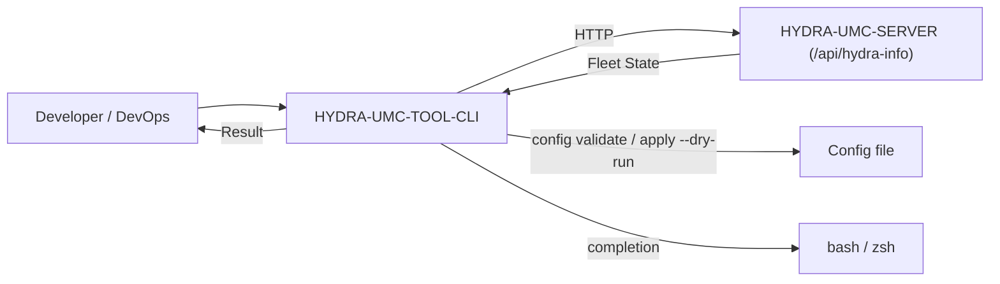

<p align="center">
  
</p>

# 💻 HYDRA-UMC-TOOL-CLI

<p align="center"><a href="README.md">🇺🇸 English</a> | <a href="README_spa.md">🇪🇸 Español</a> | <a href="README_fra.md">🇫🇷 Français</a> | <a href="README_ita.md">🇮🇹 Italiano</a> | <a href="README_deu.md">🇩🇪 Deutsch</a> | <a href="README_zho.md">🇨🇳 简体中文</a> | <a href="README_jpn.md">🇯🇵 日本語</a> | 🇵🇹 <b>Português</b></p>

### 🛠️ Interface de linha de comandos para DevOps e automação de frotas

<p align="center">
  
  
  
</p>

---

**Verificação de honestidade - o que realmente funciona hoje:** `version`, `status`, `robots`, `claims`, `claim`, `release`, `limits`, `jog-arm`, `jog`, `table`, `robot`, `audit`, `doctor`, `config validate`, `config apply --dry-run` e o `shell` interativo (`main.go`, `server.go`, `robots.go`, `control.go`, `doctor.go`, `config.go`, `shell.go`, `exitcode.go`) são código Go real e funcional, exercitado por 127 testes a passar (`go test ./...`) - idas e voltas reais com `net/http`/`httptest` contra um servidor simulado, mais ficheiros de configuração temporários reais como dados de teste, não stubs. Esses testes simulam uma instância do HYDRA-UMC-SERVER; `status`, `robots` e `doctor` (com o início de sessão incluído) também foram executados contra um processo real do HYDRA-UMC-SERVER. O `config apply` sem `--dry-run` devolve honestamente o código de saída `ExitNotImplemented` em vez de fingir êxito, porque o endpoint de escrita na frota que chamaria ainda não existe no HYDRA-UMC-SERVER. `deploy`, `flash-all` e `audit` são pura aspiração - marcados como "planeados" abaixo e ausentes por completo do `src/`, nem sequer uma função esboço. Veja o `CHANGELOG.md` para saber exatamente o que foi entregue até agora.

---

> **Estado de segurança (safety e security):** este ecossistema não é um sistema de segurança certificado. Ainda não existe um caminho de E-STOP por hardware, nem limites ou interlocks impostos pelo firmware, nem um comando de movimento verificado; as imagens de firmware são verificadas com CRC32 e um HMAC-SHA256 de chave partilhada, não com uma assinatura assimétrica; TLS e TLS mútuo são opcionais e estão desativados por defeito; nenhuma placa própria foi ainda montada ou testada. Leia a [base de segurança](https://github.com/JuanenRac/HYDRA-UMC-DOCS/blob/main/docs/SECURITY_BASELINE.md) e o [modelo de ameaças](https://github.com/JuanenRac/HYDRA-UMC-DOCS/blob/main/docs/THREAT_MODEL.md) antes de confiar em qualquer afirmação aqui para a segurança de uma pessoa.

## 📋 Num relance

| | |
|---|---|
| Versão | `0.1.8` |
| Maturidade | Funcional |
| Testes | 132 (`go test ./...`) |
| Tecnologia | Go / standard-library flag handling |
| Destino | O PC de quem o usa |
| Em hardware real | Só simulado: testado com emuladores, dublês de teste ou simuladores; não há registo de execução em hardware real para esta versão |

## 1. 🛠️ VISÃO TÉCNICA GERAL

O **HYDRA-UMC-TOOL-CLI** é o canivete suíço para programadores e administradores de sistemas do ecossistema HYDRA-UMC. É um único binário Go estático que fornece ferramentas de linha de comandos para consultar, atualizar e auditar implementações do HYDRA-UMC.

O objetivo a longo prazo são implementações massivas de missões, atualizações paralelas de firmware (CAN-OTA) e diagnósticos profundos do sistema diretamente a partir de um terminal ou de um pipeline de CI/CD. Hoje entrega a base real e funcional sobre a qual tudo o resto se constrói: a indicação da versão e um cliente HTTP em direto contra o HYDRA-UMC-SERVER.

### Funcionalidades principais:
* 🔏 **Binários de release assinados (`hydra-sign`).** `go run ./src/cmd/hydra-sign sign --key PRIVADA.pem FICHEIRO...` escreve `FICHEIRO.sha256` (formato `sha256sum`) e `FICHEIRO.sig` (Ed25519 sobre o conteúdo do ficheiro, em base64); `verify --pub PUBLICA.pem FICHEIRO...` verifica ambos e só precisa da chave pública. A chave privada só é lida do ficheiro indicado e nunca é impressa nem copiada; `pubkey --key PRIVADA.pem` imprime a metade pública. Os testes usam chaves feitas para eles. A chave que assina uma release é uma escolha do processo de publicação. O processo de publicação assina cada binário publicado com a chave de releases da HYDRA e anexa os ficheiros `.sha256` e `.sig`; os scripts de compilação definem a versão que o binário indica a partir do manifesto do projeto.
* ✅ **`hydra-cli version`** — imprime o nome e a versão da própria CLI. *(implementado)*
* ✅ **`hydra-cli status [--server URL] [--config PATH]`** — consulta o `GET /api/hydra-info` de um HYDRA-UMC-SERVER em direto e imprime a identidade que ele reporta. *(implementado)*
* ✅ **`hydra-cli robots [--server URL] [--config PATH] [--json]`** — consulta o `GET /api/settings` de um HYDRA-UMC-SERVER em direto e imprime a sua lista real de controladores/robôs (nome, estado ligado, modelo, papel). *(implementado)*
* ✅ **`hydra-cli claims`, `claim <robot>`, `release <robot>`** — lista quem reserva que robô (`GET /api/claims`) e reserva ou liberta um robô. A reserva pertence à tua conta e ao identificador de controlador deste programa (`--controller-id`, `HYDRA_CLI_CONTROLLER_ID`, por omissão `hydra-cli-<host>`), enviado em cada pedido. As recusas (outra conta, outro controlador, identificador obrigatório, jog não armado) distinguem-se e terminam com o código `8`. *(implementado)*
* ✅ **`hydra-cli limits [--robot ID]`, `jog-arm <robot> <on|off>`, `jog <robot> <eixo> <valor> [--absolute]`** — lê os limites de segurança guardados pelo servidor, arma ou desarma o jog (só é preciso quando o servidor o exige) e move um eixo. Um passo acima do limite do modelo do robô é recusado antes de ser enviado, e não se envia nada se o limite não puder ser lido; os avisos do servidor são mostrados. *(implementado)*
* ✅ **`hydra-cli robot <robô>`, `table <robô> <x> <y> [--rz N] [--relative]`, `audit [--limit N] [--type T] [--robot ID] [--verify] [--export FICHEIRO]`** — `robot` lê um robô com a sua revisão; `table` move a mesa XY num único pedido atómico (verificado contra os limites do modelo antes de ser enviado; o servidor aplica tudo ou nada); `audit` (só administradores) lê o registo de auditoria só de acrescentar, verifica a cadeia de hashes SHA-256 das linhas recebidas (código de saída 8 se estiver quebrada) e, com `--verify`, faz o servidor verificar o registo inteiro; `--export FICHEIRO` guarda as linhas tal como estão armazenadas. `claim`, `release`, `jog` e `table` aceitam também `--if-match REVISÃO` (ou `current`): o servidor recusa então a escrita com código de saída 8 se o robô mudou desde essa revisão, e nada é aplicado. O envio de reservas por WebSocket não é usado pela CLI (executa um comando e termina).
* ✅ **`hydra-cli doctor [--server URL] [--config PATH] [--json]`** — diagnóstico só de leitura do contrato do Servidor: valida `/api/hydra-info` e `/api/settings` e depois verifica os totais publicados de controladores/robôs contra a lista de definições. Nunca envia comandos nem sonda hardware. O `--json` imprime um relatório estruturado com um `checkId`/`severity`/`status` por verificação em vez da linha de texto simples, para scripts (veja [docs/DOCTOR.md](docs/DOCTOR.md)). *(implementado)*
* 🔐 **Sessões, credenciais seguras e comandos de frota:** `login`/`logout` guardam uma sessão num ficheiro que só tu podes ler (sem login em cada execução); uma palavra-passe ou um token são recusados por http simples para outra máquina, exceto com `HYDRA_CLI_ALLOW_INSECURE=1`, e `HYDRA_CLI_CA_FILE` confia numa CA privada; `scan`, `fleet doctor`, `stop`, `stop-all --yes`, `metrics` e `manifest validate` são novos. Ver [`docs/CLI_REFERENCE.md`](docs/CLI_REFERENCE.md).
* Todo o texto que vem de um servidor e é impresso (mensagens de erro, nomes, versões) passa também pela redação de segredos partilhada, pelo que um token, um valor de `password=` ou um cabeçalho bearer numa resposta nunca é repetido no terminal (os mesmos vetores dos outros projetos).
* ✅ **`hydra-cli completion <bash|zsh>`** — imprime um script de autocompletação para a shell. *(implementado)*
* ✅ **Um contrato real e estável de códigos de saída** — `0` ok, `1` erro geral, `2` erro de utilização, `3` erro de configuração, `4` erro de rede, `5` erro do servidor, `6` não implementado, `7` autenticação exigida ou recusada. Cada comando classifica as suas próprias falhas através deste contrato em vez de um simples `exit 1`, para que os scripts que envolvem esta CLI possam ramificar consoante o *porquê* da falha. *(implementado)*
* ✅ **`hydra-cli config validate --config PATH`** — carrega e valida segundo o esquema um ficheiro de configuração local (URL do servidor, tempo limite dos pedidos). *(implementado)*
* ✅ **`hydra-cli config apply --config PATH [--dry-run]`** — o `--dry-run` prova o caminho de validação real de ponta a ponta e imprime exatamente o que enviaria; sem ele, devolve honestamente "não implementado", já que ainda não existe um endpoint real de escrita na frota. *(implementado, só dry-run)*
* ✅ **`--config PATH` em `status`/`robots`/`doctor`/`shell`** — o `server`/`timeoutSec` do mesmo ficheiro validado determina agora realmente o destino HTTP e o tempo limite dos pedidos de cada comando em direto, e não apenas o `config validate`/`apply`; o `--server` continua a prevalecer quando ambos são indicados. *(implementado)*
* ✅ **`hydra-cli shell [--server URL] [--config PATH]`** — um REPL interativo: execute qualquer comando acima repetidamente contra o mesmo servidor sem reiniciar o processo. Despacha pela mesma tabela de comandos que as invocações de uma só vez usam, pelo que o comportamento do shell e o de uma só vez nunca divergem. `exit`/`quit`/Ctrl-D para sair. *(implementado)*
* ✅ **`hydra-cli help` / `--help`** — utilização completa dos comandos. *(implementado)*
* 🚧 **`hydra-cli deploy`** — envia missões e configurações para uma frota de robôs em simultâneo. *(planeado)*
* 🚧 **`hydra-cli flash-all`** — atualizações paralelas de firmware para controladores e cabeças URTC. *(planeado)*
* 🚧 **`hydra-cli audit`** — conjunto de diagnóstico automatizado para a saúde do barramento CAN e a validação de sensores. *(planeado)*

---

## 2. 🔄 FLUXO DA CLI



---

## 3. 🧱 ARQUITETURA E DECISÕES DE DESENHO

* **Porque é que `src/` tem um subcaminho `cmd/hydra-cli/` e não uma estrutura plana.** Segue a convenção padrão das CLIs em Go (um ponto de entrada `cmd/<nome-do-binário>/`, com espaço para futuros pacotes `internal/`/`pkg/` à medida que a CLI cresce para lá de um único comando) - não é uma invenção deste ecossistema, é a própria convenção da comunidade Go mais ampla para CLIs com vários comandos.
* **Porque uma CLI e não apenas scripts diretos sobre a API REST do próprio HYDRA-UMC-SERVER.** As operações à escala da frota (instalar/atualizar em muitos CM5 e não apenas num) precisam de uma orquestração real - repetições, paralelismo, uma experiência coerente - que um script curl avulso não oferece, o mesmo raciocínio que o HYDRA-UMC-UPDATER aplica mais tarde ao nível das cópias de trabalho do ecossistema.
* **Porque o `robots` lê o `GET /api/settings` e não um endpoint novo.** Esse endpoint já transporta a lista completa de controladores/robôs e já é uma leitura real que exige uma conta com sessão iniciada (veja o próprio `src/server.ts` do HYDRA-UMC-SERVER; a CLI inicia sessão com `HYDRA_CLI_USER`/`HYDRA_CLI_PASSWORD` ou envia `HYDRA_CLI_TOKEN`) - o `robots` é um cliente real de um contrato que já existe, não trabalho novo do lado do servidor. O `doctor` usa essa mesma leitura em conjunto com o `/api/hydra-info` para detetar totais públicos de frota incompatíveis sem acrescentar um endpoint. Os comandos maiores, ainda planeados (`deploy`/`flash-all`/`audit` orientado para hardware), precisam realmente de novos endpoints de escrita que ainda não existem.
* **Porque o `doctor` é explicitamente só de leitura.** Uma verificação do contrato dos endpoints é útil antes de existir hardware e segura em CI. Reporta apenas a coerência HTTP/JSON/contagens; nem comanda equipamento nem afirma a saúde de CAN, atuadores, sensores, câmaras, Hailo, CM5 ou segurança.
* **Como isto se encaixa no resto do ecossistema.** Faz à escala da frota o que o URTC-FLASHER e o URTC-TESTER fazem cada um para uma placa - gere instâncias do HYDRA-UMC-SERVER numa frota e não o firmware de uma só placa.
* **Porque o `config apply` sem `--dry-run` devolve "não implementado" em vez de não fazer nada em silêncio.** O endpoint de escrita real no HYDRA-UMC-SERVER que isto chamaria genuinamente ainda não existe (a mesma lacuna em que `deploy`/`flash-all` estão bloqueados) - um código de saída `ExitNotImplemented` distinto diz a quem chama "isto é uma lacuna real, não um erro" em vez de um não-fazer-nada enganosamente bem-sucedido.
* **Porque os erros de cada comando passam agora por um único tipo `CliError`/`ExitCode` em vez de chamadas `os.Exit` avulsas.** Um contrato de códigos de saída estável e documentado só se mantém estável se houver um único sítio que atribui os códigos - o `exitCodeFor()` (`exitcode.go`) é esse sítio, e as funções dos comandos continuam a devolver valores `error` idiomáticos e encapsuláveis em vez de chamarem elas próprias o `os.Exit`.

---

## 📂 ESTRUTURA DE DIRETÓRIOS

CLI só de software — sem hardware, firmware nem sistema operativo próprios; essas pastas são omitidas por política de estrutura do repositório.

```text
HYDRA-UMC-TOOL-CLI/
├── src/                       # Módulo Go
│   ├── go.mod                 # Definição do módulo (github.com/JuanenRac/HYDRA-UMC-TOOL-CLI)
│   └── cmd/hydra-cli/         # Ponto de entrada do binário
│       ├── main.go            # Despacho de comandos (version/help/status/robots/claims/limits/jog/doctor/config/shell)
│       ├── server.go          # Resolução partilhada de --server/--config/HYDRA_CLI_SERVER
│       ├── auth.go            # Credencial a partir do ambiente (token ou início de sessão) para as leituras autenticadas
│       ├── robots.go          # Cliente real de GET /api/settings + impressão da lista
│       ├── control.go         # Reservas, limites de segurança e jog (claims/claim/release/limits/jog-arm/jog)
│       ├── record.go          # Revisão do robô, movimento atómico da mesa e registo de auditoria (robot/table/audit)
│       ├── doctor.go          # Diagnóstico só de leitura do contrato de dois endpoints
│       ├── config.go          # Carregamento, validação e apply --dry-run reais do ficheiro de configuração
│       ├── shell.go           # REPL interativo sobre a mesma tabela de comandos
│       ├── exitcode.go        # Contrato real e estável de ExitCode/CliError
│       ├── *_test.go          # Testes reais (idas e voltas net/http/httptest, ficheiros temporários de teste)
│       └── version.go         # const Version - subida ao estilo conta-quilómetros, mantida em sincronia com o manifesto
├── docs/                      # Documentação: CLI_REFERENCE.md e DOCTOR.md
├── build/                     # Binários compilados (ignorados pelo git)
├── images/                    # Multimédia e diagramas
├── bump_version.py            # Subida de versão ao estilo conta-quilómetros (executada só pelo comando `bump` explícito)
├── bump_manifest_version.py   # Sincroniza a versão do hydra-umc.project.json com a nativa (--sync)
├── build.sh / build.bat       # Valida e compila (compilar nunca altera a versão)
├── run.sh / run.bat           # Execução real: executa o binário compilado
└── README.md
```

---

## 4. ⚙️ GUIA DE COMPILAÇÃO E EXECUÇÃO

Requer o Go >= 1.24.

```bash
# Linux/macOS
./build.sh
./run.sh version
./run.sh status --server http://localhost:3000
./run.sh robots --server http://localhost:3000
./run.sh doctor --server http://localhost:3000
./run.sh config validate --config ./hydra-cli.json
./run.sh config apply --config ./hydra-cli.json --dry-run
echo $?   # 0=ok 2=utilização 3=config 4=rede 5=servidor 6=não-implementado 7=autenticação

# Windows
build.bat
run.bat version
run.bat status --server http://localhost:3000
run.bat robots --server http://localhost:3000
run.bat doctor --server http://localhost:3000
run.bat config validate --config .\hydra-cli.json
run.bat config apply --config .\hydra-cli.json --dry-run
```

`robots` e `doctor` leem `/api/settings`, que o HYDRA-UMC-SERVER só entrega a uma conta com sessão iniciada (um administrador vê as definições completas, os restantes papéis uma cópia com os segredos ocultos). Dê uma credencial à CLI através do ambiente - nunca por uma opção, para que não apareça na lista de processos nem no histórico do shell: `HYDRA_CLI_TOKEN` (um token Bearer que o servidor já emitiu), ou `HYDRA_CLI_USER` e `HYDRA_CLI_PASSWORD` (a CLI inicia sessão com `POST /api/login` nessa execução; se houver as duas coisas, prevalece o token). Sem nenhuma, o comando termina com o código `7` e indica que variáveis definir. `status` e o primeiro pedido do `doctor` usam o `/api/hydra-info` público e nunca enviam a credencial. Uma resposta é lida até 4 MiB.

O `build` nunca altera a versão (só `python tools/hydra_project_tool.py bump` a sobe), executa a suite de testes real (`go vet` + `go test`), compila o módulo Go em `src/` para `build/hydra-cli(.exe)` e executa o `version` uma vez para verificar - depois compila de forma cruzada uma versão real para `linux/amd64`, `linux/arm64` (a arquitetura do próprio CM5), `windows/amd64`, `darwin/amd64` e `darwin/arm64` em `build/release/<os>-<arch>/`, com um ficheiro real de somas de verificação `SHA256SUMS` ao lado. O `run` volta a executar o binário compilado, reencaminhando todos os argumentos — experimente `run doctor` contra uma instância em execução do `HYDRA-UMC-SERVER`. O Doctor é uma verificação segura e só de leitura do contrato dos endpoints; veja [docs/DOCTOR.md](docs/DOCTOR.md).

---

## 🔗 Projetos relacionados

Este projeto faz parte do ecossistema de robótica HYDRA-UMC do mesmo autor (JuanenRac / Electro Hobby 3D). Vale a pena conhecê-los, porque um pedido pode ser, na verdade, sobre um destes e não sobre este repositório.

**Diretamente relacionados**
- **[HYDRA-UMC-SERVER](https://github.com/JuanenRac/HYDRA-UMC-SERVER)** — o back-end headless real (REST/WebSocket) com que todos os clientes de controlo realmente comunicam — o back-end que esta CLI gere à escala da frota.
- **[URTC-FLASHER](https://github.com/JuanenRac/URTC-FLASHER)** — ferramenta gráfica de gravação para desktop das placas URTC, por CAN-OTA e também SWD/JTAG de chip completo — a implementação CAN-OTA à escala da frota, planeada para esta ferramenta, faz para muitas placas o que o URTC-FLASHER faz para uma.
- **[URTC-TESTER](https://github.com/JuanenRac/URTC-TESTER)** — ferramenta de diagnóstico CAN em tempo real para desktop das placas URTC, com um painel por perfil de ferramenta — os diagnósticos à escala da frota, planeados para esta ferramenta, fazem para muitas placas o que o URTC-TESTER faz para uma.

**Também fazem parte do ecossistema**

*Hardware e plataforma centrais*
- **[HYDRA-UMC](https://github.com/JuanenRac/HYDRA-UMC)** — o desenho da placa-mãe do braço robótico: anfitrião CM5 + STM32H745 de dois núcleos, pensado para orquestrar até 8 braços de ferramenta por CAN-OTA/SPI-OTA (firmware numa fase inicial; ainda sem placa montada).
- **[HYDRA-UMC-OS](https://github.com/JuanenRac/HYDRA-UMC-OS)** — camada de produto reproduzível do Raspberry Pi OS para o CM5: agente só de leitura, configuração/perfis validados, aprovisionamento Wi-Fi de primeiro contacto.
- **[HYDRA-UMC-SDK](https://github.com/JuanenRac/HYDRA-UMC-SDK)** — o contrato JSON-Schema partilhado e a fronteira de software de controlo de trabalhos contra a qual cada bridge valida os seus comandos (não é uma função de segurança certificada).
- **[HYDRA-UMC-CONNECTOR-HUB](https://github.com/JuanenRac/HYDRA-UMC-CONNECTOR-HUB)** — registo declarativo de manifestos de adaptador e validador para conectores de máquinas externas; estende a ideia de contrato do SDK a máquinas externas sem substituir os projetos de gateway industrial.

*Backend central e clientes*
- **[HYDRA-UMC-STUDIO](https://github.com/JuanenRac/HYDRA-UMC-STUDIO)** — painel web de controlo com visualização 3D em tempo real de vários robôs.
- **[HYDRA-UMC-SUITE](https://github.com/JuanenRac/HYDRA-UMC-SUITE)** — centro de comando de enxame para desktop (PySide6) para vários servidores ao mesmo tempo, empacotado como executável independente.
- **[HYDRA-UMC-ANDROID-CONTROL](https://github.com/JuanenRac/HYDRA-UMC-ANDROID-CONTROL)** — aplicação Android nativa de controlo, com início de sessão biométrico e um companheiro Wear OS emparelhado.
- **[HYDRA-UMC-IOS-CONTROL](https://github.com/JuanenRac/HYDRA-UMC-IOS-CONTROL)** — aplicação de controlo para iOS/iPadOS (Flutter) com sincronização WebSocket em tempo real.
- **[HYDRA-UMC-DSI](https://github.com/JuanenRac/HYDRA-UMC-DSI)** — interface tátil nativa para o ecrã tátil DSI de 7" integrado, executada no próprio CM5.
- **[HYDRA-UMC-EDITOR-URDF](https://github.com/JuanenRac/HYDRA-UMC-EDITOR-URDF)** — criador/editor gráfico de URDF para desktop que envia os modelos concluídos para o catálogo do STUDIO.
- **[HYDRA-UMC-EDITOR-STL](https://github.com/JuanenRac/HYDRA-UMC-EDITOR-STL)** — editor de modelos STL para desktop que transforma/substitui/remove/adiciona peças reais no mesmo catálogo de modelos que o HYDRA-UMC-EDITOR-URDF também edita.
- **[HYDRA-UMC-BRIDGE-AMR](https://github.com/JuanenRac/HYDRA-UMC-BRIDGE-AMR)** — fronteira de coordenação para frotas AGV/AMR através de um publicador MQTT VDA 5050 (testado apenas contra uma frota emulada).
- **[HYDRA-UMC-BRIDGE-CNC](https://github.com/JuanenRac/HYDRA-UMC-BRIDGE-CNC)** — coordenador de células CNC de alto nível com acesso ao estado GRBL e aos bytes de controlo (testado apenas contra um emulador).
- **[HYDRA-UMC-BRIDGE-DROIDS](https://github.com/JuanenRac/HYDRA-UMC-BRIDGE-DROIDS)** — fronteira de coordenação para droides com patas/humanoides, com um emissor de comandos para o Boston Dynamics Spot (testado apenas contra um emulador).
- **[HYDRA-UMC-BRIDGE-LASER](https://github.com/JuanenRac/HYDRA-UMC-BRIDGE-LASER)** — coordenador de células laser que lê 3 sinais GPIO (chave, caixa e interlock) (testado apenas contra um chip simulado; não pode armar nem disparar um laser).
- **[HYDRA-UMC-BRIDGE-OPENPNP](https://github.com/JuanenRac/HYDRA-UMC-BRIDGE-OPENPNP)** — coordenador seguro de fluxo de placa de alto nível para pick-and-place com OpenPnP.
- **[HYDRA-UMC-BRIDGE-PRINTER3D](https://github.com/JuanenRac/HYDRA-UMC-BRIDGE-PRINTER3D)** — fronteira de coordenação segura para impressoras 3D Moonraker/Klipper, com comandos de trabalho reais protegidos por portas.
- **[HYDRA-UMC-BRIDGE-ROS2](https://github.com/JuanenRac/HYDRA-UMC-BRIDGE-ROS2)** — coordenador com um transporte ROS 2 baseado em rclpy importado sob demanda (ainda não executado contra uma instalação ROS 2).
- **[HYDRA-UMC-BRIDGE-UAV](https://github.com/JuanenRac/HYDRA-UMC-BRIDGE-UAV)** — fronteira de coordenação para UAV com câmara, com um emissor de comandos MAVLink (testado apenas contra um emulador).

*Plataforma de ferramentas URTC*
- **[URTC](https://github.com/JuanenRac/URTC)** — firmware da placa física Universal Robot Tool Controller, mais de 25 perfis de ferramenta por barramento CAN.
- **[URTC-WEB-STUDIO](https://github.com/JuanenRac/URTC-WEB-STUDIO)** — alternativa no navegador ao URTC-TESTER através da Web Serial API, sem instalação local.
- **[URTC-GATEWAY](https://github.com/JuanenRac/URTC-GATEWAY)** — gateway à frente do barramento CAN do URTC: lista de identificadores permitidos, limite de taxa e chave de sessão; software testado num computador, ainda não num barramento real.

*Nó de IA de visão (Hailo-8)*
- **[HYDRA-UMC-VISION-NODE](https://github.com/JuanenRac/HYDRA-UMC-VISION-NODE)** — centro de integração do pipeline de visão Hailo-8, com uma verificação real de prontidão de hardware por fase.
- **[HYDRA-UMC-DETECTION-HEF](https://github.com/JuanenRac/HYDRA-UMC-DETECTION-HEF)** — registo real de modelos compilados com verificação segura de carga por arquitetura Hailo e soma de verificação.
- **[HYDRA-UMC-VISION-STREAMER](https://github.com/JuanenRac/HYDRA-UMC-VISION-STREAMER)** — pipeline GStreamer real e gerador de configuração MediaMTX com uma fronteira de integração HailoRT real.
- **[HYDRA-UMC-VISUAL-SERVOING-API](https://github.com/JuanenRac/HYDRA-UMC-VISUAL-SERVOING-API)** — lei de correção de servovisão baseada em posição com autorização condicionada ao estado da zona; ainda sem estimativa de pose por câmara.
- **[HYDRA-UMC-SAFETY-ZONES](https://github.com/JuanenRac/HYDRA-UMC-SAFETY-ZONES)** — lógica v0 de violação de zonas, atualidade da calibração e pedido de E-STOP que lê as posições dos objetos de um ficheiro; nenhum detetor a alimenta e ainda não há E-STOP físico ligado.

*Nó de IA cognitiva (Hailo-10)*
- **[HYDRA-UMC-COGNITIVE-NODE](https://github.com/JuanenRac/HYDRA-UMC-COGNITIVE-NODE)** — centro de integração do pipeline cognitivo do Hailo-10 (orquestração de LLM/VLA/voz).
- **[HYDRA-UMC-VLA-ENGINE](https://github.com/JuanenRac/HYDRA-UMC-VLA-ENGINE)** — codificação/descodificação real de tokens de ação e geração de trajetórias para um modelo Visão-Linguagem-Ação.
- **[HYDRA-UMC-VOICE-UI](https://github.com/JuanenRac/HYDRA-UMC-VOICE-UI)** — front-end de voz real (VAD + analisador de intenções) com um relé para o relógio limitado e protegido por confirmação.
- **[HYDRA-UMC-SEMANTIC-PLANNER](https://github.com/JuanenRac/HYDRA-UMC-SEMANTIC-PLANNER)** — decomposição real de tarefas baseada em regras e recuperação semântica de erros sobre os códigos de erro do MCU.
- **[HYDRA-UMC-DOCS-QA](https://github.com/JuanenRac/HYDRA-UMC-DOCS-QA)** — pesquisa real de documentos TF-IDF só com a biblioteca padrão sobre a documentação Markdown deste ecossistema.
- **[HYDRA-UMC-LOCAL-TECHNICIAN](https://github.com/JuanenRac/HYDRA-UMC-LOCAL-TECHNICIAN)** — técnico de manutenção de IA local, protegido por políticas, para o próprio ecossistema: observa, diagnostica e propõe correções; os dois níveis de maior risco não estão implementados de propósito.

*Orquestração e enxame*
- **[HYDRA-UMC-ORCHESTRATOR](https://github.com/JuanenRac/HYDRA-UMC-ORCHESTRATOR)** — centro de integração com um contrato real de relatório de saúde gRPC/Protobuf e uma máquina de estados de missões.
- **[HYDRA-UMC-JOB-DISPATCHER](https://github.com/JuanenRac/HYDRA-UMC-JOB-DISPATCHER)** — fila real de trabalhos por prioridade com deduplicação, sobre uma API HTTP real.
- **[HYDRA-UMC-NODE-HEALING](https://github.com/JuanenRac/HYDRA-UMC-NODE-HEALING)** — vigilante real de saúde da frota por gRPC com repetição/recuo e deteção de identidade incoerente.
- **[HYDRA-UMC-PATH-PLANNER-3D](https://github.com/JuanenRac/HYDRA-UMC-PATH-PLANNER-3D)** — planeador real de trajetórias 3D baseado em RRT com validação real de colisões com obstáculos e espaço de trabalho.
- **[HYDRA-UMC-SWARM-SYNC](https://github.com/JuanenRac/HYDRA-UMC-SWARM-SYNC)** — sincronização real de estado CRDT LWW-Element-Map, testada por propriedades para a convergência de várias células.

*Gémeo digital e simulação*
- **[HYDRA-UMC-TWIN](https://github.com/JuanenRac/HYDRA-UMC-TWIN)** — centro de integração do motor de gémeo digital, com um contrato real de sincronização de compatibilidade de versões.
- **[HYDRA-UMC-HIL-BRIDGE](https://github.com/JuanenRac/HYDRA-UMC-HIL-BRIDGE)** — encaminhador hardware-in-the-loop com um interlock de software de colisão entre a simulação e o hardware real (testado sem hardware real).
- **[HYDRA-UMC-PHYSICS-REPLICA](https://github.com/JuanenRac/HYDRA-UMC-PHYSICS-REPLICA)** — cinemática direta real e validação de limites de juntas sobre um subconjunto real de URDF.
- **[HYDRA-UMC-SYNTHETIC-DATA-GEN](https://github.com/JuanenRac/HYDRA-UMC-SYNTHETIC-DATA-GEN)** — gerador procedural real de cenas 2D com exportação de anotações YOLO/COCO.

*Dados e análise*
- **[HYDRA-UMC-DATALAKE](https://github.com/JuanenRac/HYDRA-UMC-DATALAKE)** — armazém real de séries temporais sobre sqlite3 com uma API HTTP real de ingestão/consulta.
- **[HYDRA-UMC-ANOMALY-DETECTOR](https://github.com/JuanenRac/HYDRA-UMC-ANOMALY-DETECTOR)** — detetor real de anomalias por FFT e linha de base estatística, com monitorização de deriva.
- **[HYDRA-UMC-PRODUCTION-REPORTS](https://github.com/JuanenRac/HYDRA-UMC-PRODUCTION-REPORTS)** — cálculo real de OEE/disponibilidade sobre o histórico do DATALAKE, com exportação CSV reprodutível.
- **[HYDRA-UMC-TELEMETRY-COLLECTOR](https://github.com/JuanenRac/HYDRA-UMC-TELEMETRY-COLLECTOR)** — pipeline real de ingestão CAN/WebSocket para o DATALAKE, com deduplicação por sequência.

*Gateway industrial*
- **[HYDRA-UMC-GATEWAY-INDUSTRIAL](https://github.com/JuanenRac/HYDRA-UMC-GATEWAY-INDUSTRIAL)** — centro de integração que retransmite para protocolos industriais, com uma camada real de lista de comandos permitidos e contrapressão.
- **[HYDRA-UMC-OPCUA-SERVER](https://github.com/JuanenRac/HYDRA-UMC-OPCUA-SERVER)** — espaço de endereços OPC-UA real, verificado com uma sessão de cliente real do protocolo binário.
- **[HYDRA-UMC-MQTT-BROKER](https://github.com/JuanenRac/HYDRA-UMC-MQTT-BROKER)** — broker MQTT real com autenticação opcional por cliente e ACL de tópicos.
- **[HYDRA-UMC-MTCONNECT-ADAPTER](https://github.com/JuanenRac/HYDRA-UMC-MTCONNECT-ADAPTER)** — endpoints XML MTConnect `/probe` e `/current` reais com saída em modo degradado.

*Ferramentas complementares e operações do ecossistema*
- **[HYDRA-UMC-DASHBOARD-AI](https://github.com/JuanenRac/HYDRA-UMC-DASHBOARD-AI)** — painéis de Resumos Inteligentes e Realce de Anomalias sobre o DATALAKE/ANOMALY-DETECTOR, com um recurso estatístico honesto.
- **[HYDRA-UMC-WATCH](https://github.com/JuanenRac/HYDRA-UMC-WATCH)** — aplicação companheira WearOS com padrões de alerta tátil e um relé de voz para o telemóvel emparelhado (ainda não executada num relógio físico).
- **[URTC-SMART-RACK](https://github.com/JuanenRac/URTC-SMART-RACK)** — firmware de um rack de montagem de placas com descodificação real do ID da ferramenta e lógica de pré-aquecimento Smart Idle.
- **[URTC-VISION-TOOL](https://github.com/JuanenRac/URTC-VISION-TOOL)** — firmware mais um companheiro de visão em Python real para uma cabeça de ferramenta de inspeção térmica/RGB.
- **[HYDRA-UMC-UPDATER](https://github.com/JuanenRac/HYDRA-UMC-UPDATER)** — ferramenta administrativa de desktop que descobre, clona e atualiza todos os repositórios deste ecossistema.
- **[HYDRA-UMC-OS-REBUILDER](https://github.com/JuanenRac/HYDRA-UMC-OS-REBUILDER)** — ferramenta de desktop para Windows/Linux que constrói uma imagem do CM5 pronta a gravar com as versões mais recentes do ecossistema, com configuração de primeiro arranque de Wi-Fi/utilizador/SSH ao estilo do Raspberry Pi Imager.
- **[HYDRA-UMC-OPS-AGENT](https://github.com/JuanenRac/HYDRA-UMC-OPS-AGENT)** — coordenador de incidentes de manutenção: um papel de borda de poucos privilégios recolhe um inventário/estado higienizado, um papel de plano de controlo mostra-o só de leitura e pede a um fornecedor de IA que sugira um diagnóstico; nunca aplica um patch nem implanta nada.
- **[HYDRA-UMC-DEV-SERVER](https://github.com/JuanenRac/HYDRA-UMC-DEV-SERVER)** — anfitrião de desenvolvimento reproduzível (Raspberry Pi 5 / CM5) que guarda o código-fonte do ecossistema e executa tarefas limitadas de compilação/teste numa fila durável; um papel de desenvolvimento dedicado, explicitamente não um CM5 operacional.

---

## 📚 Documentação e comunidade

- **[CONTRIBUTING.md](CONTRIBUTING.md)** — pilha tecnológica e diretrizes de código para um pull request.
- **[CODE_OF_CONDUCT.md](CODE_OF_CONDUCT.md)** — as normas de comportamento esperadas nesta comunidade.
- **[SECURITY.md](SECURITY.md)** — como comunicar uma vulnerabilidade e as áreas de segurança em que este projeto se concentra.
- **[SUPPORT.md](SUPPORT.md)** — onde fazer perguntas e comunicar erros.
- **[LICENSE.md](LICENSE.md)** — a licença deste projeto.

## 👤 AUTOR
**JuanenRac** (Electro Hobby 3D)
📧 electrohobby3d@gmail.com
📺 [youtube.com/@electrohobby3d](https://youtube.com/@electrohobby3d)

## 📜 LICENÇA
GPL-3.0 - consulte LICENSE para mais detalhes.

