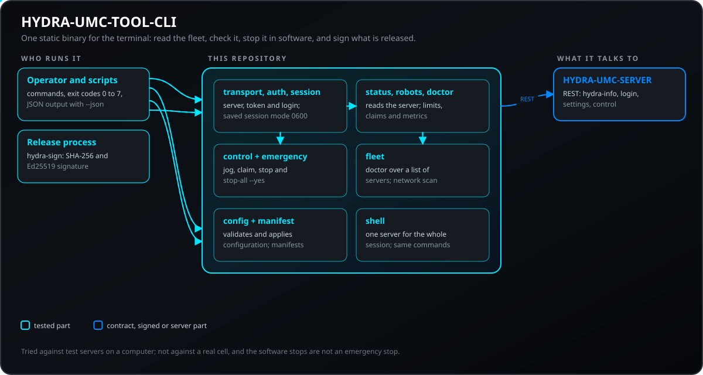
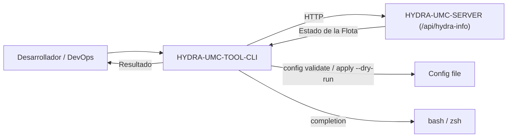
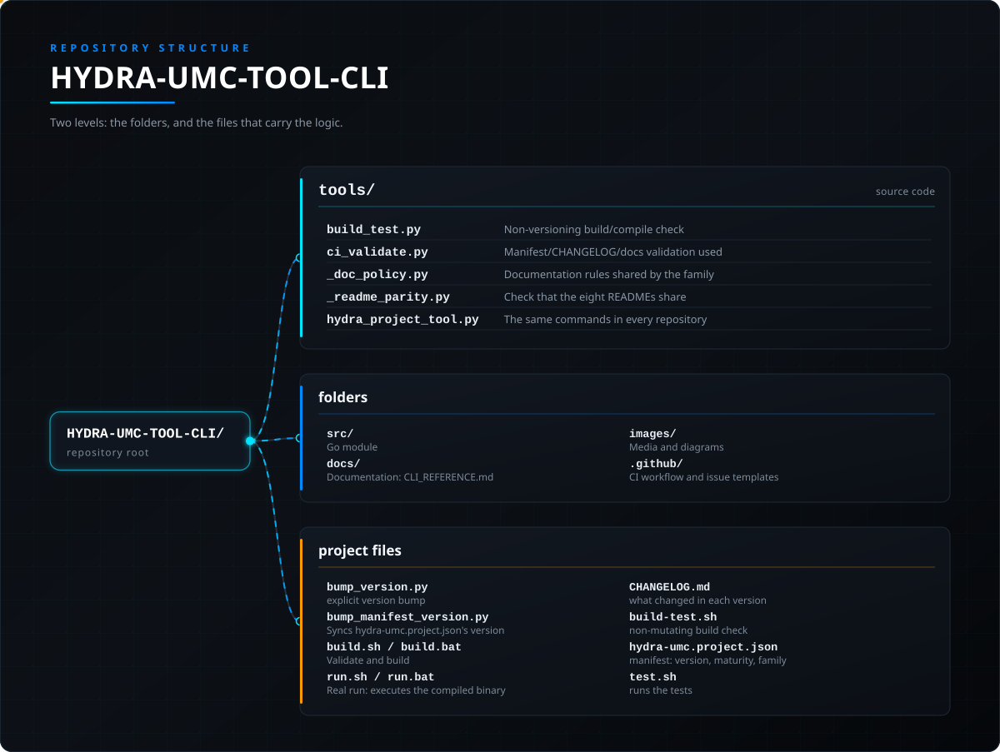

<!-- =============================================================================
HYDRA-UMC-TOOL-CLI - Command-line interface for fleet DevOps
Copyright (C) JuanenRac (Electro Hobby 3D) <electrohobby3d@gmail.com>
GPL-3.0-or-later - see LICENSE
============================================================================= -->

<p align="center">
  
</p>

# 🛠️ HYDRA-UMC-TOOL-CLI

<p align="center"><a href="README.md">🇺🇸 English</a> | 🇪🇸 <b>Español</b> | <a href="README_fra.md">🇫🇷 Français</a> | <a href="README_ita.md">🇮🇹 Italiano</a> | <a href="README_deu.md">🇩🇪 Deutsch</a> | <a href="README_zho.md">🇨🇳 简体中文</a> | <a href="README_jpn.md">🇯🇵 日本語</a> | <a href="README_por.md">🇵🇹 Português</a></p>

### 🛠️ Interfaz de Línea de Comandos para DevOps y Automatización de Flotas

<p align="center">
  
  
  
  
  
  
</p>

---

**Comprobación de honestidad - lo que realmente funciona hoy:** `version`, `status`, `robots`, `claims`, `claim`, `release`, `limits`, `jog-arm`, `jog`, `table`, `robot`, `audit`, `doctor`, `connections`, `liveness`, `ecosystem-health`, `plan-simulate`, `config validate`, `config apply --dry-run`, y el `shell` interactivo (`main.go`, `server.go`, `robots.go`, `control.go`, `doctor.go`, `observe.go`, `plansim.go`, `config.go`, `shell.go`, `exitcode.go`) son código Go real y funcional, verificado por 249 tests que pasan (`go test ./...`) - peticiones reales `net/http`/`httptest` contra un servidor simulado más fixtures reales de archivos de configuración temporales, no stubs. Esos tests simulan una instancia de HYDRA-UMC-SERVER; `status`, `robots` y `doctor` (con el inicio de sesión incluido) también se han ejecutado contra un proceso real de HYDRA-UMC-SERVER. `config apply` sin `--dry-run` devuelve honestamente el código de salida `ExitNotImplemented` en vez de simular un éxito, porque el endpoint de escritura de flota que llamaría todavía no existe en HYDRA-UMC-SERVER. `deploy`, `flash-all` y `audit` son pura aspiración - marcados como "planned" más abajo y ausentes por completo de `src/`, ni siquiera como función stub. Consulta `CHANGELOG.md` para ver exactamente qué se ha entregado hasta ahora.

---

> **Estado de seguridad física y de ciberseguridad:** este ecosistema no es un sistema de seguridad certificado. Todavía no existe una ruta de E-STOP por hardware, ni límites ni enclavamientos aplicados por el firmware, ni un comando de movimiento verificado; las imágenes de firmware se comprueban con CRC-32 y una firma Ed25519, y una compilación de versión rechaza las claves de desarrollo publicadas (los cabezales de herramienta y las placas de expansión detrás del relé siguen con cargadores de URTC, que usan un HMAC-SHA256 de clave compartida en lugar de una firma); TLS y TLS mutuo son opcionales y están desactivados por defecto; aún no se ha poblado ni probado ninguna placa propia. Lee la [línea base de seguridad](https://github.com/JuanenRac/HYDRA-UMC-DOCS/blob/main/docs/SECURITY_BASELINE.md) y el [modelo de amenazas](https://github.com/JuanenRac/HYDRA-UMC-DOCS/blob/main/docs/THREAT_MODEL.md) antes de fiarte de cualquier afirmación de aquí para la seguridad de una persona.

---

## 📋 De un vistazo

| | |
|---|---|
| Versión | `0.2.0` |
| Madurez | Funcional |
| Tests | 249 (`go test ./...`) |
| Tecnología | Go / standard-library flag handling |
| Destino | El PC de quien lo usa |
| En hardware real | Solo simulado: probado con emuladores, dobles de prueba o simuladores; no consta ninguna ejecución en hardware real para esta versión |

**Ir a:** [Resumen](#-resumen) · [Arquitectura](#-arquitectura) · [Seguridad y protección](#-seguridad-y-protección) · [Configuración](#-configuración) · [Inicio rápido](#-inicio-rápido) · [Pruebas](#-pruebas) · [Resolución de problemas](#-resolución-de-problemas) · [Estructura del repositorio](#-estructura-del-repositorio) · [Proyectos relacionados](#-proyectos-relacionados)

## 🚦 Estado del proyecto

Cada línea es una parte de este repositorio y la luz dice hasta dónde llega hoy. Se escribe con lo que el repositorio puede demostrar (pruebas, compilaciones, ejecuciones), no con lo previsto.

🟢 Hecho y verificado · 🟡 Funciona, con límites conocidos · 🟠 Hecho a medias o sin verificar · 🔴 Sin hacer o sin funcionar

| Área | Estado | Qué significa aquí |
|---|---|---|
| Software | 🟡 | Funciona para su propósito principal; la comprobación de honestidad de arriba lista lo que aún falta |
| Pruebas | 🟢 | 249 pruebas automáticas, ejecutadas en cada cambio |
| Hardware real | 🟠 | Solo simulado: probado con emuladores, dobles de prueba o simuladores; no consta ninguna ejecución en hardware real para esta versión |
| Documentación | 🟢 | README en ocho idiomas, comprobado contra el manifiesto en cada cambio |

## 🎯 Resumen

**HYDRA-UMC-TOOL-CLI** es la navaja suiza para desarrolladores y administradores de sistemas del ecosistema HYDRA-UMC. Es un único binario estático de Go que ofrece herramientas de línea de comandos para consultar, actualizar y auditar despliegues de HYDRA-UMC.

El objetivo a largo plazo son despliegues masivos de misiones, actualizaciones de firmware en paralelo (CAN-OTA) y diagnósticos profundos del sistema directamente desde una terminal o un pipeline de CI/CD. Hoy incluye la base real y funcional sobre la que se construirá todo lo demás: informe de versión y un cliente HTTP real contra HYDRA-UMC-SERVER.

### Características Clave:
* 🔏 **Binarios de release firmados (`hydra-sign`).** `go run ./src/cmd/hydra-sign sign --key PRIVADA.pem FICHERO...` escribe `FICHERO.sha256` (formato `sha256sum`) y `FICHERO.sig` (Ed25519 sobre el contenido del fichero, en base64); `verify --pub PUBLICA.pem FICHERO...` comprueba ambos y solo necesita la clave pública. La clave privada solo se lee del fichero indicado y nunca se imprime ni se copia; `pubkey --key PRIVADA.pem` imprime la mitad pública. Las pruebas usan claves hechas para ellas. Qué clave firma una release lo decide el proceso de publicación. El proceso de publicación firma cada binario publicado con la clave de releases de HYDRA y adjunta los ficheros `.sha256` y `.sig`; los scripts de compilación fijan la versión que informa el binario a partir del manifiesto del proyecto.
* ✅ **`hydra-cli version`** — imprime el nombre y la versión del propio CLI. *(implementado)*
* ✅ **`hydra-cli status [--server URL] [--config PATH]`** — consulta el `GET /api/hydra-info` de una instancia real de HYDRA-UMC-SERVER e imprime su identidad reportada. *(implementado)*
* ✅ **`hydra-cli robots [--server URL] [--config PATH] [--json]`** — consulta el `GET /api/settings` de una instancia real de HYDRA-UMC-SERVER e imprime su listado real de controladores/robots (nombre, estado en linea, modelo, rol). *(implementado)*
* ✅ **`hydra-cli claims`, `claim <robot>`, `release <robot>`** — lista quién reserva qué robot (`GET /api/claims`) y reserva o libera uno. La reserva pertenece a tu cuenta y al identificador de controlador de este programa (`--controller-id`, `HYDRA_CLI_CONTROLLER_ID`, por defecto `hydra-cli-<host>`), que se envía en cada petición. Las negativas (otra cuenta, otro controlador, falta el identificador, jog sin armar) se distinguen y salen con el código `8`. *(implementado)*
* ✅ **`hydra-cli limits [--robot ID]`, `jog-arm <robot> <on|off>`, `jog <robot> <eje> <cantidad> [--absolute]`** — lee los límites de seguridad que guarda el servidor, arma o desarma el jog (solo hace falta cuando el servidor lo exige) y mueve un eje. Un paso por encima del límite del modelo del robot se rechaza antes de enviarlo, y no se envía nada si no se puede leer el límite; se muestran los avisos del servidor. *(implementado)*
* ✅ **`hydra-cli robot <robot>`, `table <robot> <x> <y> [--rz N] [--relative]`, `audit [--limit N] [--type T] [--robot ID] [--verify] [--export FILE]`** — `robot` lee un robot con su revisión; `table` mueve la mesa XY en una sola petición atómica (comprobada contra los límites del modelo antes de enviarla; el servidor aplica todo o nada); `audit` (solo administradores) lee el registro de auditoría de solo añadir, comprueba la cadena de hashes SHA-256 de las líneas recibidas (código de salida 8 si está rota) y, con `--verify`, hace que el servidor compruebe todo el registro; `--export FILE` guarda las líneas tal como están almacenadas. `claim`, `release`, `jog` y `table` también aceptan `--if-match REVISIÓN` (o `current`): el servidor rechaza entonces la escritura con código de salida 8 si el robot cambió desde esa revisión, y no se aplica nada. La CLI no usa el envío de reservas por WebSocket (ejecuta un comando y termina).
* ✅ **`hydra-cli doctor [--server URL] [--config PATH] [--json]`** — diagnóstico de contrato del servidor en solo lectura: valida `/api/hydra-info` y `/api/settings` y comprueba que los totales publicados de controladores/robots coinciden con el listado. No envía comandos ni sondea hardware. `--json` imprime un informe estructurado con un `checkId`/`severity`/`status` por comprobación en vez de la línea de texto, para scripts (ver [docs/DOCTOR.md](docs/DOCTOR.md)). *(implementado)*
* 🔐 **Sesiones, credenciales seguras y comandos de flota:** `login`/`logout` guardan una sesión en un fichero que solo tú puedes leer (sin login en cada ejecución); una contraseña o un token se rechazan por http plano hacia otra máquina salvo `HYDRA_CLI_ALLOW_INSECURE=1`, y `HYDRA_CLI_CA_FILE` confía en una CA privada; son nuevos `scan`, `fleet doctor`, `stop`, `stop-all --yes`, `metrics` y `manifest validate`. Ver [`docs/CLI_REFERENCE.md`](docs/CLI_REFERENCE.md).
* 🧾 **`--json`, autocompletado y vistas de solo lectura:** todo comando que imprime datos también los imprime como JSON con `--json` (un objeto con `schema_version`, `command`, `ok` y los campos del comando en los comandos que actúan; la salida de texto sigue siendo la predeterminada y no cambia); `completion <bash|zsh|fish|powershell>` completa comandos, subcomandos, opciones y valores cerrados, generado desde la tabla de comandos; `connections`, `liveness` y `ecosystem-health` leen del servidor los clientes y el historial de inicios de sesión, la señal de vida de cada robot y la salud de los servicios, y `plan-simulate` comprueba un plan con la simulación en seco del planificador semántico (no se ejecuta nada; código de salida 8 si el plan se rechaza). Cada respuesta se comprueba contra su contrato antes de imprimirse, y una mal formada es un error sin salida. Véase [`docs/CLI_REFERENCE.md`](docs/CLI_REFERENCE.md).
* Todo texto que viene de un servidor y se imprime (mensajes de error, nombres, versiones) pasa además por la redacción de secretos compartida, de modo que un token, un valor de `password=` o una cabecera bearer en una respuesta nunca se repite en el terminal (mismos vectores que los demás proyectos).
* ✅ **`hydra-cli completion <bash|zsh>`** — imprime un script de autocompletado para la shell. *(implementado)*
* ✅ **Un contrato de códigos de salida real y estable** — `0` ok, `1` error general, `2` error de uso, `3` error de configuración, `4` error de red, `5` error de servidor, `6` no implementado, `7` autenticación requerida o rechazada. Cada comando clasifica sus propios fallos a través de este contrato en lugar de un simple `exit 1`, de modo que los scripts que envuelven esta CLI puedan ramificarse según *por qué* falló. *(implementado)*
* ✅ **`hydra-cli config validate --config PATH`** — carga y valida contra el esquema un archivo de configuración local (URL del servidor, timeout de las peticiones). *(implementado)*
* ✅ **`hydra-cli config apply --config PATH [--dry-run]`** — `--dry-run` demuestra el camino real de validación de principio a fin e imprime exactamente lo que enviaría; sin él, devuelve honestamente "no implementado" ya que aún no existe un endpoint de escritura de flota en vivo. *(implementado, solo dry-run)*
* ✅ **`--config PATH` en `status`/`robots`/`doctor`/`shell`** — el mismo archivo validado, con su `server`/`timeoutSec`, ahora sí determina de verdad el destino HTTP y el tiempo de espera de cada comando en vivo, no solo `config validate`/`apply`; `--server` sigue ganando si se indican ambos. *(implementado)*
* ✅ **`hydra-cli shell [--server URL] [--config PATH]`** — un REPL interactivo: ejecuta cualquiera de los comandos anteriores repetidamente contra el mismo servidor sin reiniciar el proceso. Despacha a través de la misma tabla de comandos que usan las invocaciones puntuales, así que el comportamiento del shell y el de una sola vez nunca pueden divergir. `exit`/`quit`/Ctrl-D para salir. *(implementado)*
* ✅ **`hydra-cli help` / `--help`** — uso completo de comandos. *(implementado)*
* 🚧 **`hydra-cli deploy`** — sube misiones y configuraciones a una flota de robots simultáneamente. *(planeado)*
* 🚧 **`hydra-cli flash-all`** — actualizaciones de firmware en paralelo para controladores y cabezales URTC. *(planeado)*
* 🚧 **`hydra-cli audit`** — suite de diagnóstico automatizada para la salud del bus CAN y validación de sensores. *(planeado)*

## 🧩 Papel en HYDRA-UMC

**HYDRA-UMC-TOOL-CLI** es `hydra-cli`, un único binario de Go sin dependencias de bibliotecas compartidas que habla con `HYDRA-UMC-SERVER`: estado, robots, límites, un doctor que revisa un servidor, jog y paradas por software, un barrido de redes privadas, comprobaciones de flota, validación de manifiestos y ficheros de configuración, y una consola interactiva. Incluye también `hydra-sign`, que firma y verifica binarios de versión.

## 🏛️ Arquitectura

<p align="center">
  
</p>

<details>
<summary>Versión en texto del diagrama (Mermaid)</summary>



</details>

### ARQUITECTURA Y DECISIONES DE DISEÑO

* **Por qué `src/` contiene una subruta `cmd/hydra-cli/`, no un layout plano.** Sigue la convención estándar de CLIs en Go (un punto de entrada `cmd/<nombre-binario>/`, con sitio para futuros paquetes `internal/`/`pkg/` a medida que la CLI crezca más allá de un solo comando) - no es una invención de este ecosistema, es la propia convención de la comunidad Go más amplia para CLIs multi-comando.
* **Por qué una CLI, y no simplemente scriptear directamente la propia API REST de HYDRA-UMC-SERVER.** Las operaciones a escala de flota (instalar/actualizar en muchas CM5, no solo una) necesitan orquestación real - reintentos, paralelismo, una UX consistente - que un script curl improvisado no ofrece, el mismo motivo que HYDRA-UMC-UPDATER aplica después a nivel de todo el checkout del ecosistema.
* **Cómo encaja en el resto del ecosistema.** Hace a escala de flota lo que URTC-FLASHER y URTC-TESTER hacen cada uno para una sola placa - gestiona instancias de HYDRA-UMC-SERVER a través de una flota en vez del propio firmware de una sola placa.
* **Por qué `robots` lee `GET /api/settings` en vez de un endpoint nuevo.** Ese endpoint ya lleva el listado completo de controladores/robots y ya es una lectura real que exige una cuenta con sesión iniciada (ver el propio `src/server.ts` de HYDRA-UMC-SERVER; la CLI inicia sesión con `HYDRA_CLI_USER`/`HYDRA_CLI_PASSWORD` o envía `HYDRA_CLI_TOKEN`) - `robots` es un cliente real de un contrato que ya se publica, no trabajo nuevo del lado del servidor. `doctor` utiliza esa misma lectura junto a `/api/hydra-info` para detectar totales públicos incompatibles sin añadir un endpoint. Los comandos más grandes, todavía planeados (`deploy`/`flash-all`/`audit` orientado a hardware), sí necesitan de verdad endpoints de escritura nuevos que aún no existen.
* **Por qué `doctor` es explícitamente de solo lectura.** Una comprobación de contratos es útil antes de disponer de hardware y segura para CI. Solo informa coherencia HTTP/JSON/contadores; no ordena equipos ni afirma salud de CAN, actuadores, sensores, cámaras, Hailo, CM5 o seguridad.
* **Por qué `config apply` sin `--dry-run` devuelve "no implementado" en lugar de no hacer nada silenciosamente.** El endpoint de escritura en vivo de HYDRA-UMC-SERVER que esto llamaría de verdad todavía no existe (la misma carencia que bloquea a `deploy`/`flash-all`) - un código de salida distinto, `ExitNotImplemented`, le indica a quien llama "esto es una carencia real, no un bug", en vez de un no-op engañosamente exitoso.
* **Por qué los errores de cada comando ahora fluyen a través de un único tipo `CliError`/`ExitCode` en vez de llamadas ad-hoc a `os.Exit`.** Un contrato de códigos de salida estable y documentado solo se mantiene estable si hay un único lugar que asigna los códigos - `exitCodeFor()` (`exitcode.go`) es ese lugar, y las funciones de los comandos siguen devolviendo valores `error` idiomáticos y encadenables en vez de llamar ellas mismas a `os.Exit`.

## 🔒 Seguridad y protección

| Amenaza | Defensa | Dónde |
|---|---|---|
| Una contraseña o un token que queda en la lista de procesos o en el historial del shell | La credencial viene del entorno (`HYDRA_CLI_TOKEN`, o `HYDRA_CLI_USER` y `HYDRA_CLI_PASSWORD`) o de una sesión guardada, nunca de una opción | `auth.go` |
| Una sesión guardada leída por otro usuario, o escrita a medias | El fichero se escribe en uno temporal con modo 0600 y se renombra sobre el anterior, en una carpeta creada con modo 0700 | `session.go` |
| Credenciales enviadas en claro a otra máquina | Se rechazan sobre `http://` plano hacia cualquier otra máquina salvo `HYDRA_CLI_ALLOW_INSECURE=1`; `HYDRA_CLI_CA_FILE` confía en una autoridad privada para `https://` | `transport.go` |
| Un barrido que se escapa a internet, o un stop-all por error | `scan` se queda en redes privadas salvo que se dé `--allow-public-range` y cubre como mucho 1024 direcciones por defecto; `stop-all` exige `--yes` | `fleet.go`, `emergency.go` |

**Lo que nunca hace:** actuar como parada de emergencia. `stop` y `stop-all` son órdenes por software que necesitan el servidor, la red y un inicio de sesión; la parada de emergencia física de la celda es lo que detiene una máquina.

## ⚙️ Configuración

| Variable | Por defecto | Qué fija |
|---|---|---|
| `HYDRA_CLI_SERVER` / `--server` | `http://localhost:3000` | el servidor con el que hablar |
| `HYDRA_CLI_TIMEOUT_SEC` / `--timeout` | `5` | segundos concedidos a cada petición (1 a 3600) |
| `HYDRA_CLI_TOKEN` | ninguno | un token Bearer que el servidor ya emitió |
| `HYDRA_CLI_USER`, `HYDRA_CLI_PASSWORD` | ninguno | la CLI inicia sesión en esa ejecución; el token gana si hay ambos |
| `HYDRA_CLI_ALLOW_INSECURE` | `0` | `1` permite credenciales por http plano hacia otra máquina |
| `HYDRA_CLI_CA_FILE` | ninguno | fichero PEM de una autoridad privada en la que confiar para https |
| `HYDRA_CLI_TOKEN_FILE` | la sesión guardada | el fichero donde `hydra-cli login` guarda el token y el token de renovación, legible solo por el usuario (también `tokenFile` de un fichero de configuración; por defecto `hydra-cli/session.json` en el directorio de configuración del usuario); `hydra-cli logout` revoca el token de renovación y lo borra |

## 🚀 Inicio rápido

Requiere Go 1.24 o superior.

```bash
./build.sh  # Linux, macOS (build.bat on Windows)
./run.sh status --server http://192.168.1.50:3000
./run.sh doctor
./run.sh config validate --config hydra-cli.json
./run.sh help
```

## 🧪 Pruebas

249 pruebas automáticas se ejecutan con `cd src && go test ./...`. No necesitan hardware ni nada fuera de esta máquina.

El CI ejecuta `HYDRA_UMC_CI=1 python tools/ci_validate.py`, que comprueba el manifiesto, los documentos, los ocho README y las imágenes.

## 🏗️ Compilación y publicación

Requiere Go >= 1.24.

```bash
# Linux/macOS
./build.sh
./run.sh version
./run.sh status --server http://localhost:3000
./run.sh robots --server http://localhost:3000
./run.sh doctor --server http://localhost:3000
./run.sh config validate --config ./hydra-cli.json
./run.sh config apply --config ./hydra-cli.json --dry-run
echo $?   # 0=ok 2=uso 3=config 4=red 5=servidor 6=no-implementado 7=autenticación

# Windows
build.bat
run.bat version
run.bat status --server http://localhost:3000
run.bat robots --server http://localhost:3000
run.bat doctor --server http://localhost:3000
run.bat config validate --config .\hydra-cli.json
run.bat config apply --config .\hydra-cli.json --dry-run
```

`robots` y `doctor` leen `/api/settings`, que HYDRA-UMC-SERVER solo entrega a una cuenta con sesión iniciada (un administrador ve los ajustes completos, los demás roles una copia con los secretos ocultos). Dé una credencial a la CLI por el entorno - nunca por una opción, para que no aparezca en el listado de procesos ni en el historial del shell: `HYDRA_CLI_TOKEN` (un token Bearer que el servidor ya emitió), o `HYDRA_CLI_USER` y `HYDRA_CLI_PASSWORD` (la CLI inicia sesión con `POST /api/login` en esa ejecución; si están las dos cosas, manda el token). Sin ninguna, el comando termina con el código `7` e indica qué variables definir. `status` y la primera petición de `doctor` usan el `/api/hydra-info` público y nunca envían la credencial. Una respuesta se lee hasta 4 MiB.

`build` nunca cambia la versión (solo `python tools/hydra_project_tool.py bump` la sube), corre la suite de tests real (`go vet` + `go test`), compila el módulo Go en `src/` a `build/hydra-cli(.exe)`, y ejecuta `version` una vez para verificar - luego compila de forma cruzada un release real para linux/amd64, linux/arm64 (la arquitectura propia de la CM5), windows/amd64, darwin/amd64 y darwin/arm64 en build/release/, con un fichero SHA256SUMS real de comprobacion. `run` vuelve a ejecutar el binario compilado, reenviando todos los argumentos — prueba `run doctor` contra una instancia de `HYDRA-UMC-SERVER` en marcha. Doctor es una comprobación segura y de solo lectura de contratos de endpoints; consulta [docs/DOCTOR.md](docs/DOCTOR.md).

## 🩺 Resolución de problemas

| Ves | Porque | Haz |
|---|---|---|
| exit code 7 | El comando necesita inicio de sesión y no se dio credencial, o el servidor la rechazó | Define `HYDRA_CLI_TOKEN`, o `HYDRA_CLI_USER` y `HYDRA_CLI_PASSWORD`, o ejecuta `login` |
| exit code 4 | No se pudo alcanzar el servidor | Revisa la dirección (`--server`, fichero de configuración, `HYDRA_CLI_SERVER`) y ejecuta `doctor` |
| exit code 2 | Comando desconocido, falta un argumento o una opción sin valor | Ejecuta `help`; nada se ignora en silencio |

## 📂 Estructura del repositorio

<p align="center">
  
</p>

<details>
<summary>Versión en texto del árbol</summary>

```text
HYDRA-UMC-TOOL-CLI/
├── tools/                      código fuente
│   ├── build_test.py           Comprobación de compilación sin versionado
│   ├── ci_validate.py          Validación de manifiesto/CHANGELOG/docs usada por CI
│   ├── _doc_policy.py          Reglas de documentación compartidas por la familia (copia de la de HYDRA-UMC-SDK, mantenida en sincronía)
│   ├── _readme_parity.py       Comprobación de que los ocho README comparten estructura (copia de la de HYDRA-UMC-SDK, mantenida en sincronía)
│   └── hydra_project_tool.py   Los mismos comandos en todos los repositorios: validate, test, ci, version, status, bump
├── src/                        Módulo Go
├── docs/                       Documentación: CLI_REFERENCE.md y DOCTOR.md
├── images/                     Medios y diagramas
├── .github/                    flujo de CI y plantillas de incidencias
├── bump_version.py             Incremento de versión tipo cuentakilómetros (solo lo ejecuta el comando `bump` explícito)
├── bump_manifest_version.py    Sincroniza la versión de hydra-umc.project.json con la nativa (--sync)
├── build.sh / build.bat        Valida y compila (compilar nunca cambia la versión)
├── run.sh / run.bat            Ejecución real: lanza el binario compilado
├── CHANGELOG.md                qué cambió en cada versión
├── build-test.sh               comprobación de compilación sin cambios
├── hydra-umc.project.json      manifiesto: versión, madurez, familia
└── test.sh                     ejecuta las pruebas
```

</details>

## 🗺️ Hoja de ruta y límites conocidos

`deploy`, `flash-all` y `audit` aún no están hechos: cada uno necesita en `HYDRA-UMC-SERVER` un punto de escritura de flota, de actualización por aire o de auditoría que no existe. `config apply` sin `--dry-run` es el marcador honesto de la misma carencia y responde con el código de salida 6.

## 🌍 Idiomas

Este README y los documentos del repositorio existen en ocho idiomas: inglés, español, alemán, francés, italiano, japonés, chino y portugués (Portugal). Se escriben a la vez y el CI comprueba que los ocho ficheros tengan las mismas secciones y los mismos enlaces. Este repositorio no tiene pantalla ni catálogo de mensajes propios, así que no hay cadenas de interfaz que traducir.

## 🔗 Proyectos relacionados

Este proyecto es parte del ecosistema de robótica HYDRA-UMC del mismo autor (JuanenRac / Electro Hobby 3D). Vale la pena conocerlo, ya que una petición podría en realidad ser sobre alguno de estos en vez de sobre este repositorio.

**Directamente Relacionados**
- **[HYDRA-UMC-SERVER](https://github.com/JuanenRac/HYDRA-UMC-SERVER)** — el backend headless real (REST/WebSocket) con el que habla de verdad cada cliente de control — el backend que esta CLI gestiona a escala de flota.
- **[URTC-FLASHER](https://github.com/JuanenRac/URTC-FLASHER)** — herramienta de escritorio con GUI para flashear placas URTC, CAN-OTA más SWD/JTAG de chip completo — el despliegue CAN-OTA a escala de flota planeado de esta herramienta hace para muchas placas lo que URTC-FLASHER hace para una sola.
- **[URTC-TESTER](https://github.com/JuanenRac/URTC-TESTER)** — herramienta de escritorio de diagnóstico CAN-bus en vivo para placas URTC, un panel por perfil de herramienta — el diagnóstico a escala de flota planeado de esta herramienta hace para muchas placas lo que URTC-TESTER hace para una sola.

**También Forma Parte del Ecosistema**

*Hardware y Plataforma Base*
- **[HYDRA-UMC](https://github.com/JuanenRac/HYDRA-UMC)** — el diseño de la placa madre del brazo robótico: host CM5 + coprocesador STM32H745 de doble núcleo, pensado para coordinar hasta 8 brazos herramienta por CAN-OTA/SPI-OTA (firmware en fase temprana; todavía no hay ninguna placa poblada).
- **[HYDRA-UMC-OS](https://github.com/JuanenRac/HYDRA-UMC-OS)** — capa de producto reproducible sobre Raspberry Pi OS para el CM5: agente de solo lectura, config/perfiles validados, aprovisionamiento WiFi de primer contacto.
- **[HYDRA-UMC-SDK](https://github.com/JuanenRac/HYDRA-UMC-SDK)** — el contrato JSON-Schema compartido y la barrera de software de puerta de trabajos contra la que cada bridge valida sus comandos (no es una función de seguridad certificada).
- **[HYDRA-UMC-CONNECTOR-HUB](https://github.com/JuanenRac/HYDRA-UMC-CONNECTOR-HUB)** — registro declarativo y validador de manifiestos de adaptador para conectores de máquinas externas; extiende la propia idea de contrato del SDK a máquinas externas sin sustituir a los proyectos de pasarela industrial.

*Backend Central y Clientes*
- **[HYDRA-UMC-STUDIO](https://github.com/JuanenRac/HYDRA-UMC-STUDIO)** — panel de control web con visualización 3D multi-robot en tiempo real.
- **[HYDRA-UMC-SUITE](https://github.com/JuanenRac/HYDRA-UMC-SUITE)** — centro de mando de enjambre de escritorio (PySide6) para varios servidores a la vez, empaquetado como ejecutable independiente.
- **[HYDRA-UMC-ANDROID-CONTROL](https://github.com/JuanenRac/HYDRA-UMC-ANDROID-CONTROL)** — app nativa de control para Android con inicio de sesión biométrico y un compañero Wear OS emparejado.
- **[HYDRA-UMC-IOS-CONTROL](https://github.com/JuanenRac/HYDRA-UMC-IOS-CONTROL)** — app de control para iOS/iPadOS (Flutter) con sincronización en tiempo real por WebSocket.
- **[HYDRA-UMC-DSI](https://github.com/JuanenRac/HYDRA-UMC-DSI)** — interfaz táctil nativa para la pantalla táctil DSI de 7" a bordo, embebida en el propio CM5.
- **[HYDRA-UMC-EDITOR-URDF](https://github.com/JuanenRac/HYDRA-UMC-EDITOR-URDF)** — creador/editor gráfico de URDF de escritorio que envía los modelos terminados al propio catálogo de STUDIO.
- **[HYDRA-UMC-EDITOR-STL](https://github.com/JuanenRac/HYDRA-UMC-EDITOR-STL)** — editor de escritorio de modelos STL, que transforma/reemplaza/quita/añade piezas reales en el mismo catálogo de modelos que también edita HYDRA-UMC-EDITOR-URDF.
- **[HYDRA-UMC-BRIDGE-AMR](https://github.com/JuanenRac/HYDRA-UMC-BRIDGE-AMR)** — barrera de coordinación para flotas AGV/AMR mediante un publicador MQTT VDA 5050 (probado solo contra una flota emulada).
- **[HYDRA-UMC-BRIDGE-CNC](https://github.com/JuanenRac/HYDRA-UMC-BRIDGE-CNC)** — coordinador de alto nivel para celdas CNC con acceso a estado/bytes de control GRBL (probado solo contra un emulador).
- **[HYDRA-UMC-BRIDGE-DROIDS](https://github.com/JuanenRac/HYDRA-UMC-BRIDGE-DROIDS)** — barrera de coordinación para droides con patas/humanoides, con un emisor de comandos para Boston Dynamics Spot (probado solo contra un emulador).
- **[HYDRA-UMC-BRIDGE-LASER](https://github.com/JuanenRac/HYDRA-UMC-BRIDGE-LASER)** — coordinador de celdas láser que lee 3 señales GPIO de llave/carcasa/enclavamiento (probado solo contra un chip simulado; no puede armar ni disparar un láser).
- **[HYDRA-UMC-BRIDGE-OPENPNP](https://github.com/JuanenRac/HYDRA-UMC-BRIDGE-OPENPNP)** — coordinador de alto nivel seguro para el flujo de placas de pick-and-place OpenPnP.
- **[HYDRA-UMC-BRIDGE-PRINTER3D](https://github.com/JuanenRac/HYDRA-UMC-BRIDGE-PRINTER3D)** — barrera de coordinación segura para impresoras 3D Moonraker/Klipper, con comandos de trabajo reales y controlados.
- **[HYDRA-UMC-BRIDGE-ROS2](https://github.com/JuanenRac/HYDRA-UMC-BRIDGE-ROS2)** — coordinador con un transporte ROS 2 rclpy importado de forma perezosa (todavía no ejecutado contra una instalación de ROS 2).
- **[HYDRA-UMC-BRIDGE-UAV](https://github.com/JuanenRac/HYDRA-UMC-BRIDGE-UAV)** — barrera de coordinación para UAV equipados con cámara, con un emisor de comandos MAVLink (probado solo contra un emulador).

*Plataforma de Herramientas URTC*
- **[URTC](https://github.com/JuanenRac/URTC)** — firmware para la placa física del Universal Robot Tool Controller, más de 25 perfiles de herramienta por bus CAN.
- **[URTC-WEB-STUDIO](https://github.com/JuanenRac/URTC-WEB-STUDIO)** — alternativa basada en navegador a URTC-TESTER mediante la Web Serial API, sin instalación local.
- **[URTC-GATEWAY](https://github.com/JuanenRac/URTC-GATEWAY)** — pasarela delante del bus CAN de URTC: lista de identificadores permitidos, límite de tasa y clave de sesión; software probado en ordenador, aún no en un bus real.

*Nodo IA de Visión (Hailo-8)*
- **[HYDRA-UMC-VISION-NODE](https://github.com/JuanenRac/HYDRA-UMC-VISION-NODE)** — nodo de integración para el pipeline de visión Hailo-8, con una comprobación real de disponibilidad de hardware por etapa.
- **[HYDRA-UMC-DETECTION-HEF](https://github.com/JuanenRac/HYDRA-UMC-DETECTION-HEF)** — registro real de modelos compilados con verificación de carga segura por arquitectura Hailo/checksum.
- **[HYDRA-UMC-VISION-STREAMER](https://github.com/JuanenRac/HYDRA-UMC-VISION-STREAMER)** — generador real de pipeline GStreamer + config MediaMTX, con una frontera de integración HailoRT real.
- **[HYDRA-UMC-VISUAL-SERVOING-API](https://github.com/JuanenRac/HYDRA-UMC-VISUAL-SERVOING-API)** — ley de corrección Position-Based Visual Servoing con autorización condicionada al estado de zona; todavía sin estimación de pose por cámara.
- **[HYDRA-UMC-SAFETY-ZONES](https://github.com/JuanenRac/HYDRA-UMC-SAFETY-ZONES)** — lógica v0 de invasión de zona, vigencia de calibración y solicitud de E-STOP que toma las posiciones de los objetos de un fichero; ningún detector la alimenta y todavía no hay un E-STOP físico conectado.

*Nodo IA Cognitivo (Hailo-10)*
- **[HYDRA-UMC-COGNITIVE-NODE](https://github.com/JuanenRac/HYDRA-UMC-COGNITIVE-NODE)** — nodo de integración para el pipeline cognitivo Hailo-10 (orquestación de LLM/VLA/voz).
- **[HYDRA-UMC-VLA-ENGINE](https://github.com/JuanenRac/HYDRA-UMC-VLA-ENGINE)** — codificación/decodificación real de tokens de acción y generación de trayectoria para un modelo Vision-Language-Action.
- **[HYDRA-UMC-VOICE-UI](https://github.com/JuanenRac/HYDRA-UMC-VOICE-UI)** — front-end de voz real (VAD + analizador de intención) con un relé a Watch acotado y con confirmación.
- **[HYDRA-UMC-SEMANTIC-PLANNER](https://github.com/JuanenRac/HYDRA-UMC-SEMANTIC-PLANNER)** — descomposición real de tareas basada en reglas y recuperación semántica de errores sobre códigos de error del MCU.
- **[HYDRA-UMC-DOCS-QA](https://github.com/JuanenRac/HYDRA-UMC-DOCS-QA)** — búsqueda real de documentos TF-IDF (solo librería estándar) sobre los propios documentos Markdown de este ecosistema.
- **[HYDRA-UMC-LOCAL-TECHNICIAN](https://github.com/JuanenRac/HYDRA-UMC-LOCAL-TECHNICIAN)** — técnico de mantenimiento con IA local y con puertas de política para el propio ecosistema - observa, diagnostica y propone arreglos; los dos niveles de riesgo más altos están deliberadamente sin implementar todavía.

*Orquestación y Enjambre*
- **[HYDRA-UMC-ORCHESTRATOR](https://github.com/JuanenRac/HYDRA-UMC-ORCHESTRATOR)** — nodo de integración con un contrato real de informe de salud gRPC/Protobuf y una máquina de estados de misión.
- **[HYDRA-UMC-JOB-DISPATCHER](https://github.com/JuanenRac/HYDRA-UMC-JOB-DISPATCHER)** — cola de trabajos real basada en prioridad con deduplicación, sobre una API HTTP real.
- **[HYDRA-UMC-NODE-HEALING](https://github.com/JuanenRac/HYDRA-UMC-NODE-HEALING)** — watchdog de salud de flota real basado en gRPC, con reintento/backoff y detección de discrepancia de identidad.
- **[HYDRA-UMC-PATH-PLANNER-3D](https://github.com/JuanenRac/HYDRA-UMC-PATH-PLANNER-3D)** — planificador de rutas 3D real basado en RRT, con validación real de colisión de obstáculos/espacio de trabajo.
- **[HYDRA-UMC-SWARM-SYNC](https://github.com/JuanenRac/HYDRA-UMC-SWARM-SYNC)** — sincronización de estado real mediante CRDT LWW-Element-Map, con pruebas de propiedades para convergencia multi-celda.

*Gemelo Digital y Simulación*
- **[HYDRA-UMC-TWIN](https://github.com/JuanenRac/HYDRA-UMC-TWIN)** — nodo de integración para el motor de gemelo digital, con un contrato real de sincronización por compatibilidad de versión.
- **[HYDRA-UMC-HIL-BRIDGE](https://github.com/JuanenRac/HYDRA-UMC-HIL-BRIDGE)** — enrutador hardware-in-the-loop con un enclavamiento de software por colisión entre simulación y hardware real (probado sin hardware real).
- **[HYDRA-UMC-PHYSICS-REPLICA](https://github.com/JuanenRac/HYDRA-UMC-PHYSICS-REPLICA)** — cinemática directa real y validación de límites articulares sobre un subconjunto real de URDF.
- **[HYDRA-UMC-SYNTHETIC-DATA-GEN](https://github.com/JuanenRac/HYDRA-UMC-SYNTHETIC-DATA-GEN)** — generador real de escenas 2D procedurales con exportación de anotaciones YOLO/COCO.

*Datos y Analítica*
- **[HYDRA-UMC-DATALAKE](https://github.com/JuanenRac/HYDRA-UMC-DATALAKE)** — almacén de series temporales real respaldado por sqlite3, con una API HTTP real de ingesta/consulta.
- **[HYDRA-UMC-ANOMALY-DETECTOR](https://github.com/JuanenRac/HYDRA-UMC-ANOMALY-DETECTOR)** — detector de anomalías real basado en FFT + línea base estadística, con monitorización de deriva.
- **[HYDRA-UMC-PRODUCTION-REPORTS](https://github.com/JuanenRac/HYDRA-UMC-PRODUCTION-REPORTS)** — cálculo real de OEE/disponibilidad sobre el histórico de DATALAKE, con exportación CSV reproducible.
- **[HYDRA-UMC-TELEMETRY-COLLECTOR](https://github.com/JuanenRac/HYDRA-UMC-TELEMETRY-COLLECTOR)** — pipeline real de ingesta CAN/WebSocket hacia DATALAKE, con deduplicación por secuencia.

*Pasarela Industrial*
- **[HYDRA-UMC-GATEWAY-INDUSTRIAL](https://github.com/JuanenRac/HYDRA-UMC-GATEWAY-INDUSTRIAL)** — nodo de integración que retransmite a protocolos industriales, con una capa real de lista blanca de comandos/contrapresión.
- **[HYDRA-UMC-OPCUA-SERVER](https://github.com/JuanenRac/HYDRA-UMC-OPCUA-SERVER)** — espacio de direcciones OPC-UA real, verificado con una sesión de cliente real del protocolo binario.
- **[HYDRA-UMC-MQTT-BROKER](https://github.com/JuanenRac/HYDRA-UMC-MQTT-BROKER)** — broker MQTT real con autenticación por cliente opcional y ACL de tópicos.
- **[HYDRA-UMC-MTCONNECT-ADAPTER](https://github.com/JuanenRac/HYDRA-UMC-MTCONNECT-ADAPTER)** — endpoints XML reales `/probe` y `/current` de MTConnect, con salida en modo degradado.

*Herramientas Complementarias y Operaciones del Ecosistema*
- **[HYDRA-UMC-DASHBOARD-AI](https://github.com/JuanenRac/HYDRA-UMC-DASHBOARD-AI)** — paneles de Resúmenes Inteligentes y Resaltado de Anomalías sobre DATALAKE/ANOMALY-DETECTOR, con un respaldo estadístico honesto.
- **[HYDRA-UMC-WATCH](https://github.com/JuanenRac/HYDRA-UMC-WATCH)** — app compañera de WearOS con patrones de alerta háptica y un relé de voz al teléfono emparejado (todavía no ejecutada en un reloj físico).
- **[URTC-SMART-RACK](https://github.com/JuanenRac/URTC-SMART-RACK)** — firmware para un rack de montaje de placas con decodificación real de ID de herramienta y lógica de precalentamiento Smart Idle.
- **[URTC-VISION-TOOL](https://github.com/JuanenRac/URTC-VISION-TOOL)** — firmware más un compañero de visión real en Python para un cabezal de inspección térmica/RGB.
- **[HYDRA-UMC-UPDATER](https://github.com/JuanenRac/HYDRA-UMC-UPDATER)** — herramienta administrativa de escritorio que descubre, clona y actualiza cada repositorio de este ecosistema.
- **[HYDRA-UMC-OS-REBUILDER](https://github.com/JuanenRac/HYDRA-UMC-OS-REBUILDER)** — herramienta de escritorio Windows/Linux que construye una imagen de la CM5 lista para grabar, precargada con las versiones más actuales del ecosistema, con configuración de primer arranque de Wi-Fi/usuario/SSH al estilo de Raspberry Pi Imager.
- **[HYDRA-UMC-OPS-AGENT](https://github.com/JuanenRac/HYDRA-UMC-OPS-AGENT)** — coordinador de incidencias de mantenimiento: un rol edge de bajo privilegio recopila un snapshot de inventario/salud saneado, un rol control-plane lo renderiza de solo lectura y pide a un proveedor de IA que sugiera un diagnóstico - nunca aplica un parche ni despliega nada.
- **[HYDRA-UMC-DEV-SERVER](https://github.com/JuanenRac/HYDRA-UMC-DEV-SERVER)** — host de desarrollo reproducible (Raspberry Pi 5 / CM5) que almacena el código del ecosistema y ejecuta tareas acotadas de compilación/pruebas bajo una cola duradera; un rol de desarrollo dedicado, explícitamente distinto de un CM5 operativo.

## 📚 Documentación

Dónde leer más:

* [Base de seguridad del ecosistema](https://github.com/JuanenRac/HYDRA-UMC-DOCS/blob/main/docs/SECURITY_BASELINE.md)
* [Modelo de amenazas del ecosistema](https://github.com/JuanenRac/HYDRA-UMC-DOCS/blob/main/docs/THREAT_MODEL.md)
* [Historial de cambios de este repositorio](CHANGELOG.md)
* [Licencia de este repositorio](LICENSE.md)

## 🤝 Contribuir y comunidad

* Antes de un pull request ejecuta `HYDRA_UMC_CI=1 py -3 tools/ci_validate.py` (o `HYDRA_UMC_CI=1 python3 tools/ci_validate.py`): debe imprimir `CI_VALIDATION=PASS`. No ejecutes `build.sh` ni `build.bat` para esta comprobación; compilar no es comprobar.
* Los ocho README se escriben desde una sola fuente en HYDRA-UMC-DOCS; no los edites a mano. Cambia la fuente y vuelve a escribirlos con `tools/make_readmes.py`.
* No afirmes en un README lo que no se ha ejecutado: di «simulado» o «sin probar en hardware» cuando esa sea la verdad.
* Mira [CONTRIBUTING.md](CONTRIBUTING.md), el [código de conducta](CODE_OF_CONDUCT.md), [SECURITY.md](SECURITY.md) y [SUPPORT.md](SUPPORT.md).

## 👤 AUTOR

**JuanenRac (Electro Hobby 3D)** · electrohobby3d@gmail.com

## 📜 LICENCIA

GPL-3.0-or-later - [LICENSE](LICENSE).
