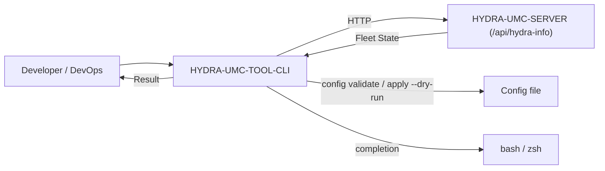

<!-- =============================================================================
HYDRA-UMC-TOOL-CLI - Command-line interface for fleet DevOps
Copyright (C) JuanenRac (Electro Hobby 3D) <electrohobby3d@gmail.com>
GPL-3.0-or-later - see LICENSE
============================================================================= -->

<p align="center">
  
</p>

# 🛠️ HYDRA-UMC-TOOL-CLI

<p align="center"><a href="README.md">🇺🇸 English</a> | <a href="README_spa.md">🇪🇸 Español</a> | <a href="README_fra.md">🇫🇷 Français</a> | <a href="README_ita.md">🇮🇹 Italiano</a> | <a href="README_deu.md">🇩🇪 Deutsch</a> | 🇨🇳 <b>简体中文</b> | <a href="README_jpn.md">🇯🇵 日本語</a> | <a href="README_por.md">🇵🇹 Português</a></p>

### 🛠️ 面向车队 DevOps 与自动化的命令行界面

<p align="center">
  
  
  
  
  
  
</p>

---

**诚实核查 - 今天真正能运行的部分：** `version`、`status`、`robots`、`claims`、`claim`、`release`、`limits`、`jog-arm`、`jog`、`table`、`robot`、`audit`、`doctor`、`config validate`、`config apply --dry-run`，以及交互式 `shell`（`main.go`、`server.go`、`robots.go`、`control.go`、`doctor.go`、`config.go`、`shell.go`、`exitcode.go`）都是真实可运行的 Go 代码，由 219 个通过的测试（`go test ./...`）验证——针对一个模拟服务器的真实 `net/http`/`httptest` 往返请求，加上真实的临时配置文件测试夹具，而不是桩代码。这些测试模拟的是一个 HYDRA-UMC-SERVER 实例；`status`、`robots` 和 `doctor`（包括登录）也已针对真实的 HYDRA-UMC-SERVER 进程运行过。`config apply` 在没有 `--dry-run` 时会诚实地返回 `ExitNotImplemented` 退出码，而不是伪装成功，因为它需要调用的车队写入端点在 HYDRA-UMC-SERVER 上还不存在。`deploy`、`flash-all` 和 `audit` 完全是愿景——在下文中标记为"planned"，在 `src/` 中完全不存在，连桩函数都没有。具体已经交付了什么，请参见 `CHANGELOG.md`。

---

> **安全与安防现状:**本生态系统不是经认证的安全系统。目前尚无硬件 E-STOP 通路,没有由固件强制执行的限位或联锁,也没有经过验证的运动指令;固件映像使用 CRC-32 和 Ed25519 签名校验,发布构建会拒绝已公开的开发密钥(中继之后的工具头和扩展板仍运行 URTC 的引导程序,它们使用共享密钥的 HMAC-SHA256 而不是签名);TLS 与双向 TLS 均为可选项,默认关闭;自制电路板尚未组装或测试。在依赖此处任何说法来保障人身安全之前,请先阅读[安全基线](https://github.com/JuanenRac/HYDRA-UMC-DOCS/blob/main/docs/SECURITY_BASELINE.md)和[威胁模型](https://github.com/JuanenRac/HYDRA-UMC-DOCS/blob/main/docs/THREAT_MODEL.md)。

---

## 📋 速览

| | |
|---|---|
| 版本 | `0.1.9` |
| 成熟度 | 可用 |
| 测试 | 219 (`go test ./...`) |
| 技术栈 | Go / standard-library flag handling |
| 目标 | 使用者的电脑 |
| 真实硬件 | 仅模拟：使用模拟器、替身或仿真测试；此版本没有在真实硬件上运行的记录 |

**跳转：** [概述](#-概述) · [架构](#-架构) · [安全与防护](#-安全与防护) · [配置](#-配置) · [快速开始](#-快速开始) · [测试](#-测试) · [故障排除](#-故障排除) · [仓库结构](#-仓库结构) · [相关项目](#-相关项目)

## 🚦 项目状态

每一行是本仓库的一个部分，灯号表示它今天做到了哪一步。内容依据仓库能够展示的证据（测试、构建、运行），而不是计划。

🟢 已完成并验证 · 🟡 可用，有已知限制 · 🟠 部分完成或尚未验证 · 🔴 未完成或不可用

| 领域 | 状态 | 在这里的含义 |
|---|---|---|
| 软件 | 🟡 | 主要用途可用；上面的诚实性检查列出了仍然缺少的内容 |
| 测试 | 🟢 | 219 项自动测试，每次变更都会运行 |
| 真实硬件 | 🟠 | 仅模拟：使用模拟器、替身或仿真测试；此版本没有在真实硬件上运行的记录 |
| 文档 | 🟢 | 八种语言的 README，每次变更都会与清单核对 |

## 🎯 概述

**HYDRA-UMC-TOOL-CLI** 是 HYDRA-UMC 生态系统开发者和系统管理员的瑞士
军刀。它是一个单一的静态 Go 二进制文件，提供用于查询、更新和审计
HYDRA-UMC 部署的命令行工具。

长期目标是直接从终端或 CI/CD 流水线实现大规模任务部署、并行固件更新
（CAN-OTA）以及深度系统诊断。今天它已交付了其余一切功能所依赖的真实
可用基础：版本报告以及针对 HYDRA-UMC-SERVER 的实时 HTTP 客户端。

### 关键特性：
* 🔏 **已签名的发布二进制文件（`hydra-sign`）。** `go run ./src/cmd/hydra-sign sign --key 私钥.pem 文件...` 会写出 `文件.sha256`（`sha256sum` 格式）和 `文件.sig`（对文件内容的 Ed25519 签名，base64）；`verify --pub 公钥.pem 文件...` 校验两者，只需要公钥。私钥只从指定文件读取，绝不会被打印或复制；`pubkey --key 私钥.pem` 打印公钥部分。测试使用专为测试生成的密钥。用哪把密钥签署发布版由发布流程决定。 发布流程会用 HYDRA 的发布密钥为每个发布的二进制文件签名，并附上 `.sha256` 和 `.sig` 文件；构建脚本根据项目清单设置二进制文件报告的版本。
* ✅ **`hydra-cli version`** —— 打印 CLI 自身的名称和版本。*（已实现）*
* ✅ **`hydra-cli status [--server URL] [--config PATH]`** —— 查询实时 HYDRA-UMC-SERVER 的 `GET /api/hydra-info`，并打印其报告的身份信息。*（已实现）*
* ✅ **`hydra-cli robots [--server URL] [--config PATH] [--json]`** —— 查询实时 HYDRA-UMC-SERVER 的 `GET /api/settings`，并打印其真实的控制器/机器人名单（名称、在线状态、型号、角色）。*（已实现）*
* ✅ **`hydra-cli claims`、`claim <robot>`、`release <robot>`** —— 列出谁预留了哪台机器人（`GET /api/claims`），并预留或释放机器人。预留属于你的账户以及本程序的控制器 ID（`--controller-id`、`HYDRA_CLI_CONTROLLER_ID`，默认 `hydra-cli-<host>`），随每个请求发送。各种拒绝（其他账户、其他控制器、需要控制器 ID、点动未解锁）会被区分，并以退出码 `8` 结束。*（已实现）*
* ✅ **`hydra-cli limits [--robot ID]`、`jog-arm <robot> <on|off>`、`jog <robot> <轴> <数值> [--absolute]`** —— 读取服务器保存的安全限值，解锁或锁定点动（仅在服务器要求时需要），并移动一个轴。超过该机器人型号限值的步长会在发送前被拒绝，读不到限值时不会发送任何内容；服务器的警告会被显示。*（已实现）*
* ✅ **`hydra-cli robot <robot>`、`table <robot> <x> <y> [--rz N] [--relative]`、`audit [--limit N] [--type T] [--robot ID] [--verify] [--export FILE]`** —— `robot` 读取一个机器人及其修订号;`table` 用一次原子请求移动 XY 工作台(发送前先按型号限值检查,服务器要么全部应用要么全部不应用);`audit`(仅管理员)读取仅追加的审计记录,检查所收到各行的 SHA-256 哈希链(链断裂时退出码为 8),使用 `--verify` 时还会让服务器检查整份记录;`--export FILE` 按存储原样保存各行。`claim`、`release`、`jog` 和 `table` 还接受 `--if-match 修订号`(或 `current`):若自该修订号以来机器人已发生变化,服务器会以退出码 8 拒绝写入,且不应用任何内容。CLI 不使用预约的 WebSocket 推送(它只执行一条命令就退出)。
* ✅ **`hydra-cli doctor [--server URL] [--config PATH] [--json]`** —— 只读服务器契约诊断：验证 `/api/hydra-info` 和 `/api/settings`，并将已发布的控制器/机器人总数与名单进行核对。不发送命令，也不探测硬件。`--json` 会输出结构化报告(每项检查带 `checkId`/`severity`/`status`)而不是纯文本行,供脚本使用(见 [docs/DOCTOR.md](docs/DOCTOR.md))。*（已实现）*
* 🔐 **会话、安全凭据与车队命令:** `login`/`logout` 把会话保存在只有你能读取的文件中(不必每次运行都登录);除非设置 `HYDRA_CLI_ALLOW_INSECURE=1`,否则密码或令牌不会通过明文 http 发往其他机器,`HYDRA_CLI_CA_FILE` 可信任私有 CA;新增 `scan`、`fleet doctor`、`stop`、`stop-all --yes`、`metrics` 和 `manifest validate`。参见 [`docs/CLI_REFERENCE.md`](docs/CLI_REFERENCE.md)。
* 来自服务器并被打印的所有文本（错误信息、名称、版本）现在还会经过共享的机密脱敏，因此响应中的令牌、`password=` 的值或 bearer 头不会回显到终端（与其他项目使用相同的测试向量）。
* ✅ **`hydra-cli completion <bash|zsh>`** — 输出适用于 shell 的 Tab 补全脚本。 *（已实现）*
* ✅ **真实、稳定的退出码契约** —— `0` 正常，`1` 一般错误，`2` 用法错误，`3` 配置错误，`4` 网络错误，`5` 服务器错误，`6` 未实现，`7` 需要认证或认证被拒绝。每个命令都通过该契约对自身的失败进行分类，而不是简单地 `exit 1`，因此封装本 CLI 的脚本可以根据*失败原因*进行分支处理。*（已实现）*
* ✅ **`hydra-cli config validate --config PATH`** —— 加载并按模式校验本地配置文件（服务器 URL、请求超时）。*（已实现）*
* ✅ **`hydra-cli config apply --config PATH [--dry-run]`** —— `--dry-run` 端到端地验证真实的校验路径，并准确打印将要发送的内容；若不带该参数，则会如实返回“未实现”，因为目前尚不存在实时的车队写入端点。*（已实现，仅支持 dry-run）*
* ✅ **在 `status`/`robots`/`doctor`/`shell` 上使用 `--config PATH`** —— 同一个已校验文件的 `server`/`timeoutSec` 现在真正驱动每个实时命令的 HTTP 目标与请求超时,不再只影响 `config validate`/`apply`；若两者同时给出,`--server` 仍然优先。*（已实现）*
* ✅ **`hydra-cli shell [--server URL] [--config PATH]`** —— 一个交互式 REPL：无需重启进程即可对同一服务器重复运行上面的任意命令。通过与单次调用完全相同的命令表进行分发，因此 shell 与单次调用的行为永远不会出现分歧。输入 `exit`/`quit` 或按 Ctrl-D 退出。*（已实现）*
* ✅ **`hydra-cli help` / `--help`** —— 完整的命令用法。*（已实现）*
* 🚧 **`hydra-cli deploy`** —— 同时向一批机器人上传任务和配置。*（计划中）*
* 🚧 **`hydra-cli flash-all`** —— 面向控制器和 URTC 刀头的并行固件更新。*（计划中）*
* 🚧 **`hydra-cli audit`** —— 用于 CAN 总线健康状况和传感器验证的自动化诊断套件。*（计划中）*

## 🧩 在 HYDRA-UMC 中的角色

**HYDRA-UMC-TOOL-CLI** 即 `hydra-cli`，一个不依赖共享库的 Go 可执行文件，与 `HYDRA-UMC-SERVER` 通信：状态、机器人、限制、检查服务器的 doctor、点动和软件停止、私有网络扫描、机群检查、清单与配置文件校验，以及交互式 shell。它还包含为发布的二进制文件签名和验证的 `hydra-sign`。

## 🏛️ 架构

<p align="center">
  
</p>

<details>
<summary>图表的文本版本（Mermaid）</summary>



</details>

### 架构与设计决策

* **为何 `src/` 包含一个 `cmd/hydra-cli/` 子路径，而非扁平布局。** 遵循标准的 Go CLI 惯例（一个 `cmd/<binary-name>/` 入口点，并为随着 CLI 超出单一命令规模而增加的未来 `internal/`/`pkg/` 包留出空间）——这并非本生态系统自身的发明，而是更广泛 Go 社区针对多命令 CLI 的自有惯例。
* **为何采用 CLI，而非直接编写脚本调用 HYDRA-UMC-SERVER 自身的 REST API。** 车队规模的操作（跨多个 CM5 进行安装/更新，而非仅一个）需要真正的编排——重试、并行性、一致的用户体验——这些是一次性 curl 脚本无法提供的，HYDRA-UMC-UPDATER 后来在生态系统检出层面应用的正是同样的理由。
* **这如何融入生态系统的其余部分。** 在车队规模上完成 URTC-FLASHER 和 URTC-TESTER 各自为单块板卡所做的事——管理跨车队的多个 HYDRA-UMC-SERVER 实例，而非单块板卡自身的固件。
* **为何 `robots` 读取 `GET /api/settings`，而非新建一个端点。** 该端点已经携带完整的控制器/机器人名单，并且已经是一个需要已登录账户的真实读取操作（参见 HYDRA-UMC-SERVER 自身的 `src/server.ts`；CLI 使用 `HYDRA_CLI_USER`/`HYDRA_CLI_PASSWORD` 登录，或发送 `HYDRA_CLI_TOKEN`）——`robots` 是一个已发布契约的真实客户端，而非新的服务器端工作。`doctor` 将同一读取与 `/api/hydra-info` 组合，在不添加端点的情况下发现不兼容的公开车队总数。更大型的、仍在计划中的命令（`deploy`/`flash-all`/面向硬件的 `audit`）确实需要目前尚不存在的新写入端点。
* **为何 `doctor` 明确为只读。** 契约检查在硬件到位前很有用，也适合在 CI 中安全运行。它只报告 HTTP/JSON/计数一致性；不会控制设备，也不会声明 CAN、执行器、传感器、摄像头、Hailo、CM5 或安全状态的健康性。
* **为何不带 `--dry-run` 的 `config apply` 会返回“未实现”，而非悄无声息地什么都不做。** 它本应调用的 HYDRA-UMC-SERVER 实时写入端点确实尚不存在（与 `deploy`/`flash-all` 被卡住的原因相同）——一个独立的 `ExitNotImplemented` 退出码会告诉调用者“这是一个真实的缺口，而非 bug”，而不是让其误以为是一次成功的空操作。
* **为何现在每个命令的错误都统一流经一个 `CliError`/`ExitCode` 类型，而非零散的 `os.Exit` 调用。** 一个稳定、有文档记录的退出码契约，只有在存在唯一一处分配退出码的地方时才能保持稳定——`exitCodeFor()`（`exitcode.go`）就是那个地方，各命令函数则继续返回符合惯例、可包装的 `error` 值，而不是自行调用 `os.Exit`。

## 🔒 安全与防护

| 威胁 | 防御 | 位置 |
|---|---|---|
| 密码或令牌留在进程列表或 shell 历史中 | 凭据来自环境变量（`HYDRA_CLI_TOKEN`，或 `HYDRA_CLI_USER` 与 `HYDRA_CLI_PASSWORD`）或已保存的会话，从不来自命令行选项 | `auth.go` |
| 被其他用户读取或只写了一半的已保存会话 | 文件先以 0600 权限写入临时文件，再重命名覆盖旧文件，所在文件夹以 0700 权限创建 | `session.go` |
| 凭据以明文发送到另一台机器 | 除非设置 `HYDRA_CLI_ALLOW_INSECURE=1`，否则通过明文 `http://` 向其他机器发送会被拒绝；`HYDRA_CLI_CA_FILE` 让 `https://` 信任私有证书颁发机构 | `transport.go` |
| 扫描跑到互联网上，或误触 stop-all | 除非给出 `--allow-public-range`，`scan` 只在私有网络内进行，默认最多 1024 个地址；`stop-all` 需要 `--yes` | `fleet.go`, `emergency.go` |

**它绝不做的事：** 充当紧急停止。`stop` 和 `stop-all` 是需要服务器、网络和登录的软件命令；真正让机器停下的是单元的物理急停。

## ⚙️ 配置

| 变量 | 默认值 | 设置内容 |
|---|---|---|
| `HYDRA_CLI_SERVER` / `--server` | `http://localhost:3000` | 要通信的服务器 |
| `HYDRA_CLI_TIMEOUT_SEC` / `--timeout` | `5` | 每个请求允许的秒数（1 到 3600） |
| `HYDRA_CLI_TOKEN` | 无 | 服务器已签发的 Bearer 令牌 |
| `HYDRA_CLI_USER`, `HYDRA_CLI_PASSWORD` | 无 | CLI 在本次运行中登录；两者都设置时以令牌为准 |
| `HYDRA_CLI_ALLOW_INSECURE` | `0` | `1` 允许通过明文 http 向另一台机器发送凭据 |
| `HYDRA_CLI_CA_FILE` | 无 | https 所信任的私有证书颁发机构的 PEM 文件 |

## 🚀 快速开始

需要 Go 1.24 或更高版本。

```bash
./build.sh  # Linux, macOS (build.bat on Windows)
./run.sh status --server http://192.168.1.50:3000
./run.sh doctor
./run.sh config validate --config hydra-cli.json
./run.sh help
```

## 🧪 测试

运行 `cd src && go test ./...` 会执行 219 个自动测试。 不需要硬件，也不需要这台机器以外的任何东西。

CI 运行 `HYDRA_UMC_CI=1 python tools/ci_validate.py`，检查清单、文档、八个 README 和图片。

## 🏗️ 构建与发布

需要 Go >= 1.24。

```bash
# Linux/macOS
./build.sh
./run.sh version
./run.sh status --server http://localhost:3000
./run.sh robots --server http://localhost:3000
./run.sh doctor --server http://localhost:3000
./run.sh config validate --config ./hydra-cli.json
./run.sh config apply --config ./hydra-cli.json --dry-run
echo $?   # 0=正常 2=用法 3=配置 4=网络 5=服务器 6=未实现 7=认证

# Windows
build.bat
run.bat version
run.bat status --server http://localhost:3000
run.bat robots --server http://localhost:3000
run.bat doctor --server http://localhost:3000
run.bat config validate --config .\hydra-cli.json
run.bat config apply --config .\hydra-cli.json --dry-run
```

`robots` 和 `doctor` 读取 `/api/settings`，HYDRA-UMC-SERVER 只会把它交给已登录的账户（管理员看到完整设置，其他角色看到隐去机密的副本）。请通过环境变量而不是命令行选项把凭据交给 CLI，这样它不会出现在进程列表和 shell 历史中：`HYDRA_CLI_TOKEN`（服务器已签发的 Bearer 令牌），或 `HYDRA_CLI_USER` 和 `HYDRA_CLI_PASSWORD`（CLI 在该次运行中通过 `POST /api/login` 登录；两者都设置时以令牌为准）。两者都没有时，命令以退出码 `7` 结束，并说明要设置哪些变量。`status` 和 `doctor` 的第一个请求使用公开的 `/api/hydra-info`，从不发送凭据。响应最多读取 4 MiB。

`build` 不会更改版本号，运行真实测试
套件（`go vet` + `go test`），将 `src/` 中的 Go 模块编译为
`build/hydra-cli(.exe)`，并运行一次 `version` 命令以进行验证——随后为
`linux/amd64`、`linux/arm64`（CM5 自身的架构）、`windows/amd64`、
`darwin/amd64` 和 `darwin/arm64` 交叉编译真实的发布版本，输出到
`build/release/`，并附带一份真实的 `SHA256SUMS` 校验和文件。`run`
再次执行编译后的二进制文件，并转发所有参数——试着对一个正在运行的
`HYDRA-UMC-SERVER` 实例运行 `run doctor`。Doctor 是安全的只读端点契约检查；详见 [docs/DOCTOR.md](docs/DOCTOR.md)。

## 🩺 故障排除

| 你看到 | 原因 | 处理 |
|---|---|---|
| exit code 7 | 命令需要登录，但没有提供凭据，或服务器拒绝了它 | 设置 `HYDRA_CLI_TOKEN`，或 `HYDRA_CLI_USER` 与 `HYDRA_CLI_PASSWORD`，或运行 `login` |
| exit code 4 | 完全无法连接到服务器 | 检查地址（`--server`、配置文件、`HYDRA_CLI_SERVER`）并运行 `doctor` |
| exit code 2 | 未知命令、缺少参数，或选项没有值 | 运行 `help`；不会有任何东西被悄悄忽略 |

## 📂 仓库结构

<p align="center">
  
</p>

<details>
<summary>目录树的文本版本</summary>

```text
HYDRA-UMC-TOOL-CLI/
├── tools/                      源代码
│   ├── build_test.py           不递增版本号的构建检查
│   ├── ci_validate.py          CI 使用的清单/CHANGELOG/文档校验
│   ├── _doc_policy.py          家族共享的文档规则 (HYDRA-UMC-SDK 的副本,保持同步)
│   ├── _readme_parity.py       检查八个 README 结构一致 (HYDRA-UMC-SDK 的副本,保持同步)
│   └── hydra_project_tool.py   每个仓库相同的命令: validate、test、ci、version、status、bump
├── src/                        Go 模块
├── docs/                       文档：CLI_REFERENCE.md 和 DOCTOR.md
├── images/                     媒体与图表
├── .github/                    CI 工作流和 Issue 模板
├── bump_version.py             显式提升版本
├── bump_manifest_version.py    将 hydra-umc.project.json 的版本与原生版本同步(--sync)
├── build.sh / build.bat        验证并构建（构建不会更改版本）
├── run.sh / run.bat            真实运行：执行编译后的二进制文件
├── CHANGELOG.md                每个版本的变更
├── build-test.sh               不修改内容的构建检查
├── hydra-umc.project.json      清单：版本、成熟度、系列
└── test.sh                     运行测试
```

</details>

## 🗺️ 路线图与已知限制

`deploy`、`flash-all` 和 `audit` 尚未实现：每一个都需要 `HYDRA-UMC-SERVER` 上目前不存在的机群写入、空中升级或审计端点。不带 `--dry-run` 的 `config apply` 是同一缺口的诚实占位，返回退出码 6。

## 🌍 语言

本 README 和仓库文档提供八种语言：英语、西班牙语、德语、法语、意大利语、日语、中文和葡萄牙语（葡萄牙）。它们同时编写，并由 CI 检查八个文件拥有相同的章节和相同的链接。 本仓库没有自己的界面或消息目录，因此没有需要翻译的界面文字。

## 🔗 相关项目

本项目是同一作者(JuanenRac / Electro Hobby 3D)打造的 HYDRA-UMC 机器人生态系统的一部分。值得了解,因为某个请求实际上可能是关于这些项目之一,而非本仓库本身。

**直接相关**
- **[HYDRA-UMC-SERVER](https://github.com/JuanenRac/HYDRA-UMC-SERVER)** — 每个控制客户端真正通信的真实无头后端(REST/WebSocket) —— 本 CLI 以车队规模管理的后端。
- **[URTC-FLASHER](https://github.com/JuanenRac/URTC-FLASHER)** — 面向 URTC 板卡的桌面图形烧录工具，支持 CAN-OTA 以及全芯片 SWD/JTAG —— 本工具计划中的车队规模 CAN-OTA 部署,对众多板卡执行的正是 URTC-FLASHER 对单块板卡所做的事情。
- **[URTC-TESTER](https://github.com/JuanenRac/URTC-TESTER)** — 面向 URTC 板卡的桌面实时 CAN 总线诊断工具，每种工具配置对应一个面板 —— 本工具计划中的车队规模诊断,对众多板卡执行的正是 URTC-TESTER 对单块板卡所做的事情。

**生态系统中的其他项目**

*核心硬件与平台*
- **[HYDRA-UMC](https://github.com/JuanenRac/HYDRA-UMC)** — 机器人手臂主板设计——CM5 主机 + 双核 STM32H745,目标是通过 CAN-OTA/SPI-OTA 协调最多 8 条工具臂(固件处于早期阶段,尚无已组装的电路板)。
- **[HYDRA-UMC-OS](https://github.com/JuanenRac/HYDRA-UMC-OS)** — 面向 CM5 的可复现 Raspberry Pi OS 产品层——只读代理、经过验证的配置/配置文件、WiFi 首次配网。
- **[HYDRA-UMC-SDK](https://github.com/JuanenRac/HYDRA-UMC-SDK)** — 每个桥接都据此校验自身指令的共享 JSON-Schema 契约与软件作业门限边界(并非经认证的安全功能)。
- **[HYDRA-UMC-CONNECTOR-HUB](https://github.com/JuanenRac/HYDRA-UMC-CONNECTOR-HUB)** — 面向外部机器连接器的声明式适配器清单注册与校验工具；把 SDK 自身的契约理念扩展到外部机器，而不取代工业网关类项目。

*核心后端与客户端*
- **[HYDRA-UMC-STUDIO](https://github.com/JuanenRac/HYDRA-UMC-STUDIO)** — 具有实时多机器人 3D 可视化的网页控制面板。
- **[HYDRA-UMC-SUITE](https://github.com/JuanenRac/HYDRA-UMC-SUITE)** — 面向多台服务器的桌面(PySide6)集群指挥中心，打包为独立可执行文件。
- **[HYDRA-UMC-ANDROID-CONTROL](https://github.com/JuanenRac/HYDRA-UMC-ANDROID-CONTROL)** — 具有生物识别登录和配对 Wear OS 伴侣应用的原生 Android 控制应用。
- **[HYDRA-UMC-IOS-CONTROL](https://github.com/JuanenRac/HYDRA-UMC-IOS-CONTROL)** — 具有实时 WebSocket 同步的 iOS/iPadOS 控制应用(Flutter)。
- **[HYDRA-UMC-DSI](https://github.com/JuanenRac/HYDRA-UMC-DSI)** — 面向机载 7 英寸 DSI 触摸屏的原生触控界面，直接嵌入 CM5 本体。
- **[HYDRA-UMC-EDITOR-URDF](https://github.com/JuanenRac/HYDRA-UMC-EDITOR-URDF)** — 将完成的模型推送到 STUDIO 自身目录的桌面版图形化 URDF 创建/编辑工具。
- **[HYDRA-UMC-EDITOR-STL](https://github.com/JuanenRac/HYDRA-UMC-EDITOR-STL)** — 桌面 STL 模型编辑器，在 HYDRA-UMC-EDITOR-URDF 编辑的同一模型目录中变换/替换/移除/添加真实部件。
- **[HYDRA-UMC-BRIDGE-AMR](https://github.com/JuanenRac/HYDRA-UMC-BRIDGE-AMR)** — 通过 VDA 5050 MQTT 发布者为 AGV/AMR 车队提供的协调边界(仅针对仿真车队测试)。
- **[HYDRA-UMC-BRIDGE-CNC](https://github.com/JuanenRac/HYDRA-UMC-BRIDGE-CNC)** — 具备 GRBL 状态/控制字节访问能力的高层 CNC 单元协调器(仅针对模拟器测试)。
- **[HYDRA-UMC-BRIDGE-DROIDS](https://github.com/JuanenRac/HYDRA-UMC-BRIDGE-DROIDS)** — 面向足式/人形机器人的协调边界,带有 Boston Dynamics Spot 指令发送器(仅针对模拟器测试)。
- **[HYDRA-UMC-BRIDGE-LASER](https://github.com/JuanenRac/HYDRA-UMC-BRIDGE-LASER)** — 读取 3 路钥匙/外壳/联锁 GPIO 信号的激光单元协调器(仅针对模拟芯片测试;无法使激光器上膛或发射)。
- **[HYDRA-UMC-BRIDGE-OPENPNP](https://github.com/JuanenRac/HYDRA-UMC-BRIDGE-OPENPNP)** — 面向 OpenPnP 贴片机板级流程的安全高层协调器。
- **[HYDRA-UMC-BRIDGE-PRINTER3D](https://github.com/JuanenRac/HYDRA-UMC-BRIDGE-PRINTER3D)** — 面向 Moonraker/Klipper 3D 打印机的安全协调边界，具备真实的受控作业指令。
- **[HYDRA-UMC-BRIDGE-ROS2](https://github.com/JuanenRac/HYDRA-UMC-BRIDGE-ROS2)** — 带有惰性导入 rclpy ROS 2 传输层的协调器(尚未在 ROS 2 环境中运行)。
- **[HYDRA-UMC-BRIDGE-UAV](https://github.com/JuanenRac/HYDRA-UMC-BRIDGE-UAV)** — 面向搭载摄像头的无人机的协调边界,带有 MAVLink 指令发送器(仅针对模拟器测试)。

*URTC 工具平台*
- **[URTC](https://github.com/JuanenRac/URTC)** — 面向实体 Universal Robot Tool Controller 板卡的固件，通过 CAN 总线支持 25 种以上工具配置。
- **[URTC-WEB-STUDIO](https://github.com/JuanenRac/URTC-WEB-STUDIO)** — 通过 Web Serial API 实现的浏览器版 URTC-TESTER 替代方案，无需本地安装。
- **[URTC-GATEWAY](https://github.com/JuanenRac/URTC-GATEWAY)** — URTC CAN 总线前的网关：允许的标识符列表、速率限制和会话密钥；软件已在计算机上测试，尚未在真实总线上测试。

*视觉 AI 节点(Hailo-8)*
- **[HYDRA-UMC-VISION-NODE](https://github.com/JuanenRac/HYDRA-UMC-VISION-NODE)** — 面向 Hailo-8 视觉流水线的集成中枢，具备逐阶段的真实硬件就绪检测。
- **[HYDRA-UMC-DETECTION-HEF](https://github.com/JuanenRac/HYDRA-UMC-DETECTION-HEF)** — 具备 Hailo 架构/校验和安全加载验证的真实编译模型注册表。
- **[HYDRA-UMC-VISION-STREAMER](https://github.com/JuanenRac/HYDRA-UMC-VISION-STREAMER)** — 具备真实 HailoRT 集成边界的真实 GStreamer 流水线 + MediaMTX 配置生成器。
- **[HYDRA-UMC-VISUAL-SERVOING-API](https://github.com/JuanenRac/HYDRA-UMC-VISUAL-SERVOING-API)** — 以区域状态为授权条件的 Position-Based Visual Servoing 修正律;尚无摄像头位姿估计。
- **[HYDRA-UMC-SAFETY-ZONES](https://github.com/JuanenRac/HYDRA-UMC-SAFETY-ZONES)** — 从文件读取物体位置的 v0 区域入侵、校准新鲜度与 E-STOP 请求逻辑;没有检测器为其供数,也尚未连接任何物理 E-STOP。

*认知 AI 节点(Hailo-10)*
- **[HYDRA-UMC-COGNITIVE-NODE](https://github.com/JuanenRac/HYDRA-UMC-COGNITIVE-NODE)** — 面向 Hailo-10 认知流水线(LLM/VLA/语音编排)的集成中枢。
- **[HYDRA-UMC-VLA-ENGINE](https://github.com/JuanenRac/HYDRA-UMC-VLA-ENGINE)** — 面向 Vision-Language-Action 模型的真实动作 token 编解码与轨迹生成。
- **[HYDRA-UMC-VOICE-UI](https://github.com/JuanenRac/HYDRA-UMC-VOICE-UI)** — 具备受限、需确认的 Watch 中继的真实语音前端(VAD + 意图解析)。
- **[HYDRA-UMC-SEMANTIC-PLANNER](https://github.com/JuanenRac/HYDRA-UMC-SEMANTIC-PLANNER)** — 基于真实规则的任务分解，以及针对 MCU 错误码的语义化错误恢复。
- **[HYDRA-UMC-DOCS-QA](https://github.com/JuanenRac/HYDRA-UMC-DOCS-QA)** — 面向本生态系统自身 Markdown 文档的真实纯标准库 TF-IDF 文档检索。
- **[HYDRA-UMC-LOCAL-TECHNICIAN](https://github.com/JuanenRac/HYDRA-UMC-LOCAL-TECHNICIAN)** — 面向生态系统自身的本地、按策略门控的 AI 维护技师——观察、诊断并提出修复建议;两个最高风险等级目前特意尚未实现。

*编排与集群*
- **[HYDRA-UMC-ORCHESTRATOR](https://github.com/JuanenRac/HYDRA-UMC-ORCHESTRATOR)** — 具备真实 gRPC/Protobuf 健康报告契约与任务状态机的集成中枢。
- **[HYDRA-UMC-JOB-DISPATCHER](https://github.com/JuanenRac/HYDRA-UMC-JOB-DISPATCHER)** — 基于真实 HTTP API 的真实优先级任务队列，支持去重。
- **[HYDRA-UMC-NODE-HEALING](https://github.com/JuanenRac/HYDRA-UMC-NODE-HEALING)** — 具备重试/退避与身份不匹配检测的真实基于 gRPC 的车队健康看门狗。
- **[HYDRA-UMC-PATH-PLANNER-3D](https://github.com/JuanenRac/HYDRA-UMC-PATH-PLANNER-3D)** — 具备真实障碍物/工作空间碰撞校验的真实基于 RRT 的三维路径规划器。
- **[HYDRA-UMC-SWARM-SYNC](https://github.com/JuanenRac/HYDRA-UMC-SWARM-SYNC)** — 经过多单元收敛属性测试的真实 CRDT LWW-Element-Map 状态同步。

*数字孪生与仿真*
- **[HYDRA-UMC-TWIN](https://github.com/JuanenRac/HYDRA-UMC-TWIN)** — 面向数字孪生引擎的集成中枢，具备真实的版本兼容性同步契约。
- **[HYDRA-UMC-HIL-BRIDGE](https://github.com/JuanenRac/HYDRA-UMC-HIL-BRIDGE)** — 在仿真与真实硬件之间带有软件碰撞联锁的硬件在环路由器(未在真实硬件上测试)。
- **[HYDRA-UMC-PHYSICS-REPLICA](https://github.com/JuanenRac/HYDRA-UMC-PHYSICS-REPLICA)** — 面向真实 URDF 子集的真实正向运动学与关节限位校验。
- **[HYDRA-UMC-SYNTHETIC-DATA-GEN](https://github.com/JuanenRac/HYDRA-UMC-SYNTHETIC-DATA-GEN)** — 具备 YOLO/COCO 标注导出功能的真实程序化 2D 场景生成器。

*数据与分析*
- **[HYDRA-UMC-DATALAKE](https://github.com/JuanenRac/HYDRA-UMC-DATALAKE)** — 具备真实数据摄入/查询 HTTP API 的真实 sqlite3 时序数据存储。
- **[HYDRA-UMC-ANOMALY-DETECTOR](https://github.com/JuanenRac/HYDRA-UMC-ANOMALY-DETECTOR)** — 具备漂移监测能力的真实 FFT + 统计基线异常检测器。
- **[HYDRA-UMC-PRODUCTION-REPORTS](https://github.com/JuanenRac/HYDRA-UMC-PRODUCTION-REPORTS)** — 基于 DATALAKE 历史数据的真实 OEE/可用率计算，支持可复现的 CSV 导出。
- **[HYDRA-UMC-TELEMETRY-COLLECTOR](https://github.com/JuanenRac/HYDRA-UMC-TELEMETRY-COLLECTOR)** — 面向 DATALAKE 的真实 CAN/WebSocket 数据摄入管道，支持序列去重。

*工业网关*
- **[HYDRA-UMC-GATEWAY-INDUSTRIAL](https://github.com/JuanenRac/HYDRA-UMC-GATEWAY-INDUSTRIAL)** — 中继至工业协议的集成中枢，具备真实的指令白名单/背压控制层。
- **[HYDRA-UMC-OPCUA-SERVER](https://github.com/JuanenRac/HYDRA-UMC-OPCUA-SERVER)** — 经真实二进制协议客户端会话验证的真实 OPC-UA 地址空间。
- **[HYDRA-UMC-MQTT-BROKER](https://github.com/JuanenRac/HYDRA-UMC-MQTT-BROKER)** — 具备可选按客户端认证与主题 ACL 的真实 MQTT 代理。
- **[HYDRA-UMC-MTCONNECT-ADAPTER](https://github.com/JuanenRac/HYDRA-UMC-MTCONNECT-ADAPTER)** — 具备降级模式输出的真实 MTConnect `/probe` 与 `/current` XML 端点。

*辅助工具与生态系统运维*
- **[HYDRA-UMC-DASHBOARD-AI](https://github.com/JuanenRac/HYDRA-UMC-DASHBOARD-AI)** — 基于 DATALAKE/ANOMALY-DETECTOR 的智能摘要与异常高亮面板，具备诚实的统计回退机制。
- **[HYDRA-UMC-WATCH](https://github.com/JuanenRac/HYDRA-UMC-WATCH)** — 带有触觉提醒模式与配对手机语音中继的 WearOS 伴侣应用(尚未在实体手表上运行)。
- **[URTC-SMART-RACK](https://github.com/JuanenRac/URTC-SMART-RACK)** — 面向板卡安装机架的固件，具备真实的工具 ID 解码与 Smart Idle 预热逻辑。
- **[URTC-VISION-TOOL](https://github.com/JuanenRac/URTC-VISION-TOOL)** — 面向热成像/RGB 检测工具头的固件及真实 Python 视觉伴侣程序。
- **[HYDRA-UMC-UPDATER](https://github.com/JuanenRac/HYDRA-UMC-UPDATER)** — 发现、克隆并更新本生态系统中每个仓库的管理类桌面工具。
- **[HYDRA-UMC-OS-REBUILDER](https://github.com/JuanenRac/HYDRA-UMC-OS-REBUILDER)** —— 构建即刻可烧录、预装生态系统最新版本的 CM5 镜像的 Windows/Linux 桌面工具,具备类似 Raspberry Pi Imager 风格的首次启动 Wi-Fi/用户/SSH 配置。
- **[HYDRA-UMC-OPS-AGENT](https://github.com/JuanenRac/HYDRA-UMC-OPS-AGENT)** — 维护事件协调器：一个低权限的边缘角色采集经过脱敏的库存/健康快照，一个控制面角色以只读方式渲染它，并请求某个 AI 提供方给出诊断建议——从不应用补丁，也从不部署任何内容。
- **[HYDRA-UMC-DEV-SERVER](https://github.com/JuanenRac/HYDRA-UMC-DEV-SERVER)** — 可复现的开发主机（Raspberry Pi 5 / CM5），保存整个生态系统的源代码，并在持久队列下运行有界的构建/测试任务；这是专用的开发角色，明确区别于运行中的 CM5。

## 📚 文档

更多阅读：

* [生态系统的安全基线](https://github.com/JuanenRac/HYDRA-UMC-DOCS/blob/main/docs/SECURITY_BASELINE.md)
* [生态系统的威胁模型](https://github.com/JuanenRac/HYDRA-UMC-DOCS/blob/main/docs/THREAT_MODEL.md)
* [本仓库的更新日志](CHANGELOG.md)
* [本仓库的许可证](LICENSE.md)

## 🤝 参与贡献与社区

* 提交 pull request 之前，请运行 `HYDRA_UMC_CI=1 py -3 tools/ci_validate.py`（或 `HYDRA_UMC_CI=1 python3 tools/ci_validate.py`）：它必须输出 `CI_VALIDATION=PASS`。此检查不要运行 `build.sh` 或 `build.bat`；构建不是检查。
* 八个 README 由 HYDRA-UMC-DOCS 中的同一个源生成；请勿手工编辑。修改源文件，再用 `tools/make_readmes.py` 重新生成。
* 不要在 README 中声称尚未运行过的内容：属实时请写“仅模拟”或“尚未在硬件上试过”。
* 请参阅 [CONTRIBUTING.md](CONTRIBUTING.md)、[行为准则](CODE_OF_CONDUCT.md)、[SECURITY.md](SECURITY.md) 和 [SUPPORT.md](SUPPORT.md)。

## 👤 作者

**JuanenRac (Electro Hobby 3D)** · electrohobby3d@gmail.com

## 📜 许可证

GPL-3.0-or-later - [LICENSE](LICENSE).
